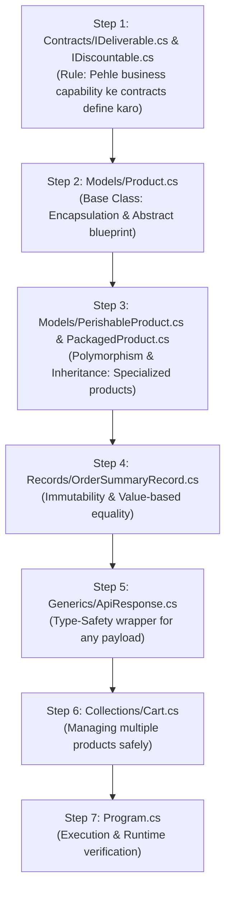

# 01-Basic-CSharp-And-OOPS: From-Scratch Learning & Architecture Guide

## 1. Executive Summary & Domain Story
Yeh project **KiranaHub (Quick-Commerce / 10-Minute Grocery Delivery)** ke foundational building blocks ko C# 13 / .NET 10 ke core OOPS, Records, Collections, aur Generics ke zariye establish karta hai. 

Is project me hum seekhte hain ki ek e-commerce product catalog kaise design hota hai jisme dudh/dahi (perishable cold-chain) aur atta/cheeni (heavy packaged grocery) dono seamlessly exist kar sakein, bina code duplication aur memory bugs ke.

---

## 2. Reading Roadmap: "Iss Project Ko Scratch Se Kaise Padhein"

Agar aap bilkul shuru se C# aur OOPS ko practical kirana domain me master karna chahte hain, toh files ko is exact sequence me padhein:



1. **Step 1: [`Contracts/IDeliverable.cs`](file:///d:/ToLearn_Antigravity/01-Basic-CSharp-And-OOPS/Contracts/IDeliverable.cs) aur [`Contracts/IDiscountable.cs`](file:///d:/ToLearn_Antigravity/01-Basic-CSharp-And-OOPS/Contracts/IDiscountable.cs)**
   - *Kyu*: Sabse pehle contracts (interfaces) banaye jate hain taaki delivery logistics aur discounts ka rule tay ho sake.
2. **Step 2: [`Models/Product.cs`](file:///d:/ToLearn_Antigravity/01-Basic-CSharp-And-OOPS/Models/Product.cs)**
   - *Kyu*: Har grocery item me common cheezein (Id, Name, Price) hoti hain. Yahan private field `_price` aur validation setter se encapsulation seekhein.
3. **Step 3: [`Models/PerishableProduct.cs`](file:///d:/ToLearn_Antigravity/01-Basic-CSharp-And-OOPS/Models/PerishableProduct.cs) & [`Models/PackagedProduct.cs`](file:///d:/ToLearn_Antigravity/01-Basic-CSharp-And-OOPS/Models/PackagedProduct.cs)**
   - *Kyu*: Inherited classes me `override` keyword se dynamic polymorphism seekhein (e.g. Milk par cold-storage fee lagti hai, Atta par heavy-weight fee).
4. **Step 4: [`Records/OrderSummaryRecord.cs`](file:///d:/ToLearn_Antigravity/01-Basic-CSharp-And-OOPS/Records/OrderSummaryRecord.cs)**
   - *Kyu*: Positional Records, non-destructive mutation (`with`), aur reference vs value equality ka farq samjhein.
5. **Step 5: [`Generics/ApiResponse.cs`](file:///d:/ToLearn_Antigravity/01-Basic-CSharp-And-OOPS/Generics/ApiResponse.cs)**
   - *Kyu*: Generic Type parameters (`<T>`) aur constraints (`where T : class`) se reusable API envelope banana seekhein.
6. **Step 6: [`Collections/Cart.cs`](file:///d:/ToLearn_Antigravity/01-Basic-CSharp-And-OOPS/Collections/Cart.cs)**
   - *Kyu*: Internal `Dictionary<string, Product>` aur external `IReadOnlyCollection<Product>` ka encapsulation pattern seekhein.
7. **Step 7: [`Program.cs`](file:///d:/ToLearn_Antigravity/01-Basic-CSharp-And-OOPS/Program.cs)**
   - *Kyu*: Sabhi concepts ka execution, assertion checks, aur console verification dekhein.

---

## 3. Deep Dive: Kya Pehle Bna, Phir Kya Aaya, Kyu Aaya, aur Uske Na Hone Se Kya Hoga?

| File Name | Kya Hai & Kaise Bna? | Kyu Aaya & Kya Karta Hai? | ⚠️ Uske Na Hone Se Kya Hoga? (Risk & Catastrophe) |
|---|---|---|---|
| **`Contracts/IDeliverable.cs`** | Pure Interface. `CalculateDeliveryFee(double distanceKm)` method define karta hai. | Har physical item ko delivery fee calculation ka contract deta hai bina class hierarchy par depend kiye. | Agar ye na ho, toh delivery calculator ko har concrete class ke liye dirty `if-else` / `switch` type checks karne padenge, violating OCP. |
| **`Contracts/IDiscountable.cs`** | Pure Interface. `ApplyDiscount(decimal percentage)` aur `DiscountPercentage` property define karta hai. | Promo code aur festive sale discounts apply karne ke liye standard capability provide karta hai. | Bina iske, non-discountable items (jaise baby formula ya milk) par bhi galat discount lag sakta hai aur loss ho sakta hai. |
| **`Models/Product.cs`** | `abstract class Product : IDeliverable, IDiscountable`. Encapsulation ke sath private `_price`. | Base class jo generic product identity hold karti hai aur negative price setter validation lagati hai. | Agar ye na ho, toh customer ya developer `product.Price = -500` set kar dega aur negative order amount ka bug create hoga! |
| **`Models/PerishableProduct.cs`** | Derived class from `Product`. Adds `ShelfLifeHours` aur cold-chain fees. | Dudh, bread, paneer jaisi perishable grocery ka special delivery fee calculate karta hai (AC / insulated bags). | Agar ye na ho, toh dahi/milk regular bag me jayega aur 40°C heat me spoil ho jayega, customer complaints aur returns badh jayengi. |
| **`Models/PackagedProduct.cs`** | Derived class from `Product`. Adds `WeightKg` aur heavy handling fee. | 5kg Atta, 10kg Rice jaisi heavy grocery par overweight rider surcharge compute karta hai. | Agar ye na ho, toh delivery riders ko 20kg load par normal bike delivery payout milega, riders order reject karenge ya strike kar denge. |
| **`Records/OrderSummaryRecord.cs`** | C# positional record: `record OrderSummaryRecord(...)`. | Immutable receipt data carrier jisme built-in value-based equality aur `with` expressions hoti hain. | Agar normal class use karein, toh 2 identical orders memory me alag reference banenge (`order1 == order2` will be FALSE), causing duplicate billings. |
| **`Generics/ApiResponse.cs`** | Generic Envelope class: `ApiResponse<T> where T : class`. | Kisi bhi payload (Product, Order, List) ko status code, success flag, aur timestamp ke sath wrap karta hai. | Agar ye na ho, toh har endpoint/service ke liye 50 alag-alag response classes (`ProductResponse`, `CartResponse`, `OrderResponse`) likhni padengi. |
| **`Collections/Cart.cs`** | Collection manager encapsulating `Dictionary<string, Product>`. | Cart me items add/remove karta hai aur total bill calculate karta hai. External users ko read-only list deta hai. | Agar developer cart list ko public array bana de, toh koi bhi external code cart ko direct manipulate (`cart.Items.Clear()`) karke state corrupt kar sakta hai. |
| **`Program.cs`** | Main entrypoint console driver with runtime self-testing. | Sabhi classes ko instantiate karta hai, boundary conditions test karta hai aur validation verify karta hai. | Ye project ka heartbeat hai; iske bina automated testing aur learning run verify nahi ho sakti. |

---

## 4. How to Run & Verify

Command execute karein:
```bash
cd d:\ToLearn_Antigravity\01-Basic-CSharp-And-OOPS
dotnet run
```

### Expected Output:
```text
======================================================
  KiranaHub: Basic C# and OOPS Demonstration
======================================================
1. Encapsulation & Validation:
   [PASSED] Negative price was successfully rejected!
   Product: Amul Taaza Fresh Milk | Valid Price: Rs 32.00

2. Polymorphic Dynamic Dispatch:
   [Milk Delivery Fee (2.5 km)]: Rs 30.00
   [Atta Delivery Fee (2.5 km)]: Rs 50.00

3. Record Value-Based Equality & Non-Destructive Mutation:
   Receipt 1 Hash: ... | Receipt 2 Hash: ...
   Are Receipt 1 and 2 Equal? True

4. Generics Wrapper:
   API Response Status: Success | Payload: OrderSummaryRecord

[SUCCESS] All basic C# and OOPS checks PASSED!
```
