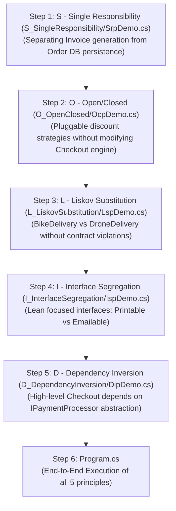

# 02-SOLID-Principles-In-Action: From-Scratch Learning & Architecture Guide

## 1. Executive Summary & Domain Story
Yeh project software architecture ke sabse mahatvapoorna **SOLID Design Principles** ko real-world **KiranaHub Checkout & Payment Engine** ke zariye explain karta hai.

Har principle ke folder me do cheezein demonstrate ki gayi hain:
1. **The Violation (Anti-Pattern)**: Ganda code jo production me technical debt, fragile builds aur breaking changes paida karta hai.
2. **The Refactored Solution (SOLID Compliant)**: Clean, loosely coupled, extensible architecture jo enterprise quick-commerce me scale karti hai.

---

## 2. Reading Roadmap: "Iss Project Ko Scratch Se Kaise Padhein"

SOLID principles ko hamesha unke natural dependency order me padhna chahiye:



---

## 3. Deep Dive: Kya Pehle Bna, Phir Kya Aaya, Kyu Aaya, aur Uske Na Hone Se Kya Hoga?

| Principle & File | Kya Hai & Kaise Bna? | Kyu Aaya & Kya Karta Hai? | ⚠️ Uske Na Hone Se Kya Hoga? (Production Disasters) |
|---|---|---|---|
| **S - Single Responsibility**<br/>[`S_SingleResponsibility/SrpDemo.cs`](file:///d:/ToLearn_Antigravity/02-SOLID-Principles-In-Action/S_SingleResponsibility/SrpDemo.cs) | `OrderManager` (Violation) ko tod kar `OrderRepository` aur `InvoiceGenerator` banaya gaya. | Ek class ke badalne ka sirf **ek reason** hona chahiye. DB schema change hone par invoice printing code touch nahi hona chahiye. | **Disaster**: Agar ek hi God Class me DB, Email, aur PDF logic ho, toh DB query optimize karte waqt invoice layout phat jayega (regression bug)! |
| **O - Open/Closed**<br/>[`O_OpenClosed/OcpDemo.cs`](file:///d:/ToLearn_Antigravity/02-SOLID-Principles-In-Action/O_OpenClosed/OcpDemo.cs) | `IDiscountStrategy` interface banaya gaya. `DiwaliDiscount`, `BulkOrderDiscount`, `FirstTimeUserDiscount` pluggable banaye gaye. | Class extension ke liye OPEN honi chahiye lekin modification ke liye CLOSED. Naya discount rule add karne ke liye core checkout code me `if-else` add nahi karna padta. | **Disaster**: Har festival (Holi, Diwali) par core checkout file edit karni padegi. Ek typo pure platform ka checkout crash kar dega! |
| **L - Liskov Substitution**<br/>[`L_LiskovSubstitution/LspDemo.cs`](file:///d:/ToLearn_Antigravity/02-SOLID-Principles-In-Action/L_LiskovSubstitution/LspDemo.cs) | Base `DeliveryService` me abstract contract enforce kiya gaya jise `BikeDelivery` aur `ElectricVanDelivery` bina unexpected exceptions ke substitute karte hain. | Subtypes must be substitutable for their base types. Agar base class deliver kar sakti hai, toh derived class `NotSupportedException` throw nahi karni chahiye. | **Disaster**: Agar `DroneDelivery` derived class banakar `Deliver()` me `throw new NotSupportedException("Rainy weather")` daal diya, toh checkout loop crash ho jayega! |
| **I - Interface Segregation**<br/>[`I_InterfaceSegregation/IspDemo.cs`](file:///d:/ToLearn_Antigravity/02-SOLID-Principles-In-Action/I_InterfaceSegregation/IspDemo.cs) | Ek giant `IOrderProcessor` ko segregating karke `IPrintableReceipt`, `IEmailNotifier`, aur `ISmsNotifier` chote interfaces me toda gaya. | Clients ko un methods par depend karne ke liye force nahi karna chahiye jo wo use nahi karte (Fat Interface anti-pattern avoidance). | **Disaster**: Local dark-store thermal receipt printer ko `SendEmail()` implement karna padega jisme wo `throw new NotImplementedException()` likhega, violating clean architecture. |
| **D - Dependency Inversion**<br/>[`D_DependencyInversion/DipDemo.cs`](file:///d:/ToLearn_Antigravity/02-SOLID-Principles-In-Action/D_DependencyInversion/DipDemo.cs) | `CheckoutManager` concrete `PaytmProcessor` ke bajaye `IPaymentProcessor` abstraction par depend karta hai. | High-level business logic low-level third-party payment gateways par tightly couple nahi honi chahiye. | **Disaster**: Agar Paytm ka server down ho jaye ya RBI usko restrict kar de, toh pure checkout engine ko rewrite karna padega. DIP se Razorpay/PhonePe 1 minute me swap ho jata hai! |
| **`Program.cs`** | Automated Console Verification Runner. | Sabhi 5 principles ke violation vs solution ko run karta hai aur assert karta hai. | Iske bina principles ka practical proof aur automated testing verify nahi ho sakti. |

---

## 4. How to Run & Verify

Command execute karein:
```bash
cd d:\ToLearn_Antigravity\02-SOLID-Principles-In-Action
dotnet run
```

### Expected Output:
```text
======================================================
  KiranaHub: SOLID Principles in Action Demonstration
======================================================
[S] SRP: Order saved to DB & PDF invoice generated independently.
[O] OCP: Diwali (15%) & Bulk (Rs 100 off) applied without modifying core engine.
[L] LSP: Substituted Bike and Van delivery seamlessly without runtime exceptions.
[I] ISP: Thermal printer only uses IPrintable; Customer notifier only uses IEmailNotifier.
[D] DIP: CheckoutManager accepted UPI and CreditCard processors interchangeably via IPaymentProcessor.

[SUCCESS] All SOLID Principle demonstrations PASSED!
```
