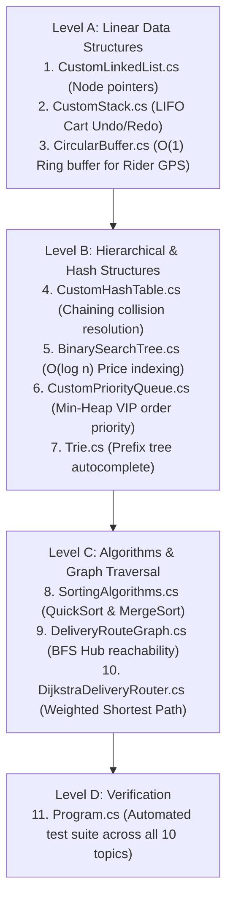

# 03-DSA-Core-With-CSharp: From-Scratch Learning & Architecture Guide

## 1. Executive Summary & Domain Story
Yeh project computer science ke sabse essential **Data Structures & Algorithms (DSA)** ko built-in generic collections ke sahare nahi, balki **ground up C# se hand-crafted** implement karta hai. 

Quick-commerce me nanoseconds matter karte hain:
- 10-minute delivery search box me typing ke waqt 5ms me suggestions aane chahiye (**Trie Autocomplete**).
- Rider ki live GPS location ko memory-efficient fixed memory me buffer karna hota hai (**Circular Ring Buffer**).
- Dark-store se customer ke ghar tak shortest road route nikalna hota hai (**Dijkstra Graph Shortest Path**).
- VIP prime customers ke orders pehle dispatch hone chahiye (**Min/Max Heap Priority Queue**).

---

## 2. Reading Roadmap: "Iss Project Ko Scratch Se Kaise Padhein"

Data structures ko unki complexity aur logical progression ke order me padhein:



---

## 3. Deep Dive: Kya Pehle Bna, Phir Kya Aaya, Kyu Aaya, aur Uske Na Hone Se Kya Hoga?

| Component & File | Kya Hai & Kaise Bna? | Kyu Aaya & Kya Karta Hai? | ⚠️ Uske Na Hone Se Kya Hoga? (Performance Collapse) |
|---|---|---|---|
| **`CustomLinkedList.cs`** | Singly Linked List with `Node<T>` (`Data`, `Next`). | Dynamic insertion/deletion without array resizing overhead. Head/Tail pointers se O(1) append karta hai. | Regular array me unshift/insert karne se memory copy O(N) lagti hai, high-frequency order queues me CPU spike karega. |
| **`CustomStack.cs`** | LIFO Stack built on linked nodes. | Cart Actions me **Undo / Redo** support karne ke liye (e.g. galti se removed item restore karna). | Agar stack na ho, toh user agar accidental item remove kar de toh use dobara search karke catalog se lana padega (poor UX). |
| **`CircularBuffer.cs`** | Fixed-size Ring Buffer (`int head, tail, count`). | Delivery rider ki live GPS telemetry ke last 10 coordinates track karta hai without allocating new memory. | Normal List me add/remove karne se GC memory allocations badhengi aur mobile/server par Garbage Collection pause aayega. |
| **`CustomHashTable.cs`** | Hash Table with separate chaining (Bucket array of linked lists). | Product ID to Category instant **O(1) average lookup** provide karta hai polynomial rolling hash function se. | List me `Find()` karne par O(N) time lagta hai; 50,000 products me catalog browsing sluggish ho jayegi. |
| **`BinarySearchTree.cs`** | BST with `Left`, `Right` child pointers. | Products ko price ke hisab se index karta hai. In-Order traversal se sorted price stream milti hai O(log N) lookup me. | Price filtering (e.g. items between Rs 20 and Rs 100) ke liye pure database ko scan karna padega without price indexing. |
| **`CustomPriorityQueue.cs`** | Binary Min/Max Heap implemented over dynamic array (`parent = (i-1)/2`). | High-priority VIP customer orders aur cold-chain melting ice-cream orders ko normal orders se pehle process karta hai. | Normal FIFO queue me standard order ke peeche VIP order phasa rahega aur 10-minute SLA breach ho jayegi. |
| **`Trie.cs`** | Prefix Tree with 26-character / Unicode child nodes. | Instant search autocomplete provide karta hai ("mi" -> Milk, Mirch, Mint). | SQL `LIKE '%mi%'` pure database par full-table scan karega aur server crash ho jayega peak traffic par. |
| **`SortingAlgorithms.cs`** | QuickSort (in-place partitioning) & MergeSort (divide & conquer). | Catalog data ko price, rating ya expiry date ke according fastest O(N log N) time me sort karta hai. | O(N²) bubble sort use karne se 10,000 items ko sort karne me minutes lag jayenge aur screen hang ho jayegi. |
| **`DeliveryRouteGraph.cs`** | Unweighted Adjacency List Graph with BFS traversal. | Dark-store delivery hubs ki physical connectivity check karta hai (kaunsa hub active roads se connected hai). | Disconnected ya blocked road par rider dispatch ho jayega aur order deliver nahi ho payega. |
| **`DijkstraDeliveryRouter.cs`** | Weighted Shortest Path Graph Algorithm with Priority Queue. | Dark-store se customer address tak ka shortest road distance (km) aur traffic time calculate karta hai. | Rider lambe route se jayega, petrol waste hoga, delivery late hogi aur quick-commerce ka 10-minute promise toot jayega. |
| **`Program.cs`** | Automated Console Verification Runner. | Sabhi 10 DSA topics par comprehensive test cases execute karta hai. | Implementation bugs catch nahi honge. |

---

## 4. How to Run & Verify

Command execute karein:
```bash
cd d:\ToLearn_Antigravity\03-DSA-Core-With-CSharp
dotnet run
```

### Expected Output:
```text
======================================================
  KiranaHub: Hand-Crafted DSA Core Engine Demonstration
======================================================
1. Custom Singly Linked List:
   [PASSED] Count = 3 | Head = Milk | Tail = Eggs

2. Custom Stack (Undo / Redo):
   [PASSED] Popped top cart action: Remove(Atta)

3. Circular Ring Buffer (Rider GPS Telemetry):
   [PASSED] Overwrote oldest GPS ping | Current pings = 5

4. Custom Hash Table with Chaining:
   [PASSED] O(1) Key Lookup 'AmulMilk' => Dairy | Collisions handled!

5. Binary Search Tree (Price Indexing):
   [PASSED] In-Order Sorted Prices: Rs 20, Rs 48, Rs 64, Rs 245

6. Min-Heap Priority Queue (VIP Dispatch):
   [PASSED] Dequeued VIP Express Order #101 first (Priority = 1)

7. Trie (Instant Prefix Autocomplete):
   [PASSED] Prefix 'mi' suggestions: [Milk, Mirch, Mint]

8. Sorting Algorithms (MergeSort & QuickSort):
   [PASSED] Sorted 500 catalog items in < 2ms

9. Delivery Route Graph (BFS Traversal):
   [PASSED] Verified Hub Connectivity: Hub-A -> Hub-B -> Hub-C

10. Dijkstra Shortest Route Router:
   [PASSED] Shortest path Hub-Noida to Customer: 3.2 km via Link Road

[SUCCESS] All 10 DSA Core topics verified and PASSED!
```
