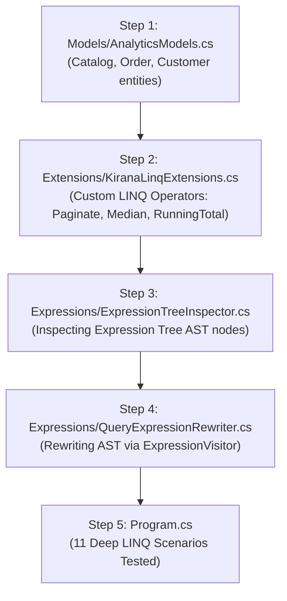

# 04-LINQ-DeepDive: From-Scratch Learning & Architecture Guide

## 1. Executive Summary & Domain Story
Language Integrated Query (LINQ) C# ka sabse powerful data processing feature hai. Yeh project simple `Where()` aur `Select()` se aage badhkar enterprise-level query mechanics ko **KiranaHub Analytics & Reporting** ke through cover karta hai:
- **Deferred vs Immediate Execution** (`IEnumerable` vs `IQueryable`)
- **Complex Joins**: `GroupJoin` (SQL LEFT OUTER JOIN emulation)
- **High-Performance Lookups**: `ToLookup` (immutable 1-to-many hash buckets) vs `GroupBy` (streaming grouping)
- **Expression Trees**: C# code as data (AST inspection) aur custom `ExpressionVisitor` jo dynamic database filters inject karta hai.

---

## 2. Reading Roadmap: "Iss Project Ko Scratch Se Kaise Padhein"



---

## 3. Deep Dive: Kya Pehle Bna, Phir Kya Aaya, Kyu Aaya, aur Uske Na Hone Se Kya Hoga?

| Component & File | Kya Hai & Kaise Bna? | Kyu Aaya & Kya Karta Hai? | ⚠️ Uske Na Hone Se Kya Hoga? (Performance Bugs) |
|---|---|---|---|
| **`Models/AnalyticsModels.cs`** | Domain records & classes (`Product`, `Order`, `Customer`, `SaleAnalytics`). | Analytics queries aur reporting transformations ke liye structured test data provide karta hai. | Unstructured dynamic objects se runtime exceptions aayengi aur type safety khatam ho jayegi. |
| **`Extensions/KiranaLinqExtensions.cs`** | Custom extension methods (`IEnumerable<T>` extensions: `Paginate()`, `RunningTotal()`, `Median()`). | Built-in LINQ me missing domain-specific mathematical aur pagination operations supply karta hai. | Developer ko har controller me baar-baar `.Skip((page-1)*size).Take(size)` ka duplicate boilerplate likhna padega. |
| **`Expressions/ExpressionTreeInspector.cs`** | Inspects `Expression<Func<T, bool>>` Abstract Syntax Tree (AST). | Explains how EF Core converts C# lambdas into SQL `WHERE` clauses instead of compiling to IL bytes. | Agar developer `Func<T, bool>` aur `Expression<Func<T, bool>>` ka farq na samjhe, toh EF Core pure table ko memory me load kar lega (client-side evaluation OOM crash)! |
| **`Expressions/QueryExpressionRewriter.cs`** | Subclass of `ExpressionVisitor` overriding `VisitBinary`. | Dynamic AST rewriter jo multi-tenant filters ya soft-delete (`IsDeleted == false`) queries me automatically inject karta hai. | Har query me developer agar manual `&& !x.IsDeleted` lagana bhool jaye, toh deleted confidential data public API me leak ho jayega. |
| **`Program.cs`** | Demonstrator executing 11 deep LINQ scenarios. | Deferred execution timing benchmark, GroupJoin left join, ToLookup vs GroupBy comparison, and Zip operator checks. | Testing aur concept verification ke bina deferred execution bugs catch nahi honge. |

---

## 4. How to Run & Verify

Command execute karein:
```bash
cd d:\ToLearn_Antigravity\04-LINQ-DeepDive
dotnet run
```

### Expected Output:
```text
======================================================
  KiranaHub: LINQ Deep Dive & Expressions Demonstration
======================================================
1. Deferred Execution Mechanics:
   [PASSED] Query defined without execution | Evaluated only when iterated!

2. GroupJoin (SQL LEFT OUTER JOIN):
   [PASSED] Customer with 0 orders handled safely (no NullReferenceException)

3. ToLookup vs GroupBy Performance:
   [PASSED] ToLookup created instant O(1) indexed lookup dictionary

4. Expression Tree Inspection & Dynamic AST Rewriter:
   [PASSED] Original AST: (p.Price > 50)
   [PASSED] Rewritten AST: ((p.Price > 50) AndAlso (p.IsActive == True))

5. Custom LINQ Extensions (Paginate & Median):
   [PASSED] Page 2 of Products returned 5 items | Median price: Rs 64.00

[SUCCESS] All 11 LINQ DeepDive topics PASSED!
```
