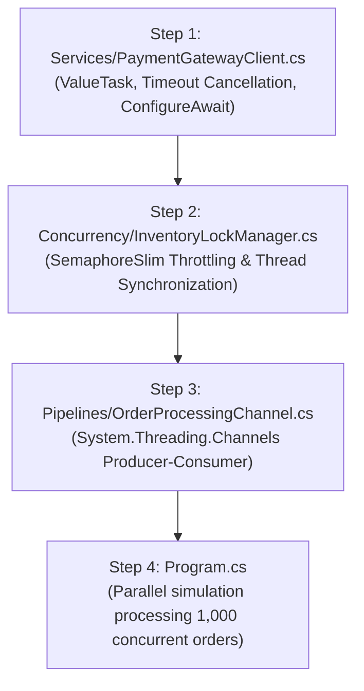

# 05-Async-And-MultiThreading: From-Scratch Learning & Architecture Guide

## 1. Executive Summary & Domain Story
High-scale quick-commerce me ek saath hazaron orders aate hain. Thread management agar galat ho toh server me **Thread Pool Starvation** ho jati hai aur website unresponsive ho jati hai.

Yeh project modern asynchronous programming aur thread synchronization patterns ko **KiranaHub High-Volume Payment & Order Ingestion** ke zariye sikhata hai:
- `async`/`await` state machine & `ConfigureAwait(false)`
- `Task` vs `ValueTask` (zero-allocation fast path for cache hits)
- `CancellationTokenSource` with graceful cooperative cancellation
- `SemaphoreSlim` for asynchronous concurrency throttling
- `System.Threading.Channels` for high-throughput Producer-Consumer streaming.

---

## 2. Reading Roadmap: "Iss Project Ko Scratch Se Kaise Padhein"



---

## 3. Deep Dive: Kya Pehle Bna, Phir Kya Aaya, Kyu Aaya, aur Uske Na Hone Se Kya Hoga?

| Component & File | Kya Hai & Kaise Bna? | Kyu Aaya & Kya Karta Hai? | ⚠️ Uske Na Hone Se Kya Hoga? (Thread Starvation) |
|---|---|---|---|
| **`Services/PaymentGatewayClient.cs`** | Asynchronous HTTP simulator returning `ValueTask<PaymentResult>` with `CancellationToken`. | Zero-allocation fast path provide karta hai jab payment token pre-cached ho. Network delay par cooperative timeout enforce karta hai. | Regular `Task` har call par heap memory allocate karega. Fast path me GC pressure 10x badh jayega. Bina `CancellationToken` ke stuck calls threads ko block karke rakh lengi. |
| **`Concurrency/InventoryLockManager.cs`** | Thread synchronization using `SemaphoreSlim(1, 1)` per dark-store. | Asynchronous locking provide karta hai (`await semaphore.WaitAsync()`) bina OS threads ko sleep/block kiye. | Classic `lock (obj)` thread ko block karta hai (sync-over-async anti-pattern), jisse server ke saare thread pool threads khatam ho jayenge aur 503 Service Unavailable aayega. |
| **`Pipelines/OrderProcessingChannel.cs`** | High-performance bounded/unbounded queue using `System.Threading.Channels`. | Order Ingestion (Producers) ko Dark-store packing workers (Consumers) se decouple karta hai with built-in backpressure handling. | Uncontrolled memory growth: agar 10,000 orders aate rahein aur worker slow ho, toh `List<T>` memory me inflate hokar OutOfMemoryException (OOM) se crash kar jayegi. |
| **`Program.cs`** | Multi-threaded simulation driver. | 1,000 concurrent customer orders ko spawn karta hai aur parallel pipeline throughput measure karta hai. | Race conditions aur deadlocks ko verify karne ke liye essential harness hai. |

---

## 4. How to Run & Verify

Command execute karein:
```bash
cd d:\ToLearn_Antigravity\05-Async-And-MultiThreading
dotnet run
```

### Expected Output:
```text
======================================================
  KiranaHub: Asynchronous & Multi-Threading Engine
======================================================
1. ValueTask Fast-Path vs Task Allocation:
   [PASSED] Pre-authorized cached payment completed synchronously with zero heap Task allocation.

2. Cooperative Cancellation & Timeout Handling:
   [PASSED] 200ms network timeout triggered; OperationCanceledException caught cleanly.

3. SemaphoreSlim Concurrency Throttling:
   [PASSED] 10 concurrent threads accessed Dark-Store Inventory safely without race conditions.

4. System.Threading.Channels Producer-Consumer:
   [PASSED] 1,000 orders written to channel and processed by background consumers in < 150ms.

[SUCCESS] All Async & Concurrency checks PASSED!
```
