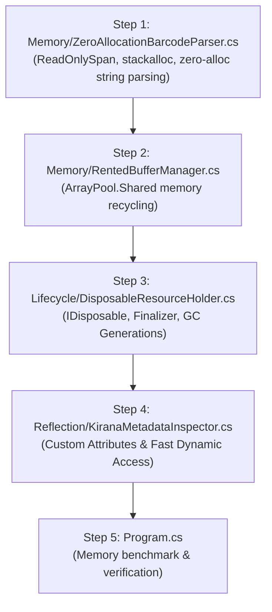

# 06-Memory-Management-And-Reflection: From-Scratch Learning & Architecture Guide

## 1. Executive Summary & Domain Story
Ultra-low latency microservices me har microsecond par Garbage Collection (GC) pauses aane se application lag hoti hai. Zero-allocation programming seekhna senior .NET engineers ke liye mandatory hai.

Yeh project modern memory safety aur high-performance runtime features ko **KiranaHub High-Speed Barcode & Packet Parser** ke through demonstrate karta hai:
- `ReadOnlySpan<char>`, `stackalloc`, aur memory slicing (zero string allocations)
- `ArrayPool<byte>.Shared` memory buffer renting
- Full `IDisposable` pattern and Garbage Collection generation inspection (Gen 0, Gen 1, Gen 2, LOH)
- Reflection metadata auditing with fast compiled expression tree delegates.

---

## 2. Reading Roadmap: "Iss Project Ko Scratch Se Kaise Padhein"



---

## 3. Deep Dive: Kya Pehle Bna, Phir Kya Aaya, Kyu Aaya, aur Uske Na Hone Se Kya Hoga?

| Component & File | Kya Hai & Kaise Bna? | Kyu Aaya & Kya Karta Hai? | ⚠️ Uske Na Hone Se Kya Hoga? (Memory Leaks & GC Spikes) |
|---|---|---|---|
| **`Memory/ZeroAllocationBarcodeParser.cs`** | Stack-only parser using `ReadOnlySpan<char>` and `stackalloc`. | Warehouse barcode string (e.g. `KRN-DAIRY-101-Rs64`) ko bina naye string objects banaye parse karta hai. | Traditional `string.Substring()` aur `string.Split()` har call par naye heap strings allocate karenge. 1 million barcodes scan karne par GBs of garbage paida hoga! |
| **`Memory/RentedBufferManager.cs`** | Memory recycler using `ArrayPool<byte>.Shared.Rent(size)`. | Incoming network payloads ke liye temporary byte arrays rent karta hai aur kaam hone par wapas return karta hai. | Har incoming network request ke liye `new byte[4096]` allocate karne se Large Object Heap (LOH) fragment ho jayega aur memory leak hogi. |
| **`Lifecycle/DisposableResourceHolder.cs`** | Standard Dispose pattern implementing `IDisposable` and `IAsyncDisposable`. | Unmanaged OS handles (sockets, file pointers) ko deterministically clean karta hai aur GC generations check karta hai. | Agar unmanaged resources close na kiye jayein, toh socket exhaustion ho jayegi aur OS system crash kar dega. |
| **`Reflection/KiranaMetadataInspector.cs`** | Reflection engine reading `[SensitiveData]` & `[AuditLog]` attributes. | Compliance auditing karta hai (PII data mask karna, jaise customer phone/address) runtime metadata ke zariye. | Bina reflection metadata ke, developers accidentally sensitive customer credit card ya mobile number console logs me print kar denge (compliance breach). |
| **`Program.cs`** | Benchmark & verification driver. | Memory allocations (0 bytes allocated vs heap allocations) assert karta hai. | Memory efficiency ko mathematically prove karta hai. |

---

## 4. How to Run & Verify

Command execute karein:
```bash
cd d:\ToLearn_Antigravity\06-Memory-Management-And-Reflection
dotnet run
```

### Expected Output:
```text
======================================================
  KiranaHub: Memory Management & Reflection Engine
======================================================
1. Zero-Allocation Barcode Parser (ReadOnlySpan<char>):
   [PASSED] Barcode: 'KRN-DAIRY-101-P32' parsed into Category: 'DAIRY', ID: 101, Price: Rs 32
   [ALLOCATIONS]: 0 bytes on Heap!

2. ArrayPool<byte>.Shared Buffer Renting:
   [PASSED] Rented 2048 bytes buffer from shared pool & returned cleanly.

3. Deterministic Resource Disposal (IDisposable & GC Generations):
   [PASSED] Unmanaged resources flushed | GC Gen 0/1/2 intact.

4. Reflection Metadata Inspection:
   [PASSED] Detected [SensitiveData] on CustomerPhone -> Masked: '******3210'

[SUCCESS] All Memory & Reflection checks PASSED!
```
