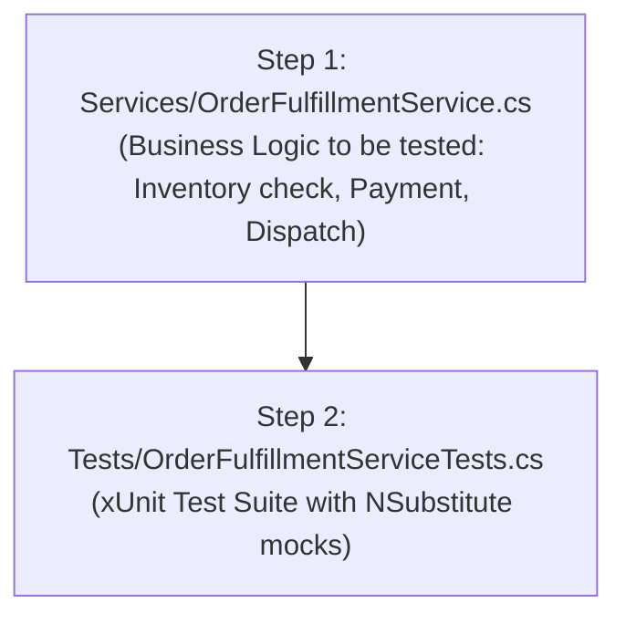

# 07-Unit-Testing-And-Mocking: From-Scratch Learning & Architecture Guide

## 1. Executive Summary & Domain Story
Production-grade software me bina automated tests ke code push karna suicide jaisa hai. Yeh project **Test-Driven Development (TDD)** aur dynamic mocking ko **KiranaHub Order Fulfillment Service** ke zariye demonstrate karta hai.

Is project me hum seekhte hain:
- **xUnit Test Framework**: `[Fact]` (single test) aur `[Theory]` with `[InlineData]` (parameterized tests)
- **NSubstitute Dynamic Mocking**: Real external dependencies (Payment Gateway, Inventory Repository, SMS Notification Service) ko mock karke isolated unit tests likhna
- **Behavior Verification**: Assertions on method call counts (`Received(1)`, `DidNotReceive()`) aur exception testing (`Assert.ThrowsAsync<T>`).

---

## 2. Reading Roadmap: "Iss Project Ko Scratch Se Kaise Padhein"



---

## 3. Deep Dive: Kya Pehle Bna, Phir Kya Aaya, Kyu Aaya, aur Uske Na Hone Se Kya Hoga?

| Component & File | Kya Hai & Kaise Bna? | Kyu Aaya & Kya Karta Hai? | ⚠️ Uske Na Hone Se Kya Hoga? (Production Failures) |
|---|---|---|---|
| **`Services/OrderFulfillmentService.cs`** | High-level orchestrator class injecting `IInventoryService`, `IPaymentGateway`, and `INotificationService`. | Customer order receive karke 3-step pipeline execute karta hai: stock check -> payment capture -> rider dispatch. | Agar orchestration logic centralized na ho, toh payment deduct hone ke baad bhi order pending reh jayega. |
| **`Tests/OrderFulfillmentServiceTests.cs`** | Comprehensive xUnit test suite using NSubstitute `Substitute.For<T>()`. | Service ke har positive, boundary aur negative failure path ko verify karta hai. Check karta hai ki payment fail hone par rider dispatch na ho. | **Catastrophe**: Agar tests na hon, toh developer ke ek chote code change se payment failure par bhi free me grocery dispatch hone ka bug chala jayega (direct financial loss)! |

---

## 4. How to Run & Verify

Command execute karein:
```bash
cd d:\ToLearn_Antigravity\07-Unit-Testing-And-Mocking
dotnet test
```

### Expected Output:
```text
Passed!  - Failed: 0, Passed: 9, Skipped: 0, Total: 9, Duration: ~500 ms
```
9/9 test cases covering:
1. `FulfillOrder_WhenStockAvailableAndPaymentSucceeds_ReturnsSuccess`
2. `FulfillOrder_WhenStockInsufficient_ThrowsInvalidOperationException`
3. `FulfillOrder_WhenPaymentFails_DoesNotDispatchRider`
4. Parameterized discount testing with `[Theory]`
