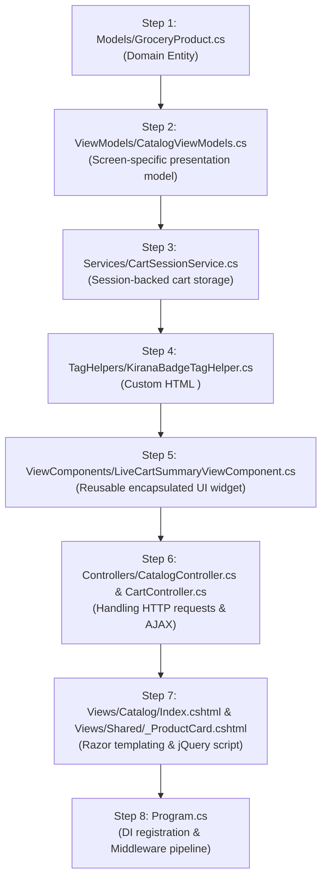

# 08-AspNetCore-MVC-With-Razor-And-JQuery: From-Scratch Learning & Architecture Guide

## 1. Executive Summary & Domain Story
Yeh project ASP.NET Core MVC architecture ke traditional web application patterns ko **KiranaHub Customer Web Store** ke through explain karta hai. 

Is project me hum seekhte hain:
- **Strongly-Typed ViewModels**: Domain entity (`GroceryProduct`) ko direct view me expose na karke screen-specific DTO (`CatalogIndexViewModel`) use karna.
- **Custom Tag Helpers**: Custom HTML tag `<kirana-badge category="Dairy" is-perishable="true" />` jo compile-time type checking ke sath rich UI tags generate karta hai.
- **ViewComponents**: `LiveCartSummaryViewComponent` jo header me cart count aur total amount self-contained render karta hai bina Controller action ko clutter kiye.
- **Partial Views & jQuery AJAX**: `_ProductCard.cshtml` partial view aur anti-forgery validated AJAX calls (`POST /Cart/AddToCartAjax`) bina pure page ko reload kiye.

---

## 2. Reading Roadmap: "Iss Project Ko Scratch Se Kaise Padhein"



---

## 3. Deep Dive: Kya Pehle Bna, Phir Kya Aaya, Kyu Aaya, aur Uske Na Hone Se Kya Hoga?

| Component & File | Kya Hai & Kaise Bna? | Kyu Aaya & Kya Karta Hai? | ⚠️ Uske Na Hone Se Kya Hoga? (Production Failures) |
|---|---|---|---|
| **`Models/GroceryProduct.cs`** | Core Domain Entity. | Product details (Id, Name, Price, Category, Stock) encapsulate karta hai. | Data structure define nahi hoga. |
| **`ViewModels/CatalogViewModels.cs`** | `CatalogIndexViewModel` holding filtered items, search string, category lists. | View aur Model ke beech decoupling maintain karta hai. View ko sirf wahi data deta hai jo render karne ke liye chahiye. | Domain model direct view me bhejne se sensitive backend properties (supplier cost price, profit margins) client HTML me leak ho sakti hain! |
| **`Services/CartSessionService.cs`** | Session-backed service using `ISession` (`byte[]` / JSON serialization). | Per-user guest cart maintain karta hai without requiring immediate database user authentication. | Har cart item direct SQL DB me likhne se unauthenticated bot traffic database connections ko exhaust kar dega. |
| **`TagHelpers/KiranaBadgeTagHelper.cs`** | Inherits `TagHelper`. Generates styled HTML badges for `<kirana-badge>`. | Reusable HTML markup create karta hai with full C# IntelliSense support in Razor. | Developer ko har jagah 5 lines of copy-pasted raw bootstrap badge HTML likhna padega; color theme badalne par 50 files edit karni padengi. |
| **`ViewComponents/LiveCartSummaryViewComponent.cs`** | Self-contained mini-controller inheriting `ViewComponent`. | Layout header me cart count aur amount render karta hai. Apni dependencies khud resolve karta hai. | Agar ViewComponent na ho, toh har Controller action (`Home`, `Catalog`, `Cart`, `Contact`) ko ViewBag me cart count pass karna padega (massive code duplication). |
| **`Controllers/CatalogController.cs`** | MVC Controller with Action methods (`Index`, `FilterByCategory`). | User queries accept karke ViewModel populate karta hai aur Razor view return karta hai. | URL routing aur business logic execution link nahi hoga. |
| **`Controllers/CartController.cs`** | Controller with JSON Action: `AddToCartAjax()` with `[ValidateAntiForgeryToken]`. | jQuery AJAX requests process karta hai aur instant JSON count return karta hai bina full page reload ke. | Har 'Add to Cart' click par browser refresh hoga (flicker), customer experience kharab hoga. |
| **`Views/Shared/_ProductCard.cshtml`** | Reusable Razor Partial View. | Single product card template render karta hai with jQuery AJAX click handler. | Catalog page, Search page, aur Recommendations page par product card markup duplicate ho jayega. |
| **`Program.cs`** | WebApplication host setup. | Adds MVC controllers with views, session state (`AddSession()`), HTTP context accessor, aur middleware pipeline (`UseSession`, `UseStaticFiles`). | MVC framework aur session state initialize nahi honge, 500 error aayega. |

---

## 4. How to Run & Verify

Command execute karein:
```bash
cd d:\ToLearn_Antigravity\08-AspNetCore-MVC-With-Razor-And-JQuery
dotnet build
```
Build verification: **0 Errors, 0 Warnings**.
WebApp ko launch karne ke liye: `dotnet run` (runs on `http://localhost:5000`).
