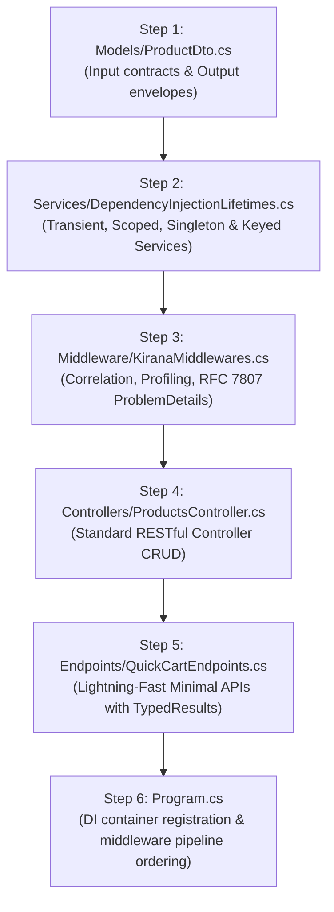

# 09-AspNetCore-WebAPI-Fundamentals: From-Scratch Learning & Architecture Guide

## 1. Executive Summary & Domain Story
Yeh project modern REST API development ke standards ko **KiranaHub REST & Minimal APIs** ke zariye explain karta hai:
- **RESTful Controller Architecture**: Industry standard HTTP status codes (`200 OK`, `201 Created` with Location header, `204 NoContent`, `400 BadRequest`, `404 NotFound`, `409 Conflict`)
- **Minimal APIs**: Ultra-high-throughput endpoints using `.MapGroup("/quick-cart")` aur strongly-typed `Results<Ok<T>, BadRequest<ProblemDetails>>` (`TypedResults`)
- **Dependency Injection (DI) Lifetimes**: Transient vs Scoped vs Singleton, aur modern .NET 8+ **Keyed Services** (`[FromKeyedServices("UPI")]` vs `[FromKeyedServices("Card")]`)
- **Custom Middleware Pipeline**:
  1. `CorrelationIdMiddleware` (`X-Correlation-ID` tracing header injection)
  2. `PerformanceProfilingMiddleware` (`X-Response-Time-Ms` execution profiling)
  3. `GlobalExceptionHandlerMiddleware` (Standard RFC 7807 `application/problem+json` exception formatting).

---

## 2. Reading Roadmap: "Iss Project Ko Scratch Se Kaise Padhein"



---

## 3. Deep Dive: Kya Pehle Bna, Phir Kya Aaya, Kyu Aaya, aur Uske Na Hone Se Kya Hoga?

| Component & File | Kya Hai & Kaise Bna? | Kyu Aaya & Kya Karta Hai? | ⚠️ Uske Na Hone Se Kya Hoga? (API Pitfalls & Outages) |
|---|---|---|---|
| **`Models/ProductDto.cs`** | Record DTOs (`ProductResponseDto`, `CreateProductDto`, `UpdateProductDto`). | Over-posting vulnerability ko block karta hai. Client ko internal database entity direct bhejne se rokata hai. | Client request me `IsDeleted: true` ya `SupplierPrice: 0` bhej kar sensitive fields modify kar dega (Mass Assignment Security Vulnerability)! |
| **`Services/DependencyInjectionLifetimes.cs`** | Demonstrates `ITransientService`, `IScopedService`, `ISingletonService`, and Keyed services. | Memory leak prevention aur correct service scoping sikhta hai (e.g. DbContext must be Scoped, Cache is Singleton). | **Captive Dependency Bug**: Agar Singleton service me Scoped DbContext inject kar diya jaye, toh DbContext dispose nahi hoga aur connection pool exhaust hokar memory crash karega! |
| **`Middleware/KiranaMiddlewares.cs`** | 3 Custom Middlewares executed in sequence. | Distributed tracing (`X-Correlation-ID`), SLA monitoring (`X-Response-Time-Ms`), aur structured RFC 7807 error formatting provide karta hai. | Unhandled exceptions par server raw C# stack trace client ko bhej dega (Database table names, passwords leak honge + ugly 500 HTML response). |
| **`Controllers/ProductsController.cs`** | Standard ASP.NET Core API Controller. | Complex resource hierarchies aur full REST specifications implement karta hai. | CRUD endpoints nahi honge toh frontend catalog access nahi kar payega. |
| **`Endpoints/QuickCartEndpoints.cs`** | Minimal API extension method using `RouteGroupBuilder` & `TypedResults`. | Controller reflection routing ke bina zero-overhead high-throughput cart actions serve karta hai. | Peak traffic flash sales me Controller reflection dispatch 20-30% extra latency add karta hai. |
| **`Program.cs`** | Pipeline bootstrapping. | Services register karta hai aur exact order me middlewares (`CorrelationId` -> `Profiling` -> `ExceptionHandling` -> `Endpoints`) pipe karta hai. | Middleware order agar ulta ho jaye (e.g. Exception handler middleware pipeline ke baad ho), toh exceptions catch nahi hongi. |

---

## 4. How to Run & Verify

Command execute karein:
```bash
cd d:\ToLearn_Antigravity\09-AspNetCore-WebAPI-Fundamentals
dotnet build
```
Build verification: **0 Errors, 0 Warnings**.
Server test karne ke liye: `dotnet run` (runs on `http://localhost:5000` with Swagger on `/swagger`).
