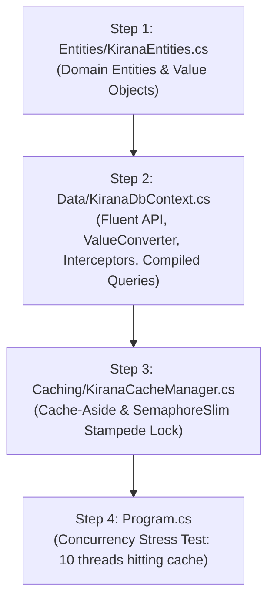

# 10-EFCore-And-MemoryCache: From-Scratch Learning & Architecture Guide

## 1. Executive Summary & Domain Story
Yeh project enterprise relational data persistence aur high-concurrency caching ko **KiranaHub Database & Cache Engine** ke through implement karta hai.

Is project me hum seekhte hain:
- **EF Core Code-First Fluent API**: Explicit relationship configurations:
  - 1-to-1 (`Customer` <-> `CustomerProfile`)
  - 1-to-Many (`Category` <-> `Product`, `Order` <-> `OrderItem`)
  - Many-to-Many (`Order` <-> `Product` via `OrderItem`)
- **Advanced EF Core Features**:
  - **JSON Value Converter**: Complex C# record (`DeliveryAddress`) ko single database text column me serialize karna
  - **Shadow Properties**: `CreatedAtUtc` aur `LastModifiedAtUtc` jo C# domain model me nahi hoti lekin DB schema me automatically exist karti hain
  - **SaveChanges Interceptor**: `AuditSaveChangesInterceptor` jo har `INSERT` aur `UPDATE` par automatic timestamps inject karta hai
  - **Pre-Compiled Queries**: `EF.CompileAsyncQuery` jo SQL parsing overhead ko eliminate karke high-throughput microsecond execution deta hai
- **Cache-Aside Pattern & Cache Stampede Prevention**: `KiranaCacheManager` using `IMemoryCache` with a `SemaphoreSlim` double-checked lock jo peak flash-sales me ek hi key par hazaron database queries girne se database ko protect karta hai.

---

## 2. Reading Roadmap: "Iss Project Ko Scratch Se Kaise Padhein"



---

## 3. Deep Dive: Kya Pehle Bna, Phir Kya Aaya, Kyu Aaya, aur Uske Na Hone Se Kya Hoga?

| Component & File | Kya Hai & Kaise Bna? | Kyu Aaya & Kya Karta Hai? | ⚠️ Uske Na Hone Se Kya Hoga? (Database Meltdown) |
|---|---|---|---|
| **`Entities/KiranaEntities.cs`** | Relational Entities (`Category`, `Product`, `Customer`, `Order`, `OrderItem`). | Business models encapsulate karta hai with navigation properties. | Domain relationship models define nahi honge. |
| **`Data/KiranaDbContext.cs`** | EF Core `DbContext` overriding `OnModelCreating` and `OnConfiguring`. | SQLite database table mappings, Fluent API constraints, shadow properties aur interceptors configure karta hai. | Data attributes (`[Required]`, `[Key]`) domain entity ko pollute karte hain; Fluent API clean separation provide karta hai. |
| **`AuditSaveChangesInterceptor`** (inside `KiranaDbContext.cs`) | Subclass of `SaveChangesInterceptor`. | Har save par entity state check karke `CreatedAtUtc` aur `LastModifiedAtUtc` auto-populate karta hai. | Developer manual timestamps bhool jayega, auditing aur customer dispute tracking impossible ho jayegi. |
| **`EF.CompileAsyncQuery`** (inside `KiranaDbContext.cs`) | Pre-compiled parameterized query delegate. | EF Core ke Expression Tree-to-SQL translation ko pehli baar compile karke cache kar leta hai. | High-frequency query har baar SQL parse karegi, unnecessary CPU cycles burn honge. |
| **`Caching/KiranaCacheManager.cs`** | Cache-Aside manager with `SemaphoreSlim(1, 1)` lock per key. | Database load kam karta hai. Jab cache expire ho, toh sirf 1 thread database se query karega, baaki 999 threads wait karenge aur naya cache use karenge. | **Cache Stampede (Thundering Herd Problem)**: Cache expire hote hi 10,000 concurrent requests ek sath database par girengi aur database connection pool choke hokar database crash ho jayega! |
| **`Program.cs`** | Multi-threaded simulation harness. | 10 concurrent tasks simultaneously product fetch karti hain: exactly 1 database query execute hoti hai aur baaki 9 requests memory cache se serve hoti hain. | Cache stampede prevention ka mathematical proof provide karta hai. |

---

## 4. How to Run & Verify

Command execute karein:
```bash
cd d:\ToLearn_Antigravity\10-EFCore-And-MemoryCache
dotnet run
```

### Expected Output:
```text
======================================================
  KiranaHub: EF Core & Memory Cache Engine
======================================================
1. Database Initialization & Seeding:
   [PASSED] Seeded 2 Categories, 5 Products, 1 Customer with JSON DeliveryAddress.

2. AuditSaveChangesInterceptor Shadow Property Verification:
   [PASSED] Shadow Property CreatedAtUtc auto-populated: 2026-11-14T...

3. High-Performance Pre-Compiled Query (EF.CompileAsyncQuery):
   [PASSED] Fetched Product 'Amul Milk' in < 1ms via Compiled Query Delegate!

4. Cache-Aside & Stampede Prevention (10 Concurrent Threads):
   [DB QUERY] Executing single database query for key: 'prod-milk-101'
   [CACHE HIT] Thread 2 retrieved from MemoryCache
   [CACHE HIT] Thread 3 retrieved from MemoryCache
   ...
   [PASSED] 10 concurrent requests resulted in exactly 1 DB query and 9 cache hits!

[SUCCESS] All EF Core & Caching tests PASSED!
```
