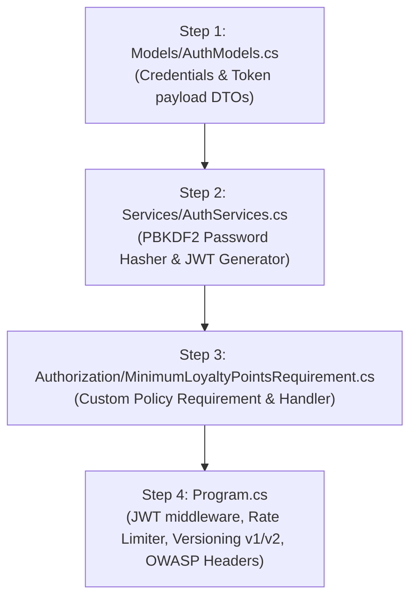

# 11-Auth-Identity-And-Security: From-Scratch Learning & Architecture Guide

## 1. Executive Summary & Domain Story
Financial transactions aur customer personal data ki safety quick-commerce me highest priority hoti hai. Yeh project **Authentication, Role-Based Access Control (RBAC), Custom Policy Authorization, Rate Limiting, API Versioning, aur OWASP Hardening** ko implement karta hai.

Is project me hum seekhte hain:
- **PBKDF2 Password Hashing**: Cryptographic salt generation aur constant-time hash comparison jo rainbow table aur timing attacks ko block karta hai.
- **Signed JWT Bearer Tokens**: HMAC-SHA256 signed access tokens with custom claims (`Sub`, `Email`, `Roles`, `LoyaltyPoints`, `IsPrimeMember`).
- **Dynamic Policy Authorization**: `MinimumLoyaltyPointsRequirement` jo custom user claims ke basis par access allow/deny karta hai (e.g. VIP deals access).
- **API Versioning (`v1` vs `v2`)**: `Asp.Versioning.Http` ke zariye breaking changes ko gracefully introduce karna.
- **ASP.NET Core Rate Limiting**: Fixed-window rate limiter (5 requests / 10 seconds -> 429 Too Many Requests) jo DDoS aur brute-force attacks ko block karta hai.
- **OWASP Security Headers**: `X-Frame-Options: DENY`, `X-Content-Type-Options: nosniff`, `Strict-Transport-Security`.

---

## 2. Reading Roadmap: "Iss Project Ko Scratch Se Kaise Padhein"



---

## 3. Deep Dive: Kya Pehle Bna, Phir Kya Aaya, Kyu Aaya, aur Uske Na Hone Se Kya Hoga?

| Component & File | Kya Hai & Kaise Bna? | Kyu Aaya & Kya Karta Hai? | ⚠️ Uske Na Hone Se Kya Hoga? (Security Breaches) |
|---|---|---|---|
| **`Models/AuthModels.cs`** | DTO records for authentication requests and responses. | Typed payloads encapsulate karta hai for login, registration and token delivery. | Unstructured payloads allow invalid fields or missing passwords. |
| **`Services/AuthServices.cs`** | `PasswordHasherService` using `Rfc2898DeriveBytes` (PBKDF2) + `JwtTokenService` using `System.IdentityModel.Tokens.Jwt`. | Passwords ko plain-text ya raw MD5/SHA256 me store hone se bachata hai. Cryptographically secure JWT tokens generate karta hai. | **Catastrophic Data Breach**: Agar plain passwords ya MD5 use kiya jaye, toh database dump leak hote hi sabhi customer accounts compromise ho jayenge! |
| **`Authorization/MinimumLoyaltyPointsRequirement.cs`** | Custom `IAuthorizationRequirement` & `AuthorizationHandler`. | Business policy enforce karta hai (e.g. secret VIP flash sale me enter hone ke liye customer ke paas minimum 100 loyalty points hone chahiye). | Simple role-based checks (`[Authorize(Roles = "Admin")]`) dynamic claims data (loyalty points, subscription status) ko evaluate nahi kar sakte. |
| **`Program.cs`** | Pipeline security configuration. | JWT Bearer verification options, Rate Limiting policies (`AddFixedWindowLimiter`), Versioning (`AddApiVersioning`), aur OWASP security response headers inject karta hai. | Rate limiting na hone se bot scripts checkout endpoint par 10,000 req/sec hit karke payment gateway down kar dengi (DDoS). |

---

## 4. How to Run & Verify

Command execute karein:
```bash
cd d:\ToLearn_Antigravity\11-Auth-Identity-And-Security
dotnet build
```
Build verification: **0 Errors, 0 Warnings**.
Server test karne ke liye: `dotnet run` (runs on `http://localhost:5000` with Swagger endpoints for `/v1/auth/login`, `/v2/auth/login`, etc.).
