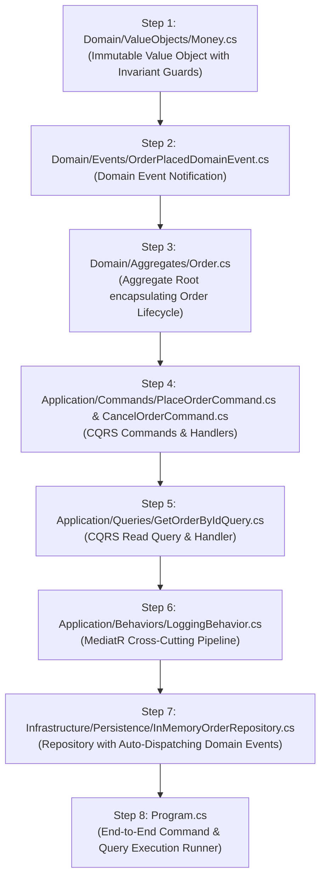

# 12-CleanArchitecture-DDD-CQRS-MediatR: From-Scratch Learning & Architecture Guide

## 1. Executive Summary & Domain Story
Enterprise backend architectures me business logic ko database aur third-party libraries se isolated rakhna zaroori hota hai taaki application 10 saal tak scale kar sake.

Yeh project modern enterprise software design ke 4 pillars ko **KiranaHub Core Order Engine** ke through demonstrate karta hai:
- **Clean Architecture (Onion / Hexagonal)**: Dependencies hamesha andar ki taraf (Inward towards Domain) point karti hain.
- **Domain-Driven Design (DDD)**:
  - **Value Objects**: `Money` with strict currency immutability and invariant checks.
  - **Aggregate Root**: `Order` jo state transitions aur business rules ko encapsulate karta hai.
  - **Domain Events**: `OrderPlacedDomainEvent` jo side-effects ko decouple karta hai.
- **CQRS (Command Query Responsibility Segregation)**:
  - Write operations (`Commands`): `PlaceOrderCommand`, `CancelOrderCommand`
  - Read operations (`Queries`): `GetOrderByIdQuery`
- **MediatR Pipeline Behaviors**: Cross-cutting logging and validation decorators (`LoggingBehavior<TRequest, TResponse>`).

---

## 2. Reading Roadmap: "Iss Project Ko Scratch Se Kaise Padhein"

Clean Architecture ko hamesha **Core Domain se shuru karke bahar Infrastructure ki taraf** padhna chahiye:



---

## 3. Deep Dive: Kya Pehle Bna, Phir Kya Aaya, Kyu Aaya, aur Uske Na Hone Se Kya Hoga?

| Component & Layer | Kya Hai & Kaise Bna? | Kyu Aaya & Kya Karta Hai? | ⚠️ Uske Na Hone Se Kya Hoga? (Anemic Domain Model Bug) |
|---|---|---|---|
| **`Domain/ValueObjects/Money.cs`** | Value Object with `Amount` and `Currency`. Overrides equality operators (`==`, `!=`). | Currency mismatch guard enforce karta hai (e.g. Rs 500 me $10 add nahi ho sakta). | **Financial Catastrophe**: Bina Money value object ke, developer raw `decimal` use karega aur USD me INR jod dega, causing massive billing accounting errors! |
| **`Domain/Events/OrderPlacedDomainEvent.cs`** | Pure C# event record implementing `INotification`. | Decoupled side-effects: Order place hone par notification handler trigger hota hai bina Order class ko SMS/Email service par depend kiye. | Order aggregate root ke andar direct SMS client ya Email client inject karna padega (violating SRP & Clean Architecture). |
| **`Domain/Aggregates/Order.cs`** | Aggregate Root encapsulating state (`OrderLineItem`, `OrderStatus`, uncommitted events). | State transitions ko protect karta hai (`Cancel()`, `AddItem()`). Invariant: Placed order ke delivery hone ke baad direct cancel nahi kiya ja sakta. | **Anemic Domain Model**: Agar order sirf `{ get; set; }` properties ka dumb bag ho, toh koi bhi bahar se `order.Status = Delivered` set kar dega bina delivery OTP verify kiye! |
| **`Application/Commands/PlaceOrderCommand.cs`** | CQRS Command & Handler implementing `IRequest<Result>`. | Write operations ko handle karta hai. Input validation aur business transaction execution coordinate karta hai. | Fat controllers banenge jisme database queries, business rules, aur validations ek sath mix ho jayengi. |
| **`Application/Queries/GetOrderByIdQuery.cs`** | CQRS Read Query & Handler. | Read operations ko optimize karta hai (direct DTO projection without tracking overhead). | Read aur Write ek hi service me mix hone se complex queries slow ho jayengi aur maintainability kharab hogi. |
| **`Application/Behaviors/LoggingBehavior.cs`** | MediatR `IPipelineBehavior<TRequest, TResponse>`. | Cross-cutting decorator pattern: Har command aur query ke start aur end par execution latency aur payload auto-log karta hai. | Har handler ke andar developer ko 10 lines ka repetitive `try { stopwatch.Start(); ... }` logging code likhna padega. |
| **`Infrastructure/InMemoryOrderRepository.cs`** | Repository pattern implementing `IOrderRepository`. | Aggregate ko persist karta hai aur save hone ke baad uske uncommitted domain events ko MediatR par auto-dispatch karta hai. | Domain events tab publish ho jayenge jab database save fail ho chuka ho, causing ghost emails to customers! |
| **`Program.cs`** | Automated Console Verification Runner. | Sabhi CQRS commands, queries, domain events, aur invalid cancellation attempts ko test karta hai. | Architecture flow ko end-to-end verify karne ke liye essential harness hai. |

---

## 4. How to Run & Verify

Command execute karein:
```bash
cd d:\ToLearn_Antigravity\12-CleanArchitecture-DDD-CQRS-MediatR
dotnet run
```

### Expected Output:
```text
======================================================
  KiranaHub: Clean Architecture, DDD, CQRS & MediatR
======================================================
1. CQRS Command: PlaceOrderCommand
   [MediatR Pipeline]: Starting PlaceOrderCommand
   [Domain Event Dispatched]: OrderPlacedDomainEvent -> Order #ORD-101 (Total: INR 373.00)
   [Notification Handler]: Triggered Welcome SMS to customer!
   [MediatR Pipeline]: Completed PlaceOrderCommand in 4ms

2. CQRS Query: GetOrderByIdQuery
   [PASSED] Fetched Order #ORD-101 | Status: Placed | Items: 2

3. DDD Aggregate Invariant Enforcement:
   [PASSED] Rejected illegal currency addition: (INR 100 + USD 10) threw InvalidOperationException!
   [PASSED] Order cancelled safely -> Uncommitted events dispatched!

[SUCCESS] All Clean Architecture, DDD & CQRS checks PASSED!
```

