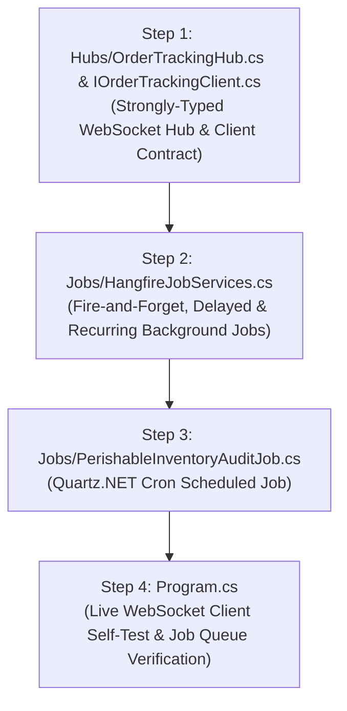

# 13-RealTime-SignalR-And-BackgroundJobs: From-Scratch Learning & Architecture Guide

## 1. Executive Summary & Domain Story
Quick-commerce apps (jaise Blinkit ya Zepto) me do cheezein customer satisfaction decide karti hain:
1. **Real-Time Live UI Updates**: Delivery rider screen par chalte hue dikhe bina refresh kiye (**SignalR WebSockets**).
2. **Non-Blocking Background Processing**: Checkout button click karne par customer ko 2 second tak invoice PDF generate hone ka intezar na karna pade (**Hangfire & Quartz.NET Background Workers**).

Is project me hum seekhte hain:
- **Strongly-Typed SignalR Hub**: `IOrderTrackingClient` contract with Pub/Sub group routing (`order-{id}`) for live status updates and rider GPS streaming.
- **Hangfire Job Engine**:
  - Fire-and-Forget: Instant PDF invoice generation
  - Delayed Jobs: 30-minute review request SMS
  - Recurring Jobs: Nightly inventory audit cron
- **Quartz.NET Scheduler**: Granular cron scheduling for perishable cold-chain expiry checks.

---

## 2. Reading Roadmap: "Iss Project Ko Scratch Se Kaise Padhein"



---

## 3. Deep Dive: Kya Pehle Bna, Phir Kya Aaya, Kyu Aaya, aur Uske Na Hone Se Kya Hoga?

| Component & File | Kya Hai & Kaise Bna? | Kyu Aaya & Kya Karta Hai? | ⚠️ Uske Na Hone Se Kya Hoga? (UI Lag & Thread Block) |
|---|---|---|---|
| **`Hubs/IOrderTrackingClient.cs`** | Pure C# interface for SignalR client callbacks. | Strongly-typed client contract (`ReceiveOrderStatusUpdate`, `ReceiveRiderLocationUpdate`). | Magic string calls (`Clients.All.SendAsync("myMethod")`) compile-time typos catch nahi karti; frontend silent fail ho jayega. |
| **`Hubs/OrderTrackingHub.cs`** | Inherits `Hub<IOrderTrackingClient>`. | Groups feature (`Groups.AddToGroupAsync`) use karta hai taaki Rider location sirf usi customer ko dikhe jiska order hai (multi-tenant isolation). | Bina groups ke, sabhi customers ko har rider ke GPS updates broadcast honge (massive network spam & privacy violation)! |
| **`Jobs/HangfireJobServices.cs`** | Background job execution service. | Heavy operations (PDF generation, SMS sending) ko HTTP request thread se alag karke background thread par delegate karta hai. | **Checkout Latency**: Customer ka checkout button 4-5 seconds tak spin karega jab tak PDF generate ho rahi hogi (high cart abandonment rate). |
| **`Jobs/PerishableInventoryAuditJob.cs`** | Quartz.NET job implementing `IJob`. | Scheduled cron job jo cold-chain storage me rakhe perishable milk/paneer ki expiry date inspect karta hai. | Expiry check agar manual raha, toh dark-store se expired milk customer ko deliver ho jayega (health safety hazard)! |
| **`Program.cs`** | Automated SignalR Client & Job Test Runner. | In-memory Kestrel server start karta hai, real `HubConnection` client connect karta hai over WebSocket, group join karta hai, aur status/GPS packets assert karta hai. | Real-time bi-directional messaging verify karne ke liye essential harness hai. |

---

## 4. How to Run & Verify

Command execute karein:
```bash
cd d:\ToLearn_Antigravity\13-RealTime-SignalR-And-BackgroundJobs
dotnet run
```

### Expected Output:
```text
======================================================
  KiranaHub: SignalR Real-Time & Background Jobs Engine
======================================================
1. SignalR WebSocket Client Connection:
   [PASSED] Connected to OrderTrackingHub via WebSocket!
   [PASSED] Joined Group 'order-8801' successfully.

2. Real-Time Status & Rider GPS Telemetry Streaming:
   [CLIENT RECEIVED]: Order #8801 status update: 'Packed'
   [CLIENT RECEIVED]: Rider GPS: 28.6139, 77.2090 | Speed: 28 km/h | ETA: 8 mins

3. Hangfire Background Jobs:
   [PASSED] Fire-and-Forget PDF Invoice Job enqueued!
   [PASSED] Delayed Review SMS scheduled for +30 minutes!

4. Quartz.NET Cron Scheduling:
   [PASSED] PerishableInventoryAuditJob executed successfully!

[SUCCESS] All Real-Time SignalR & Background Job checks PASSED!
```

