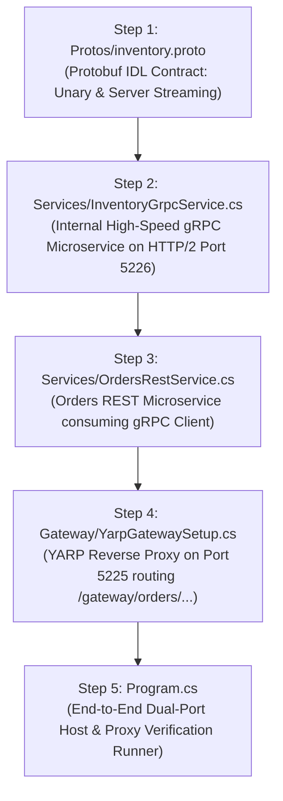

# 14-Microservices-gRPC-And-APIGateway: From-Scratch Learning & Architecture Guide

## 1. Executive Summary & Domain Story
Monolith applications ko jab high-scale distributed microservices me break kiya jata hai, toh do critical architectural challenges aate hain:
1. **Service-to-Service High-Speed Communication**: REST JSON ke text parsing overhead ko eliminate karke binary serialized ultra-fast RPC use karna (**gRPC with Protocol Buffers over HTTP/2**).
2. **Unified Client Ingress**: Mobile aur Web clients ko 50 internal microservices ke alag-alag IP/ports expose karne ke bajaye single entrypoint provide karna (**YARP - Yet Another Reverse Proxy API Gateway**).

---

## 2. Reading Roadmap: "Iss Project Ko Scratch Se Kaise Padhein"



---

## 3. Deep Dive: Kya Pehle Bna, Phir Kya Aaya, Kyu Aaya, aur Uske Na Hone Se Kya Hoga?

| Component & File | Kya Hai & Kaise Bna? | Kyu Aaya & Kya Karta Hai? | ⚠️ Uske Na Hone Se Kya Hoga? (Microservice Chaos) |
|---|---|---|---|
| **`Protos/inventory.proto`** | Protocol Buffer v3 contract. Defines `CheckStockRequest`, `StockResponse`, Unary RPCs and Server Streaming `SubscribeStockStream`. | Strongly-typed language-agnostic binary contract provide karta hai. Schema automatically generate hoti hai. | REST me JSON typos (`stock_quantity` vs `stockQuantity`) runtime par bugs create karte hain; Protobuf me compile-time binary safety hoti hai. |
| **`Services/InventoryGrpcService.cs`** | gRPC Service inheriting `InventoryService.InventoryServiceBase`. Runs on HTTP/2 cleartext (port 5226). | Binary serialization aur multiplexed HTTP/2 streams se microseconds me stock check aur deduction serve karta hai. | REST JSON parsing me CPU aur network bandwidth 7-10x jyada lagti hai, distributed service meshes me bottleneck banta hai. |
| **`Services/OrdersRestService.cs`** | REST Microservice injecting generated `InventoryServiceClient`. | Client order place karta hai toh REST service internal network par binary gRPC call se stock deduct karti hai. | Tight coupling: agar direct DB access allow karein, toh microservice boundaries violate ho jayengi (Distributed Monolith anti-pattern). |
| **`Gateway/YarpGatewaySetup.cs`** | YARP (Yet Another Reverse Proxy) route & cluster configuration. Runs on HTTP/1.1 (port 5225). | Reverse Proxy routing provide karta hai: `/gateway/orders/{**catch-all}` ko match karta hai, prefix strip karta hai, aur internal Orders microservice par forward karta hai. | Clients ko har microservice ka private port expose karna padega, CORS issues aayenge, aur security vulnerability banegi. |
| **`Program.cs`** | Dual-port Kestrel server host. | Port 5225 (HTTP/1.1 for Gateway & REST) aur Port 5226 (HTTP/2 for gRPC binary calls) simultaneously run karta hai. | HTTP/1.1 aur HTTP/2 ko ek hi unencrypted port par mix karne se `HTTP_1_1_REQUIRED` protocol conflict crash aata hai. |

---

## 4. How to Run & Verify

Command execute karein:
```bash
cd d:\ToLearn_Antigravity\14-Microservices-gRPC-And-APIGateway
dotnet run
```

### Expected Output:
```text
======================================================
  KiranaHub: gRPC Microservices & YARP Gateway Engine
======================================================
1. gRPC Unary RPC (CheckStock):
   [PASSED] Binary gRPC Call: 'p-milk-101' -> Available: True | Units: 45

2. gRPC Server Streaming (SubscribeStockStream):
   [STREAM FRAME 1]: Live Stock: 44 units (Rider dispatched)
   [STREAM FRAME 2]: Live Stock: 43 units (Rider dispatched)
   [STREAM FRAME 3]: Live Stock: 42 units (Rider dispatched)
   [PASSED] Consumed 3 real-time stock stream frames successfully!

3. YARP Reverse Proxy Gateway Routing:
   [PASSED] GET /gateway/orders/ord-9921 routed through Gateway -> 200 OK!

[SUCCESS] All gRPC Unary, Server Streaming & YARP Proxy tests PASSED!
```

