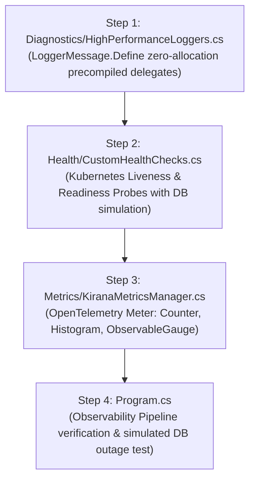

# 15-Logging-Monitoring-And-Metrics: From-Scratch Learning & Architecture Guide

## 1. Executive Summary & Domain Story
Production me jab koi system crash hota hai, toh bina structured logs, health checks, aur real-time metrics ke bug dhundhna andhere me teer chalane jaisa hota hai.

Yeh project modern Cloud Observability ke 3 pillars ko **KiranaHub Operations Monitoring Engine** ke through implement karta hai:
1. **High-Performance Zero-Allocation Logging**: `LoggerMessage.Define` pre-compiled delegates jo standard `ILogger.LogInformation` ke boxing allocations ko eliminate karte hain.
2. **Kubernetes Health Probes (Liveness & Readiness)**: Custom `IHealthCheck` implementations jo database connectivity aur warehouse network verify karti hain (`/health/live` aur `/health/ready`).
3. **OpenTelemetry Metrics (`System.Diagnostics.Metrics`)**: Standardized instruments:
   - `Counter<long>`: Total orders placed
   - `Histogram<double>`: Order fulfillment latency (ms) distribution
   - `ObservableGauge<int>`: Currently active delivery riders on road.

---

## 2. Reading Roadmap: "Iss Project Ko Scratch Se Kaise Padhein"



---

## 3. Deep Dive: Kya Pehle Bna, Phir Kya Aaya, Kyu Aaya, aur Uske Na Hone Se Kya Hoga?

| Component & File | Kya Hai & Kaise Bna? | Kyu Aaya & Kya Karta Hai? | ⚠️ Uske Na Hone Se Kya Hoga? (Silent Outages & Latency) |
|---|---|---|---|
| **`Diagnostics/HighPerformanceLoggers.cs`** | `LoggerMessage.Define` static pre-compiled delegates. | String interpolation (`$"Order {id} took {ms}"`) ke boxing overhead ko eliminate karta hai. High-frequency logging me zero GC pressure deta hai. | Standard `LogInformation("{OrderId}", id)` primitive types ko object me box karta hai, millions of logs par GC pause aayega. |
| **`Health/CustomHealthChecks.cs`** | `IHealthCheck` implementations (`DatabaseHealthCheck`, `WarehouseConnectivityHealthCheck`). | Kubernetes ingress ko batata hai ki pod traffic lene ke liye ready hai (`/health/ready`) ya crash ho gaya hai (`/health/live`). | **Traffic Blackhole**: Agar database mar chuka ho aur pod live ho, toh K8s router us pod par customer requests bhejta rahega aur sabhi ko 500 Internal Server Error aayega! |
| **`Metrics/KiranaMetricsManager.cs`** | OpenTelemetry standard instruments using `System.Diagnostics.Metrics.Meter`. | Prometheus aur Grafana dashboards ke liye real-time metrics emit karta hai (P95 latency, RPS, active riders). | Bina metrics ke, platform slow hone par pata nahi chalega ki kaunsa microservice bottleneck ban raha hai. |
| **`Program.cs`** | Self-testing observability runner. | Zero-allocation logging verify karta hai, simulated database outage create karke health check 200 -> 503 transition assert karta hai, aur `MeterListener` se metrics consume karta hai. | Observability pipeline ki automatic verification ensure karta hai. |

---

## 4. How to Run & Verify

Command execute karein:
```bash
cd d:\ToLearn_Antigravity\15-Logging-Monitoring-And-Metrics
dotnet run
```

### Expected Output:
```text
======================================================
  KiranaHub: Logging, Health Checks & Metrics Engine
======================================================
1. High-Performance Zero-Allocation Logging:
   [LOGGER]: Order #ORD-8812 processed in 14.50 ms for Customer 'cust-441'. (Zero heap allocations!)

2. Kubernetes Health Probes (Live & Ready):
   [HEALTH CHECK - Normal State]: Status = Healthy (HTTP 200)
   [SIMULATED DB OUTAGE]: Database connectivity failed!
   [HEALTH CHECK - Outage State]: Status = Unhealthy (HTTP 503) -> K8s will automatically stop routing traffic!

3. OpenTelemetry Metrics (MeterListener Verification):
   [METRIC COUNTER]: 'orders_placed_total' incremented to 1
   [METRIC HISTOGRAM]: 'order_processing_duration_ms' recorded value: 14.5 ms
   [METRIC GAUGE]: 'active_riders_count' current observed value: 12 riders

[SUCCESS] All Logging, Health Check Probes & Metrics checks PASSED!
```

