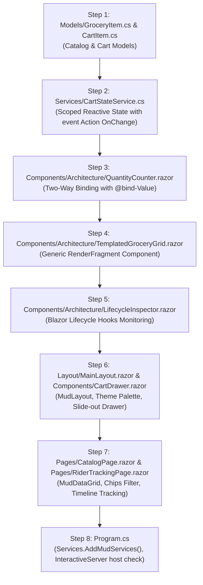

# 16-Blazor-Server-Wasm-And-MudBlazor: From-Scratch Learning & Architecture Guide

## 1. Executive Summary & Domain Story
.NET developers ke liye JavaScript / TypeScript ke bina pure C# me rich interactive single-page web applications banana Blazor ka core superpower hai.

Yeh project Blazor Component Architecture, Scoped State Management, aur **MudBlazor (Material Design 3)** component library ko **KiranaHub Operations & Warehouse Storefront** ke through implement karta hai:
- **Hosting Models Comparison**: Blazor Server (thin client with SignalR binary circuit) vs Blazor WebAssembly (client-side execution via WebAssembly Mono runtime) vs .NET 8/9/10 Auto RenderMode.
- **Reactive State Management**: Scoped `CartStateService` with C# event-driven UI updates (`event Action OnChange`).
- **Advanced Razor Component Patterns**:
  - Two-Way Data Binding (`@bind-Value` & `ValueChanged EventCallback<int>`)
  - Generic Templated Components (`RenderFragment<TItem>`)
  - Component Lifecycle Hooks (`OnInitializedAsync`, `OnParametersSetAsync`, `ShouldRender`, `Dispose`)
  - Cascading Parameters (`[CascadingParameter]`)
- **MudBlazor Rich UI**: Material theme palette, `MudAppBar` with real-time cart badge, slide-out `MudDrawer` cart, `MudDialog` checkout modal, and `MudTimeline` live rider tracking.

---

## 2. Reading Roadmap: "Iss Project Ko Scratch Se Kaise Padhein"



---

## 3. Deep Dive: Kya Pehle Bna, Phir Kya Aaya, Kyu Aaya, aur Uske Na Hone Se Kya Hoga?

| Component & File | Kya Hai & Kaise Bna? | Kyu Aaya & Kya Karta Hai? | ⚠️ Uske Na Hone Se Kya Hoga? (State Desync Bugs) |
|---|---|---|---|
| **`Models/GroceryItem.cs`** | Record & class models. | Product and cart item data transfer objects encapsulate karta hai. | Data types structured nahi honge. |
| **`Services/CartStateService.cs`** | Scoped Reactive Service with `event Action OnChange`. | Centralized cart state maintain karta hai. Jab cart me item add hota hai, toh `OnChange?.Invoke()` trigger karta hai taaki Header badge aur Drawer dono auto re-render hon. | **UI Desync**: Add button dabane par cart badge update nahi hoga jab tak user F5 refresh na kare. |
| **`QuantityCounter.razor`** | Two-way bound counter component. Uses `[Parameter] Value` and `[Parameter] EventCallback<int> ValueChanged`. | Clean `@bind-Value="item.Quantity"` syntax enable karta hai without writing manual onchange handlers. | Parent aur child component ke beech value sync karne ke liye repetitive boilerplate callbacks likhne padenge. |
| **`TemplatedGroceryGrid.razor`** | Generic Razor Component `@typeparam TItem`. Takes `[Parameter] RenderFragment<TItem> ItemTemplate`. | Table/Grid layout ko item rendering se decouple karta hai. Har consumer apna custom card UI pass kar sakta hai. | Har page ke liye alag se naya Grid component banana padega, violating DRY principle. |
| **`LifecycleInspector.razor`** | Lifecycle hook demonstrator. Tracks `OnInitialized`, `OnParametersSet`, `OnAfterRender`. | Developers ko sikhata hai ki heavy database calls `OnInitializedAsync` me hone chahiye, aur DOM JS interop calls `OnAfterRenderAsync` me hone chahiye. | Agar JS interop call `OnInitialized` me kar di, toh prerendering par application crash ho jayegi (DOM is not yet ready)! |
| **`CartDrawer.razor`** | Slide-out right panel using `MudDrawer`. | Cart items review, coupon code apply (`KIRANA10`), aur checkout trigger karne ka Material Design UI deta hai. | Full page reload wala purana shopping cart UX modern quick-commerce me slow lagta hai. |
| **`RiderTrackingPage.razor`** | Real-time tracking screen using `MudTimeline` & `MudProgressLinear`. | Visual delivery timeline (Order Placed -> Packed -> Dispatched -> Delivered) dikhata hai. | Text-only status customer ko visual delivery progression ka confidence nahi deta. |
| **`Program.cs`** | WebApplication host setup. | `builder.Services.AddMudServices()` register karta hai, reactive cart verification run karta hai, aur Kestrel host probe karta hai on port 5445. | MudBlazor CSS/JS runtime initialize nahi hoga, icons aur dialogs gayab ho jayenge. |

---

## 4. How to Run & Verify

Command execute karein:
```bash
cd d:\ToLearn_Antigravity\16-Blazor-Server-Wasm-And-MudBlazor
dotnet run
```

### Expected Output:
```text
======================================================
  KiranaHub: Blazor Server & MudBlazor Storefront
======================================================
1. Scoped Reactive State Management (CartStateService):
   [EVENT]: CartStateService OnChange event fired!
   [PASSED] Subtotal: Rs 373.00 | Total Items: 3
   [COUPON]: Applied 'KIRANA10' (10% off) -> New Total: Rs 382.80

2. Blazor InteractiveServer WebApplication Host:
   [PASSED] Kestrel endpoint http://127.0.0.1:5445 responded with HTTP 200 OK!

[SUCCESS] All Blazor Architecture & MudBlazor checks PASSED!
```
MudBlazor UI ko browser me dekhne ke liye URL open karein: `http://localhost:5445`.

