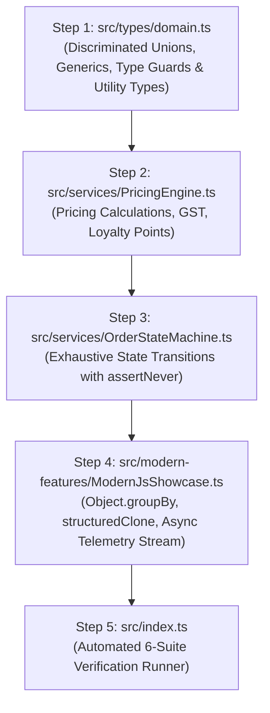

# 17-TypeScript-And-Modern-JavaScript: From-Scratch Learning & Architecture Guide

## 1. Executive Summary & Domain Story
Enterprise frontend applications me runtime bugs (jaise `Cannot read property of undefined`) ko compile time par khatam karna TypeScript ka core mission hai.

Yeh project modern TypeScript strict typing aur modern ECMAScript (ES2022 - ES2024) features ko **KiranaHub Domain Core SDK & Pricing Engine** ke zariye sikhata hai:
- **Discriminated Unions**: Order status lifecycle (`Placed`, `Packed`, `Dispatched`, `Delivered`, `Cancelled`) with compile-time exhaustiveness checks (`assertNever`)
- **Generic Constraints**: `IRepository<T extends Entity>`
- **Type Guards & Assertions**: `isPerishableItem(item): item is ...`, `assertValidRiderPhone(phone): asserts phone is string`
- **TypeScript Utility Types**: Deep exploration of `Partial<T>`, `Required<T>`, `Readonly<T>`, `Pick<T, K>`, `Omit<T, K>`, `Record<K, V>`
- **Modern ES2024+ Features**: `Object.groupBy()`, `structuredClone()`, Async Iterators (`for await...of`), and high-performance `Map`/`Set` indexing.

---

## 2. Reading Roadmap: "Iss Project Ko Scratch Se Kaise Padhein"



---

## 3. Deep Dive: Kya Pehle Bna, Phir Kya Aaya, Kyu Aaya, aur Uske Na Hone Se Kya Hoga?

| Component & File | Kya Hai & Kaise Bna? | Kyu Aaya & Kya Karta Hai? | ⚠️ Uske Na Hone Se Kya Hoga? (Runtime Type Disasters) |
|---|---|---|---|
| **`src/types/domain.ts`** | Discriminated union of interfaces sharing literal property `status: 'Placed' \| 'Packed' ...`. | Runtime states ko compile-time type safety deta hai. Jab `order.status === 'Dispatched'` check hota hai, compiler automatic `order.riderPhone` access allow karta hai. | **Undefined Property Crash**: Dispatched se pehle Placed state me agar developer `order.riderName` access karega, toh browser runtime par crash ho jayega! |
| **`assertNever(x: never): never`** (inside `OrderStateMachine.ts`) | Exhaustiveness check helper. | Agar future me koi naya state (e.g. `Refunded`) add ho jaye aur switch statement me uska case miss ho, toh TypeScript compiler build fail kar dega. | Developer naya state handle karna bhool jayega aur production me unhandled state silent bug create karega. |
| **`src/services/PricingEngine.ts`** | Pure functional pricing calculator. | Subtotal, 5% GST, free delivery threshold (>= 500) aur loyalty points compute karta hai. | Client-side aur server-side me calculation mismatch hone par customer cart dispute create hoga. |
| **`src/modern-features/ModernJsShowcase.ts`** | ES2024 showcase methods. | `Object.groupBy()` se zero 3rd-party dependency categorization, `structuredClone()` se deep immutability, aur Async Iterators se real-time GPS stream simulation. | Purane `JSON.parse(JSON.stringify())` se Date objects aur Set/Map corrupt ho jate hain; `structuredClone` memory safe deep copy deta hai. |
| **`src/index.ts`** | Automated test runner using `node:assert/strict`. | Generic Repository, Type Guards, Discriminated Unions, Pricing engine aur Modern JS showcase ko 6 structured test suites me assert karta hai. | TypeScript code compile aur runtime execution verify nahi ho sakegi. |

---

## 4. How to Run & Verify

Command execute karein:
```bash
cd d:\ToLearn_Antigravity\17-TypeScript-And-Modern-JavaScript
npm test
npm run build
```

### Expected Output:
```text
====================================================================
  KiranaHub Project 17: TypeScript & Modern JS Core Engine Test Suite
====================================================================
[TEST 1] Testing Generic Repository<T extends Entity>... -> PASSED
[TEST 2] Testing Type Guards & Assertion Functions...   -> PASSED
[TEST 3] Testing Discriminated Unions & State Machine... -> PASSED
[TEST 4] Testing PricingEngine & Discounts...           -> PASSED
[TEST 5] Testing TypeScript Utility Types...            -> PASSED
[TEST 6] Testing Modern JS (Object.groupBy, Streams)... -> PASSED

====================================================================
 [SUCCESS] All TypeScript & Modern JS Core Engine checks PASSED!
====================================================================
```

