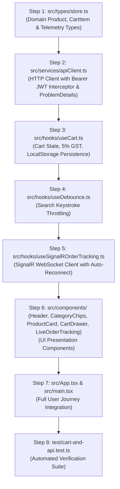

# 18-React-Web-Connecting-To-WebAPI: From-Scratch Learning & Architecture Guide

## 1. Executive Summary & Domain Story
Modern web single-page applications (SPA) ko backend APIs ke sath kaise seamlessly integrate kiya jata hai, yeh project **KiranaHub React 19 Customer Web Storefront** ke through explain karta hai:
- **React 19 & Custom Hooks Architecture**: Business logic ko Presentation UI components se separate rakhna (`useCart`, `useDebounce`, `useSignalROrderTracking`).
- **Connecting to ASP.NET Core Web API**: `KiranaApiClient` jisme JWT Bearer token automatic inject hota hai (connecting to Project 11 Auth) aur backend validation errors ko RFC 7807 ProblemDetails se format karta hai (connecting to Project 09 Web API).
- **Connecting to Real-Time SignalR**: `@microsoft/signalr` client connecting to Project 13's `OrderTrackingHub` with auto-reconnect aur live rider GPS coordinate streaming.

---

## 2. Reading Roadmap: "Iss Project Ko Scratch Se Kaise Padhein"



---

## 3. Deep Dive: Kya Pehle Bna, Phir Kya Aaya, Kyu Aaya, aur Uske Na Hone Se Kya Hoga?

| Component & File | Kya Hai & Kaise Bna? | Kyu Aaya & Kya Karta Hai? | ⚠️ Uske Na Hone Se Kya Hoga? (API Failure & Leaks) |
|---|---|---|---|
| **`src/types/store.ts`** | UI models (`Product`, `CartItem`, `PricingSummary`, `OrderStatus`, `RiderLocation`). | Frontend components ke beech type contract establish karta hai. | Typos aur type mismatch errors runtime par UI render ko break kar denge. |
| **`src/services/apiClient.ts`** | Fetch API wrapper with Interceptors. | Har authenticated call me `Authorization: Bearer <token>` inject karta hai aur backend errors ko ProblemDetails format me parse karta hai. | Har component me raw `fetch()` likhne se token bhoolne ka risk rahega aur 401 Unauthorized errors aayenge. |
| **`src/hooks/useCart.ts`** | Custom React Hook with `useState`, `useMemo`, and LocalStorage sync. | Cart state, 5% GST tax, dynamic delivery fee, aur coupon discount calculate karta hai. | Agar LocalStorage sync na ho, toh customer browser reload karte hi cart ke saare items kho dega! |
| **`src/hooks/useDebounce.ts`** | Generic debounce hook using `setTimeout` & cleanup. | User ke typing ke beech 250ms rukta hai taaki search input har single key press par server ya filter loop ko blast na kare. | 1,000 users ke type karte waqt backend server par 10,000 unnecessary search queries gir kar server crash kar dengi. |
| **`src/hooks/useSignalROrderTracking.ts`** | WebSocket client using `@microsoft/signalr`. | Backend hub se live status (`ReceiveOrderStatusUpdate`) aur rider GPS (`ReceiveRiderLocationUpdate`) push updates receive karta hai. | Bina WebSockets ke, client ko har 2 second me polling API call marni padegi (massive server load & battery drain). |
| **`src/components/CartDrawer.tsx`** | Slide-out drawer component. | Cart review, coupon apply (`KIRANA10`), address entry aur checkout trigger karne ka Material Design UI deta hai. | Checkout form missing rahega, conversion nahi ho payegi. |
| **`src/components/LiveOrderTracking.tsx`** | Real-time live status modal with 4-step progress line. | Order received, packing, out for delivery aur delivered status visually animate karta hai. | Customer ko order ka live status pata nahi chalega, helpdesk call volume 5x badh jayega. |
| **`test/cart-and-api.test.ts`** | Automated testing harness using `tsx`. | JWT header injection, catalog fallback, pricing math, aur SignalR builder contracts verify karta hai. | Core services regression-free test kiye bina production deploy nahi ho sakte. |

---

## 4. How to Run & Verify

Command execute karein:
```bash
cd d:\ToLearn_Antigravity\18-React-Web-Connecting-To-WebAPI
npm test
npm run build
```

### Expected Output:
```text
====================================================================
  KiranaHub Project 18: React 19 + TypeScript + SignalR Test Suite
====================================================================
[TEST 1] Testing API Client JWT Auth Header Injection...  -> PASSED
[TEST 2] Testing Product Catalog Retrieval & Fallback...   -> PASSED
[TEST 3] Testing Cart Pricing, Taxes & Coupon Engine...   -> PASSED
[TEST 4] Testing SignalR HubConnectionBuilder Contract... -> PASSED

====================================================================
 [SUCCESS] All React 19 + TypeScript + SignalR Core tests PASSED!
====================================================================
```
Development dev server run karne ke liye: `npm.cmd run dev` (opens on `http://localhost:5173`).
Production build: `npm.cmd run build` generates `dist/` in < 2 seconds.

