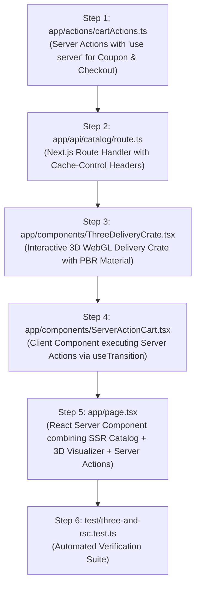

# 19-NextJs-FullStack-And-ThreeJs: From-Scratch Learning & Architecture Guide

## 1. Executive Summary & Domain Story
Enterprise quick-commerce applications me SEO optimization, instant page load speed, aur immersive modern 3D graphics ek sath deliver karna sabse bada milestone hota hai.

Yeh project **Next.js 15 App Router Full-Stack Architecture** aur **Three.js 3D WebGL Graphics** ko implement karta hai:
- **React Server Components (RSC)**: Initial grocery catalog ko server par pre-render karke client par **0 KB JavaScript** bhejta hai (instant First Contentful Paint).
- **Server Actions (`"use server"`)**: Client se direct server-side functions execute karna (`validateAndApplyCoupon`, `submitOrderAction`) bina alag se REST API endpoints likhe.
- **Next.js Route Handlers**: Cached JSON endpoints (`/api/catalog`) with HTTP `Cache-Control: public, s-maxage=60`.
- **Three.js 3D Interactive WebGL Crate**: Procedural BoxGeometry, realistic PBR materials (`MeshStandardMaterial`), directional lighting, continuous floating animation loop, aur 360° pointer drag rotation.

---

## 2. Reading Roadmap: "Iss Project Ko Scratch Se Kaise Padhein"



---

## 3. Deep Dive: Kya Pehle Bna, Phir Kya Aaya, Kyu Aaya, aur Uske Na Hone Se Kya Hoga?

| Component & File | Kya Hai & Kaise Bna? | Kyu Aaya & Kya Karta Hai? | ⚠️ Uske Na Hone Se Kya Hoga? (Performance & Security Risks) |
|---|---|---|---|
| **`app/actions/cartActions.ts`** | Server-side mutations tagged with `"use server"`. | Coupon verification aur order placement ko server boundary me execute karta hai. Client bundle me source code expose nahi hota. | **Security Vulnerability**: Client-side JS me agar coupon discount calculate ho, toh user browser devtools se discount 100% karke free me grocery loot sakta hai! |
| **`app/api/catalog/route.ts`** | Next.js API Route Handler using `NextResponse.json`. | External clients aur mobile apps ko cached REST JSON data provide karta hai with CDN edge caching. | Microservices aur third-party aggregators ko catalog consume karne ka interface nahi milega. |
| **`app/components/ThreeDeliveryCrate.tsx`** | Client component (`"use client"`) using `three`. | Immersive 3D WebGL experience deta hai: procedural cardboard texture, ambient/directional lights, aur touch drag 360 rotation. Proper cleanup me geometries dispose karta hai. | Agar geometries aur renderers unmount par dispose na kiye jayein, toh WebGL context memory leak hokar browser tab crash kar dega! |
| **`app/components/ServerActionCart.tsx`** | Client Component using `useTransition()`. | Non-blocking server action execution provide karta hai with pending states (`isPending`) without reloading the page. | Server action execute hote waqt UI freeze ho jayega agar non-blocking transition use na kiya jaye. |
| **`app/page.tsx`** | React Server Component (RSC). | HTML ko direct server par render karta hai. Static grocery cards ke liye client par koi React virtual DOM hydration code nahi bhejna padta. | Pure client-side SPA initial load par 3-4 seconds ka blank white screen dikhata hai jab tak JS bundle download na ho (poor SEO & low conversion). |
| **`test/three-and-rsc.test.ts`** | Automated testing harness using `tsx`. | Three.js scene graph, PBR materials, Server Action coupon logic, aur Route Handler endpoints verify karta hai. | Headless CI/CD verification ensure karta hai. |

---

## 4. How to Run & Verify

Command execute karein:
```bash
cd d:\ToLearn_Antigravity\19-NextJs-FullStack-And-ThreeJs
npm test
npm run build
```

### Expected Output:
```text
====================================================================
  KiranaHub Project 19: Next.js 15 + Three.js 3D Test Suite
====================================================================
[TEST 1] Testing Three.js 3D Scene Graph & PBR Material... -> PASSED
[TEST 2] Testing Server Action: validateAndApplyCoupon...  -> PASSED
[TEST 3] Testing Server Action: submitOrderAction...       -> PASSED
[TEST 4] Testing Next.js Route Handler GET /api/catalog... -> PASSED

====================================================================
 [SUCCESS] All Next.js 15 + Three.js 3D Core tests PASSED!
====================================================================
```
Production Build Output:
`✓ Compiled successfully in 13.2s` with 5 static/dynamic routes generated.
Dev server: `npm.cmd run dev` (opens on `http://localhost:3000`).

