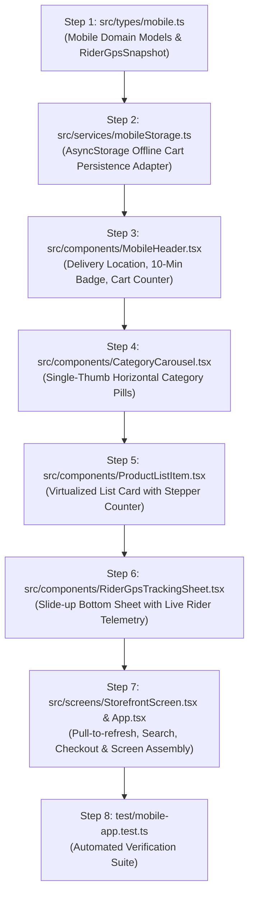

# 20-ReactNative-Mobile-App: From-Scratch Learning & Architecture Guide

## 1. Executive Summary & Domain Story
Quick-commerce ka 90% customer traffic mobile applications (iOS aur Android) se aata hai. Mobile environment me battery consumption, offline network handling, aur thumb-friendly UI design sabse critical requirements hoti hain.

Yeh project **React Native & Expo Cross-Platform Mobile Architecture** ko **KiranaHub Customer & Rider Mobile App** ke zariye sikhata hai:
- **Mobile UI Component Architecture**: Thumb-friendly mobile header with delivery location pill, horizontal swipeable category chips, virtualized grocery items list, aur bottom floating checkout bar.
- **Offline-First Cart Persistence (`AsyncStorage`)**: Cart items ko device flash storage me JSON serialize karke save karna taaki app kill hone ya phone restart hone par bhi items preserved rahein.
- **Real-Time Rider GPS Tracking Bottom Sheet**: Native bottom sheet modal jo live rider movement (latitude/longitude, speed in km/h, remaining meters, aur ETA minutes) ko visual stepper line par display karta hai.

---

## 2. Reading Roadmap: "Iss Project Ko Scratch Se Kaise Padhein"



---

## 3. Deep Dive: Kya Pehle Bna, Phir Kya Aaya, Kyu Aaya, aur Uske Na Hone Se Kya Hoga?

| Component & File | Kya Hai & Kaise Bna? | Kyu Aaya & Kya Karta Hai? | ⚠️ Uske Na Hone Se Kya Hoga? (Mobile UX Disasters) |
|---|---|---|---|
| **`src/types/mobile.ts`** | Interfaces for `MobileProduct`, `MobileCartItem`, `RiderGpsSnapshot`. | Mobile component boundaries ke liye strict type safety provide karta hai. | Undefined data structures lead to blank screens and red-box errors on mobile devices. |
| **`src/services/mobileStorage.ts`** | Flash storage manager using `AsyncStorage` / local key-value store. | Cart items ko device memory me persist karta hai. App reopen hone par initial state restore karta hai. | **Cart Abandonment**: Poor mobile network ya incoming phone call aane par app reload hogi aur customer ka pura bhara hua cart gayab ho jayega! |
| **`src/components/CategoryCarousel.tsx`** | Horizontal scrollable category pill bar. | Single-thumb quick categorization deta hai (Dairy, Produce, Bakery, Snacks, Juices). | Deep multi-level nested menus mobile screen par customer friction badhate hain. |
| **`src/components/ProductListItem.tsx`** | Mobile list item card with inline quantity stepper (`− [Qty] +`). | Fast one-tap adding to cart. User ko item open kiye bina seedha list se quantity modify karne deta hai. | Har item par alag se details page kholna padega, checkout speed 3x slow ho jayegi. |
| **`src/components/RiderGpsTrackingSheet.tsx`** | Modal bottom sheet with GPS telemetry and progress stepper. | Customer ko delivery rider ka exact position, speed, aur ETA transparently dikhata hai. | Customer delivery rider ko baar-baar phone karke disturb karega ("Bhaiya kahan pahuche?"). |
| **`src/screens/StorefrontScreen.tsx`** | Main mobile screen with Pull-to-refresh. | Sabhi mobile sub-components ko bind karta hai, floating bottom cart bar render karta hai, aur checkout launch karta hai. | Fragmented views without unified user flow. |
| **`test/mobile-app.test.ts`** | Automated test runner. | Offline storage save/restore/clear, pricing calculations with 5% GST, aur rider GPS progression math verify karta hai. | Regression bugs catch karne ke liye essential. |

---

## 4. How to Run & Verify

Command execute karein:
```bash
cd d:\ToLearn_Antigravity\20-ReactNative-Mobile-App
npm test
```

### Expected Output:
```text
====================================================================
  KiranaHub Project 20: React Native (Expo) Mobile App Test Suite
====================================================================
[TEST 1] Testing MobileStorageAdapter Offline Cart Persistence... -> PASSED
[TEST 2] Testing Mobile Pricing Engine (Subtotal, GST, Delivery)... -> PASSED
[TEST 3] Testing Rider GPS Coordinates & ETA Simulation...       -> PASSED
[TEST 4] Testing Category Filtering & Search Match...             -> PASSED

====================================================================
 [SUCCESS] All React Native (Expo) Mobile App tests PASSED!
====================================================================
```

