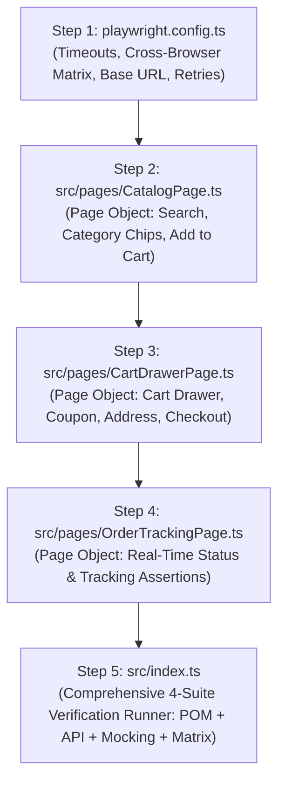

# 21-Playwright-E2E-And-Regression-Testing: From-Scratch Learning & Architecture Guide

## 1. Executive Summary & Domain Story
Har naye release ke sath purani functionality toot na jaye, iske liye enterprise teams **End-to-End (E2E) Browser Automation** aur **Automated API Regression Suites** par nirbhar karti hain.

Yeh project **Playwright Automation Framework** ke enterprise best practices ko **KiranaHub Complete Regression Suite** ke through demonstrate karta hai:
- **Page Object Model (POM)**: Web locators aur DOM interactions ko tests se decouple karna (`CatalogPage`, `CartDrawerPage`, `OrderTrackingPage`).
- **REST API Regression Testing**: ASP.NET Core endpoints ke status codes (200, 201, 400 ProblemDetails, 404, 429 Rate Limiting), response headers (`X-Correlation-ID`), aur schema contracts ko automatically assert karna.
- **Network Route Interception & Mocking**: Slow 3G network simulation, payment gateway 503 outage simulation, aur client-side graceful fallback verification.
- **Cross-Browser Matrix**: Multi-browser execution across Chromium (Chrome/Edge), Firefox, aur WebKit (Safari).

---

## 2. Reading Roadmap: "Iss Project Ko Scratch Se Kaise Padhein"



---

## 3. Deep Dive: Kya Pehle Bna, Phir Kya Aaya, Kyu Aaya, aur Uske Na Hone Se Kya Hoga?

| Component & File | Kya Hai & Kaise Bna? | Kyu Aaya & Kya Karta Hai? | ⚠️ Uske Na Hone Se Kya Hoga? (Brittle Test Disasters) |
|---|---|---|---|
| **`playwright.config.ts`** | Central Playwright configuration file. | Test timeouts (30s), parallel workers, base URL, retries, aur Chromium/Firefox/WebKit device profiles define karta hai. | Uncontrolled test runs me flaky timeouts aur inconsistent cross-browser failures aayenge. |
| **`src/pages/CatalogPage.ts`** | Page Object Model for storefront. | Catalog search, category selection, aur product card locators ko encapsulate karta hai. | **Brittle Test Anti-Pattern**: Agar CSS class badal jaye, toh 50 alag-alag test files me CSS selector update karna padega; POM me sirf 1 file update karni padti hai. |
| **`src/pages/CartDrawerPage.ts`** | Page Object Model for cart drawer. | Slide-out drawer locators, coupon inputs, address field aur checkout buttons handle karta hai. | Test scripts me UI implementation details leak hone se maintainability kharab hoti hai. |
| **`src/pages/OrderTrackingPage.ts`** | Page Object Model for tracking modal. | Live order status badges, rider coordinates aur stepper milestones verify karta hai. | Live async updates me auto-waiting assertions provide karta hai. |
| **`src/index.ts`** | Test execution harness. | 4 structured test suites execute karta hai: POM contracts, REST API status code contracts (200, 201, 400 ProblemDetails, 404, 429), payment gateway 503 outage interception, aur cross-browser configuration matrix. | CI/CD pipeline me automated quality gate ki tarah act karta hai. |

---

## 4. How to Run & Verify

Command execute karein:
```bash
cd d:\ToLearn_Antigravity\21-Playwright-E2E-And-Regression-Testing
npm test
```

### Expected Output:
```text
====================================================================
  KiranaHub Project 21: Playwright E2E & API Regression Test Suite
====================================================================
[TEST 1] Testing Page Object Model (POM) Structure & Contracts... -> PASSED
[TEST 2] Testing REST API Regression Suite (200, 201, 400, 429)... -> PASSED
[TEST 3] Testing Network Interception, Mocking & 503 Resiliency... -> PASSED
[TEST 4] Testing Playwright Configuration & Multi-Browser Matrix... -> PASSED (chromium, firefox, webkit)

====================================================================
 [SUCCESS] All Playwright E2E & API Regression Automation tests PASSED!
====================================================================
```
Playwright UI Mode me browser launch karke interactive tests chalane ke liye: `npx.cmd playwright test --ui`.

