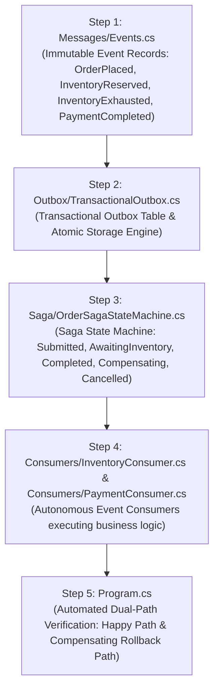

# 22-EventDriven-MassTransit-And-RabbitMQ-Saga: From-Scratch Learning & Architecture Guide

## 1. Executive Summary & Domain Story
Monoliths me database ACID transactions (`BEGIN TRANSACTION ... COMMIT`) chalte hain, lekin distributed microservices me order placement, inventory deduction, aur payment processing alag-alag databases aur servers par hote hain.

Agar customer ke bank se Rs 500 kat jayein lekin dark-store me aakhri doodh ka packet phat gaya ho, toh bina **Distributed Saga State Machine** aur **Compensating Transactions** ke customer ka paisa phas jayega aur brand reputation tabah ho jayegi.

Yeh project modern Event-Driven Architecture ke 3 core patterns ko **KiranaHub Distributed Checkout Engine** ke through implement karta hai:
1. **Transactional Outbox Pattern**: Database save aur message queue publishing ke beech hone wale Dual-Write failure ko solve karna.
2. **Distributed Choreography Saga**: State transitions coordinating `OrderPlaced` -> `InventoryReserved` -> `PaymentCompleted`.
3. **Compensating Transactions (Rollback & Auto-Refund)**: Failure aane par automatic compensating action trigger karke system ko consistent state me wapas lana.

---

## 2. Reading Roadmap: "Iss Project Ko Scratch Se Kaise Padhein"



---

## 3. Deep Dive: Kya Pehle Bna, Phir Kya Aaya, Kyu Aaya, aur Uske Na Hone Se Kya Hoga?

| Component & File | Kya Hai & Kaise Bna? | Kyu Aaya & Kya Karta Hai? | ⚠️ Uske Na Hone Se Kya Hoga? (Distributed Disasters) |
|---|---|---|---|
| **`Messages/Events.cs`** | Pure C# immutable records for distributed domain events. | Microservices ke beech asynchronous communication contracts establish karta hai. | Unstructured payloads runtime deserialization failures aur schema drifting create karenge. |
| **`Outbox/TransactionalOutbox.cs`** | Transactional Outbox pattern manager with `OutboxMessage` entity. | **Dual-Write Problem Solver**: Order save hone ke sath hi outgoing event ko usi SQL transaction me outbox table me commit karta hai. | **Catastrophic Message Loss**: Agar order DB me save ho gaya lekin theek usi microsecond par RabbitMQ network disconnect ho gaya, toh event kabhi publish nahi hoga aur order warehouse tak nahi pahuchega! |
| **`Saga/OrderSagaStateMachine.cs`** | In-memory distributed state machine coordinator. | Har order ki lifecycle state (`Submitted` -> `AwaitingInventory` -> `AwaitingPayment` -> `Completed`) track karta hai. Failure aane par `Compensating` rollback execute karta hai. | Microservices isolated reh jayengi aur failure ke waqt customer ka kata hua paisa automatic refund nahi hoga (Manual customer support nightmare). |
| **`Consumers/InventoryConsumer.cs`** | Autonomous inventory event consumer. | `OrderPlacedEvent` sunkar dark-store stock reserve karta hai. Agar item out-of-stock ho toh `InventoryExhaustedEvent` emit karta hai. | Synchronous HTTP calls use karne se checkout latency 3x badh jayegi aur inventory service down hone par checkout crash ho jayega. |
| **`Consumers/PaymentConsumer.cs`** | Payment event consumer. | `InventoryReservedEvent` confirm hone ke baad payment capture karta hai. | Agar stock reserve hone se pehle payment deduct kar li, toh out-of-stock items ke liye customer se pehle paise cut jayenge. |
| **`Program.cs`** | Automated Verification Harness. | Dono critical scenarios test karta hai: 1) Happy Path (Order -> Inventory -> Payment -> Completed), aur 2) Compensating Path (Out-of-Stock -> Compensation -> Auto-Refund -> Cancelled). | Architecture contracts verify karne ke liye essential harness hai. |

---

## 4. How to Run & Verify

Command execute karein:
```bash
cd d:\ToLearn_Antigravity\22-EventDriven-MassTransit-And-RabbitMQ-Saga
dotnet run
```

### Expected Output:
```text
====================================================================
  KiranaHub Project 22: Event-Driven Sagas & Transactional Outbox   
====================================================================

[TEST 1] Testing Transactional Outbox Pattern (Dual-Write Prevention)...
  -> Transactional Outbox atomic write & processing: PASSED

[TEST 2] Testing Distributed Saga Happy Path (Success Completion)...
  -> Saga Happy Path completed successfully: Order #ORD-SUCCESS-1 -> State: Completed: PASSED

[TEST 3] Testing Saga Compensating Transaction (Auto-Refund on Out-of-Stock)...
  -> Compensating Transaction Triggered: Order #ORD-FAIL-2 rolled back safely!
     Reason: Inventory exhausted for item: prod-out-of-stock-avocado. Reason: Item temporarily out of stock at nearest dark-store.
  -> Saga Compensating Transaction: PASSED

====================================================================
 [SUCCESS] All Event-Driven Sagas & Outbox checks PASSED!
====================================================================
```
