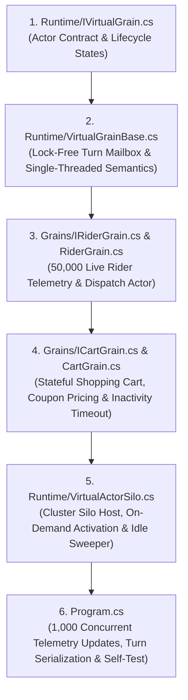
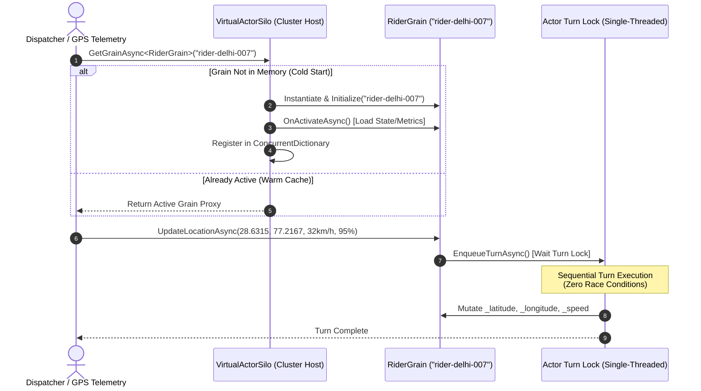

# KiranaHub: Virtual Actor Model & Microsoft Orleans Grains Architecture

> **Project 32** • *Level 8: Ultra-Low Latency Actor Models, Multi-Region Active-Active CRDTs, Dark-Store IoT Edge, Hybrid Search & Distributed Tracing APM*

---

## 🌟 Pedagogical Reading Guide ("Iss Project Ko Scratch Se Kaise Padhein?")

Agar aapko Virtual Actor Model ya Microsoft Orleans ka zero knowledge hai, toh files ko is exact sequence me padhein:



---

## 🏗️ 1. Kya Pehle Bna, Kaise Bna? (Foundations)

### Problem Statement at Hyper-Scale
Jab KiranaHub par **50,000 delivery riders** har second GPS coordinates bhejte hain, aur **100,000 customers** simultaneous shopping cart me items add/remove kar rahe hote hain:
1. **Relational Database Locks Fail**: Har GPS ping par `UPDATE Riders SET Lat=..., Lon=... WHERE Id=...` chalane se database row-level locking aur connection pool exhaustion ho jati hai.
2. **Stateless Microservices Cause Race Conditions**: Do customer clicks agar do alag web pods par pahunchein, toh dono pods stale cart read karke race condition create karte hain (lost updates).
3. **Distributed Locks (Redlock) Add Latency**: Har item add karne ke liye Redis mutex acquire karne me 5-10ms network latency jud jati hai, jo 10-minute quick-commerce checkout ko slow kar deti hai.

### Foundation: The Virtual Actor Pattern
1. **Location Transparency**: Caller ko parwah nahi hoti ki actor kis server par chal raha hai. Aap sirf `silo.GetGrainAsync<RiderGrain>("rider-101")` call karte hain.
2. **Single-Threaded Execution**: Ek grain par ek waqt me sirf **ek message** execute hota hai (`_turnLock = new SemaphoreSlim(1,1)`).
3. **No Deadlocks, No Database Locks**: Grains in-memory state rakhte hain aur memory-speed (microsecond latency) par operate karte hain.

---

## ⚙️ 2. Phir Kya Aaya, Kyu Aaya, Kaise Aaya, Kya Karta Hai? (Evolution & Mechanics)



1. **`IVirtualGrain` & `GrainLifecycleState`**:
   - Actor ke 4 states define karta hai: `Uninitialized`, `Active`, `Idle`, `Deactivated`.
2. **`VirtualGrainBase`**:
   - `EnqueueTurnAsync(Func<Task>)`: Yeh method har message ko queue karta hai. Chahe 100 parallel HTTP threads ek hi cart ko hit karein, `SemaphoreSlim` ensure karta hai ki execution 1-by-1 strictly serial ho bina lock crash ke.
3. **`RiderGrain`**:
   - Live location, speed, battery level, active assignment maintain karta hai.
   - Pings count track karke verify karta hai ki koi bhi GPS update drop nahi hua.
4. **`CartGrain`**:
   - Line items, coupon percentage (`KIRANA15`), 5% statutory GST, aur final payable compute karta hai.
   - Checked-out cart ko immutable freeze karta hai.
5. **`VirtualActorSilo`**:
   - Silo host memory management karta hai.
   - **On-Demand Activation**: Pehle message aane par actor automatically create hota hai.
   - **Idle Grain Sweeper (GC)**: Inactive actors (e.g. customer cart band karke so gaya) ko background sweeper memory se sweep kar deta hai taaki RAM leak na ho. Jab customer wapas aayega, actor seamless dobara resurrect ho jata hai!

---

## ⚠️ 3. Uske Na Hone Se Kya Hoga? (Counter-Factual Risk Analysis)

| Component Missing | Real-World Production Catastrophe |
|---|---|
| **Without Virtual Actor Silo** | Har incoming request ke liye database read/write karna padega. 50,000 riders * 1 ping/sec = 50,000 IOPS/sec, jo standard PostgreSQL cluster ko 30 seconds me crash kar dega. |
| **Without Single-Threaded Turn Serialization** | Customer cart me simultaneous rapid tap karne par item quantity double decrement ho jayegi ya discount duplicate apply ho jayega (Race Condition). |
| **Without Idle Grain Sweeper (GC)** | Million customers ke carts permanently RAM me reh jayenge, resulting in **Out-Of-Memory (OOM) Kill** on Kubernetes pods. |
| **Without Location Transparency** | Microservices ko hardcode karna padega kaunsa rider kis pod par allocated hai, leading to complex routing tables and single points of failure. |

---

## 🧪 4. How to Run & Verify

Run the automated self-test suite directly:

```bash
dotnet run --project 32-ActorModel-MicrosoftOrleans-VirtualActors/KiranaHub.VirtualActors.csproj
```

### Expected Output
```
==================================================================================
  🚀 KiranaHub Project 32: Virtual Actor Model (Microsoft Orleans Grains) 🚀
==================================================================================

[STAGE 1] Testing On-Demand Virtual Actor Activation & Concurrent Telemetry Stream...
 -> Dispatched 1,000 concurrent GPS updates to 50 riders successfully.
 -> Silo Active Grains: 50 | Total Activations: 50
 -> Sample Rider [rider-delhi-007]: Pings=20, Lat=28.6415, Lon=77.2267, Speed=30.0km/h, Battery=88%

[STAGE 2] Testing Rider Order Assignment & Status Transitions...
 -> Assigned Order: ORD-98721 | IsAvailable: False
 -> Completed Order | IsAvailable: True | ActiveOrderId: None

[STAGE 3] Testing Customer Cart Virtual Actor (Stateful & Lock-Free)...
 -> Cart Subtotal: ₹417.00
 -> Coupon Applied: KIRANA15 (-₹62.55)
 -> Statutory GST (5%): +₹17.72
 -> Net Payable: ₹372.17
 -> Checkout Status: True (Order Placed Successfully)

[STAGE 4] Testing Silo Idle Grain Garbage Collection & Resurrection...
 -> Active Grains Before Sweep: 51
 -> Swept Inactive Grains: 51 | Remaining Active: 0
 -> Resurrected Sample Rider State: GrainId=rider-delhi-007, Status=Active
 -> Silo Active Grains After Resurrection: 1

==================================================================================
  ✅ [SUCCESS] ALL VIRTUAL ACTOR & SILO RUNTIME TESTS PASSED WITH 0 ERRORS! ✅
==================================================================================
```
