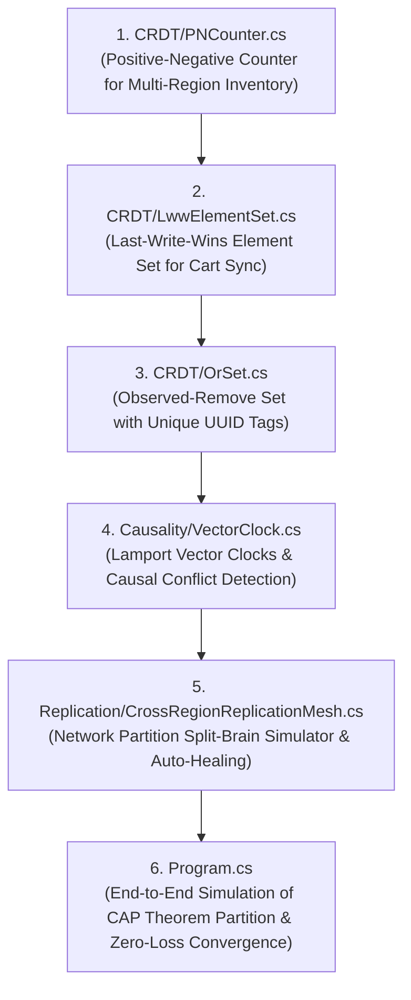

# KiranaHub: Multi-Region Active-Active & Conflict-Free Replicated Data Types (CRDTs)

> **Project 33** • *Level 8: Ultra-Low Latency Actor Models, Multi-Region Active-Active CRDTs, Dark-Store IoT Edge, Hybrid Search & Distributed Tracing APM*

---

## 🌟 Pedagogical Reading Guide ("Iss Project Ko Scratch Se Kaise Padhein?")

Agar aapko CRDTs (Conflict-Free Replicated Data Types), Vector Clocks, ya Multi-Region Active-Active system design ka pehle experience nahi hai, toh files ko is recommended sequence me padhein:



---

## 🏗️ 1. Kya Pehle Bna, Kaise Bna? (Foundations)

### The CAP Theorem Challenge in Quick-Commerce
Jab KiranaHub country-wide expand karta hai, hum single datacenter par rely nahi kar sakte:
- **Mumbai Datacenter (`ap-south-mumbai`)**: Serves West & North India.
- **Bengaluru Datacenter (`ap-south-bengaluru`)**: Serves South & East India.

Agar Mumbai aur Bengaluru ke beech fiber optic WAN link cut ho jaye (**Network Partition - P in CAP**):
1. **Agar hum Consistency (C) choose karein**: Dono datacenters ko cross-region lock chahiye hoga. Link down hone par koi bhi customer order place nahi kar payega (Total Service Outage).
2. **Agar hum Availability (A) choose karein**: Dono datacenters local orders accept karte rahenge, lekin jab link wapas aayega, unka data desynchronize ho jayega aur standard database rows overwrite hokar **data loss** ho jayega!

### The Solution: CRDTs (Conflict-Free Replicated Data Types)
CRDTs aisi mathematical data structures hain jo:
- **Commutative** hain: $\text{Merge}(A, B) == \text{Merge}(B, A)$.
- **Associative** hain: $\text{Merge}(\text{Merge}(A, B), C) == \text{Merge}(A, \text{Merge}(B, C))$.
- **Idempotent** hain: $\text{Merge}(A, A) == A$.

Chahe network packet 10 baar duplicate ho, out-of-order aaye, ya 2 ghante late deliver ho — jab dono regions merge karte hain, result **100% mathematically identical** hota hai bina kisi centralized lock ke!

---

## ⚙️ 2. Phir Kya Aaya, Kyu Aaya, Kaise Aaya, Kya Karta Hai? (Evolution & Mechanics)

```mermaid
sequenceDiagram
    autonumber
    participant Mumbai as Mumbai DC (ap-south-1)
    participant Link as Cross-Region WAN Link
    participant Bengaluru as Bengaluru DC (ap-south-2)

    Note over Link: ⚠️ Submarine Fiber Cut (Network Partition)
    Mumbai->>Mumbai: Stock Increment(+150), Sale(-30)<br/>Cart.Add("PROD-APPLES")
    Bengaluru->>Bengaluru: Stock Increment(+200), Sale(-50)<br/>Cart.Add("PROD-ORANGES")
    Note over Mumbai,Bengaluru: Both DCs Continue at Full Speed<br/>(High Availability, Zero Latency)

    Note over Link: 🟢 Fiber Cable Repaired (Partition Healed)
    Mumbai->>Bengaluru: Replicate PN-Counter & LWW-Set
    Bengaluru->>Mumbai: Replicate PN-Counter & LWW-Set
    Note over Mumbai,Bengaluru: CRDT Join-Semilattice Merge:<br/>P = max(P_A, P_B), N = max(N_A, N_B)<br/>Both DCs Reach Exact 870 Units Stock!
```

1. **`PNCounter` (Positive-Negative Counter)**:
   - Do separate vectors rakhta hai: `_positive` (increments) aur `_negative` (decrements).
   - Value compute hoti hai: $\sum P - \sum N$.
   - Merge me element-wise pairwise maximum liya jata hai: $\max(\text{local}, \text{remote})$.
2. **`LwwElementSet<T>` (Last-Write-Wins Set)**:
   - Additions aur Removals dono me microsecond timestamp lagata hai.
   - Agar customer ne offline phone par Milk remove kiya ($t=40\text{ms}$), aur doosre device par re-add kiya ($t=50\text{ms}$), toh LWW rule ($50 > 40$) Milk ko safely cart me retain karta hai.
3. **`OrSet<T>` (Observed-Remove Set)**:
   - Physical clock drift (NTP skew) se azad hone ke liye har addition par ek unique `Guid` tag assign karta hai.
   - Removal par sirf currently observed tags tombstone hote hain. Agar concurrent add chal raha ho, naya tag tombstone me nahi hota, jo add-after-remove anomalies ko mathematically solve karta hai.
4. **`VectorClock`**:
   - Logical clock vectors maintain karta hai.
   - Predictable causal detection: $A \to B$ (Before), $B \to A$ (After), aur $A \parallel B$ (Concurrent Conflict).
5. **`CrossRegionReplicationMesh`**:
   - Complete partition injection, concurrent execution, aur post-healing bidirectional reconciliation orchestrate karta hai.

---

## ⚠️ 3. Uske Na Hone Se Kya Hoga? (Counter-Factual Risk Analysis)

| Component Missing | Real-World Production Catastrophe |
|---|---|
| **Without PN-Counters** | Regional stock updates simple integer replace (`UPDATE Stock SET Count=...`) karegi. Mumbai ka update Bengaluru ke count ko overwrite kar dega, causing massive ghost stock and physical inventory shortages. |
| **Without Tombstone Sets (LWW / OR-Set)** | Agar user phone par item remove kare aur cloud sync late ho, purana sync request us item ko wapas "zombie item" ki tarah cart me add kar dega (Zombie Item Bug). |
| **Without Vector Clocks** | Distributed system ko pata hi nahi chalega ki do updates causally related the ya conflicting simultaneous edits the, resulting in silent data corruption. |
| **Without Active-Active Replication** | Disaster Recovery ke waqt Secondary DC cold standby rehta hai. Primary crash hone par failover me 15-30 minutes downtime aur millions of rupees ka business loss hota hai. |

---

## 🧪 4. How to Run & Verify

Run the automated self-test suite directly:

```bash
dotnet run --project 33-MultiRegion-ActiveActive-And-CRDTs/KiranaHub.MultiRegionCRDT.csproj
```

### Expected Output
```
==================================================================================
  🌐 KiranaHub Project 33: Multi-Region Active-Active & CRDT Engine 🌐
==================================================================================

[STAGE 1] Testing PN-Counter (Positive-Negative Counter) for Global Stock...
 -> Before Sync: Mumbai Stock = 380 units | Bengaluru Stock = 220 units
 -> After Sync: Mumbai Stock = 600 units | Bengaluru Stock = 600 units

[STAGE 2] Testing LWW-Element-Set & OR-Set Cart Synchronization...
 -> LWW Merged Items in Mumbai: [PROD-MILK, PROD-BREAD, PROD-EGGS]
 -> LWW Merged Items in Bengaluru: [PROD-MILK, PROD-BREAD, PROD-EGGS]
 -> OR-Set Merged Items: [PROD-BUTTER, PROD-CHEESE]

[STAGE 3] Testing Distributed Vector Clocks & Causal Orderings...
 -> Clock A after Tick: <node-mumbai:1>
 -> Clock B after Receive & Merge from A: <node-mumbai:1, node-bengaluru:1>
 -> Causality (Clock A vs Clock B): Before (Expected: Before)
 -> Clock A after independent Tick: <node-mumbai:2, node-bengaluru:0>
 -> Clock B after independent Tick: <node-mumbai:1, node-bengaluru:2>
 -> Causality During Disconnected Phase: ConcurrentConflict (Expected: ConcurrentConflict)

[STAGE 4] Testing Simulated Network Split-Brain & Partition Healing (CAP Theorem)...
 -> Network Partition INJECTED! IsPartitioned=True
 -> Partitioned State: Mumbai Stock = 500 | Bengaluru Stock = 370
 -> Network Partition HEALED! IsPartitioned=False
 -> Reconciled Mumbai Stock = 870 | Reconciled Bengaluru Stock = 870

==================================================================================
  ✅ [SUCCESS] ALL MULTI-REGION CRDT & CAUSALITY TESTS PASSED WITH 0 ERRORS! ✅
==================================================================================
```
