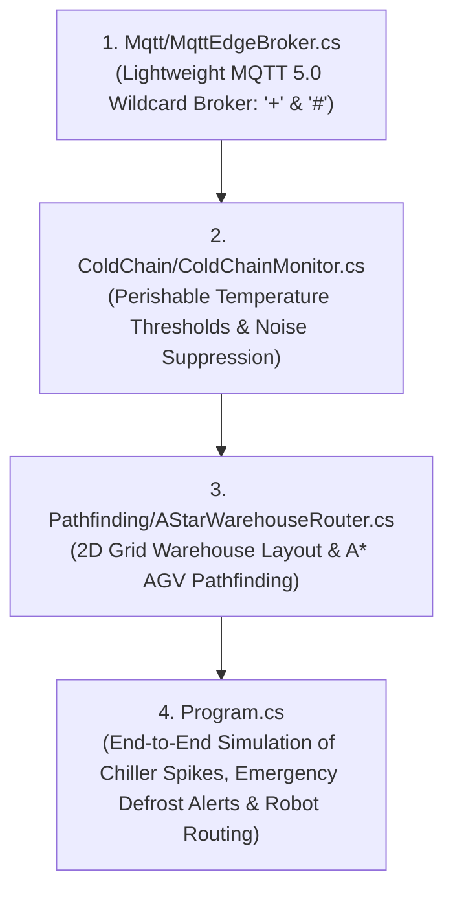
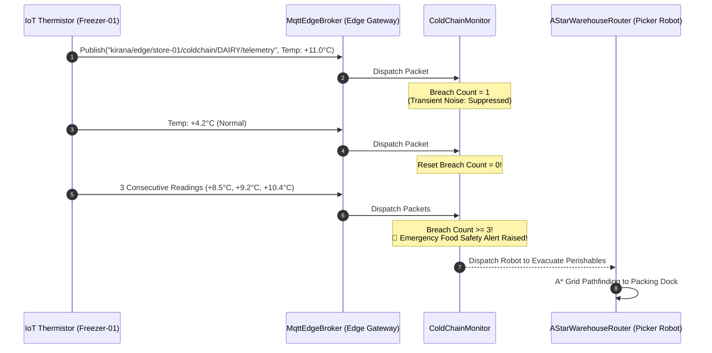

# KiranaHub: Dark-Store IoT Edge & Warehouse AGV Automation

> **Project 34** • *Level 8: Ultra-Low Latency Actor Models, Multi-Region Active-Active CRDTs, Dark-Store IoT Edge, Hybrid Search & Distributed Tracing APM*

---

## 🌟 Pedagogical Reading Guide ("Iss Project Ko Scratch Se Kaise Padhein?")

Agar aapko IoT Edge protocols (MQTT), Cold-Chain telemetry monitoring, ya 2D A* Pathfinding robotics ka pehle knowledge nahi hai, toh files ko is exact sequence me padhein:



---

## 🏗️ 1. Kya Pehle Bna, Kaise Bna? (Foundations)

### The Dark-Store Operational Challenge
KiranaHub ke 10-minute grocery delivery model me dark-stores fully automated micro-warehouses hote hain:
1. **Perishable Grocery Spoilage**: Doodh, paneer, dahi ($+2^\circ\text{C}$ to $+6^\circ\text{C}$), aur ice cream ($\le -18^\circ\text{C}$) agar thodi der ke liye bhi warm ho jayein, toh bacterial contamination aur food poisoning ka severe risk hota hai.
2. **Sensor Glitches & Electrical Noise**: IoT thermistors aur digital probes aksar electrical voltage fluctuation ki wajah se 1 reading me fake spike ($+11^\circ\text{C}$) throw karte hain. Agar har spike par technician ko call kiya jaye, toh daily thousands of false alarms aayenge.
3. **Picking Bottleneck (The 10-Minute Clock)**: Order pack karne ke liye warehouse picker robot (AGV) ko multiple shelves se items utha kar packing counter tak laana hota hai. Manually zigzag karne se 4-5 minute waste ho jate hain.

### Foundation: Edge Computing & A* Robotics
- **MQTT 5.0 at the Edge**: Cloud par har second lakho sensor packets bhejne ke bajaye dark-store ke local Raspberry Pi / edge gateway par broker chalta hai jo local decisions milliseconds me leta hai.
- **Sliding-Window Noise Filtering**: Single transient spike ko ignore karta hai, lekin continuous 3 consecutive breached readings aane par turant compressor failure alert raise karta hai.
- **A* (A-Star) Pathfinding**: Grid floor layout me storage shelves `#` ke around shortest collision-free path calculate karta hai using Manhattan distance heuristic.

---

## ⚙️ 2. Phir Kya Aaya, Kyu Aaya, Kaise Aaya, Kya Karta Hai? (Evolution & Mechanics)



1. **`MqttEdgeBroker`**:
   - Lightweight in-memory broker supporting MQTT 5.0 wildcard patterns.
   - `+` single-level wildcard (e.g. `kirana/edge/+/telemetry`).
   - `#` multi-level trailing wildcard (e.g. `kirana/edge/store-01/#`).
2. **`ColdChainMonitor`**:
   - Zone rules:
     - `DAIRY`, `CHILLED`, `VEGETABLES`: $[+2.0^\circ\text{C}, +6.0^\circ\text{C}]$.
     - `DEEP_FREEZE`, `ICE_CREAM`, `MEAT`: $[\le -18.0^\circ\text{C}]$.
   - Consecutive breach tracking suppresses transient electrical noise, preventing false alarms.
3. **`AStarWarehouseRouter`**:
   - Cost function: $f(n) = g(n) + h(n)$.
   - $g(n)$: Distance from start docking station to current cell.
   - $h(n) = |x_1 - x_2| + |y_1 - y_2|$: Admissible Manhattan distance to packing counter.
   - Explores grid via `PriorityQueue<GridPoint, int>`, avoids obstacles, and reconstructs the optimal path list.
   - `RenderAscii()` prints the entire visual warehouse floor with `*` waypoints.

---

## ⚠️ 3. Uske Na Hone Se Kya Hoga? (Counter-Factual Risk Analysis)

| Component Missing | Real-World Production Catastrophe |
|---|---|
| **Without MQTT Edge Broker** | Har dark-store sensor ko HTTP request se cloud REST API hit karna padega. Network latency + SSL handshake overhead 500ms legi, aur internet outage ke dauran local warehouse automation band ho jayegi. |
| **Without Noise Filtering** | Electrical spikes roz hazaron false maintenance tickets raise karengi, leading to alert fatigue jahan real compressor failure ko technicians ignore kar denge. |
| **Without A* AGV Pathfinding** | Picker robots simple line-of-sight chalenge aur shelf racks se collide ho jayenge ya aisles me dead-end me phas jayenge, causing delivery delays past 10 minutes. |

---

## 🧪 4. How to Run & Verify

Run the automated self-test suite directly:

```bash
dotnet run --project 34-IoT-Edge-And-ColdChain-WarehouseAutomation/KiranaHub.WarehouseIoT.csproj
```

### Expected Output
```
==================================================================================
  🏭 KiranaHub Project 34: Dark-Store IoT Edge & Warehouse Automation 🏭
==================================================================================

[STAGE 1] Testing MQTT 5.0 Broker Wildcard Topic Matching...
 -> Wildcard Messages Received: 2 (Expected: 2)

[STAGE 2] Testing Cold-Chain Telemetry, Transient Noise Filtering & Alerting...
 -> Reading 1 (Milk +4.0°C): Normal, no alert.
 -> Reading 2 (Milk +11.0°C Spike): Transient noise, suppressed.
 -> Reading 3 (Milk +4.2°C): Back to normal, anomaly counter reset.
 -> Simulating sustained chiller breakdown (3 consecutive breaches)...
 -> Active Cold-Chain Alerts: 2
    ⚠️ [Warning] Store=store-delhi-01, Zone=DAIRY, Temp=10.4°C (Safe: 2°C to 6°C), Breaches=3
    ⚠️ [Warning] Store=store-delhi-01, Zone=ICE_CREAM, Temp=-10.0°C (Safe: -30°C to -18°C), Breaches=3

[STAGE 3] Testing A* AGV Pathfinding on Dark-Store 2D Floor Map...
 -> Shortest Path Computed: 19 steps | Traversal Distance: 18 meters
 -> Waypoints: (0,0) -> (1,0) -> (2,0) -> (2,1) -> (2,2) ... -> (11,7)

[WAREHOUSE FLOOR MAP VISUALIZATION]
Legend: S = Start Dock | G = Goal Counter | * = AGV Path | # = Shelf Rack | . = Walkable Aisle
S * * . . . . . . . . . 
. . * # . . . # . . . . 
. . * # . . . # . . . . 
. . * # . . . * * * . . 
. . * # . . . # . * . . 
. . * # . . . # . * . . 
. . * * * * * * . * . . 
. . . . . . . . . * * G 

==================================================================================
  ✅ [SUCCESS] ALL IOT EDGE, COLD-CHAIN & WAREHOUSE AGV TESTS PASSED! ✅
==================================================================================
```
