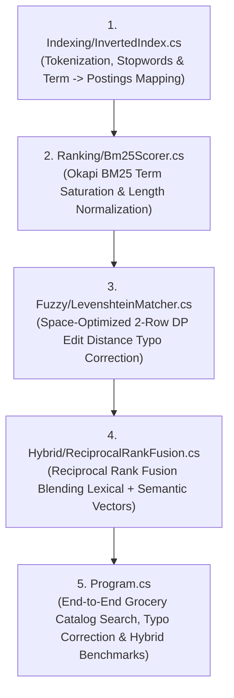
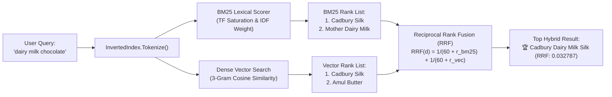

# KiranaHub: High-Performance Hybrid Search Engine (BM25 + Vectors + RRF)

> **Project 35** • *Level 8: Ultra-Low Latency Actor Models, Multi-Region Active-Active CRDTs, Dark-Store IoT Edge, Hybrid Search & Distributed Tracing APM*

---

## 🌟 Pedagogical Reading Guide ("Iss Project Ko Scratch Se Kaise Padhein?")

Agar aapko Information Retrieval (IR), Search Engines, BM25, ya Vector Fusion ka pehle experience nahi hai, toh files ko is exact sequence me padhein:



---

## 🏗️ 1. Kya Pehle Bna, Kaise Bna? (Foundations)

### The E-Commerce Search Dilemma
KiranaHub ke 10-minute grocery delivery app me search bar sabse critical conversion funnel hai:
1. **SQL `LIKE '%butter%'` Fails**: Relational database par wildcard `LIKE` search table scan karti hai, $O(N)$ slow hoti hai, aur koi relevance ranking provide nahi karti (Amul Butter aur Peanut Butter me differentiate nahi kar pati).
2. **Pure Lexical (Keyword) Search Fails on Misspellings**: Agar user "magi masla" type kare, toh exact keyword search 0 results return karegi, causing customer drop-off.
3. **Pure Vector (Embedding) Search Fails on Exact Part Numbers / Brand Names**: Semantic vectors concept samajhte hain ("breakfast" -> "oats"), lekin exact product skus aur brand names par keyword search se peeche reh jate hain.

### The Foundation: Hybrid Search Architecture
- **Inverted Index**: Words se documents ka reverse map banata hai ($O(1)$ lookup).
- **Okapi BM25 Ranking**: TF-IDF ka modern successor jo term frequency saturation ($k_1$) aur document length penalty ($b$) balance karta hai.
- **Levenshtein Dynamic Programming**: Misspelled words ko closest vocabulary word me auto-correct karta hai.
- **Reciprocal Rank Fusion (RRF)**:
  $$RRF(d) = \sum_{m \in \{\text{BM25}, \text{Vector}\}} \frac{1}{60 + \text{rank}_m(d)}$$
  Sparse keyword precision aur dense vector recall ko mathematically merge karke world-class search experience deliver karta hai!

---

## ⚙️ 2. Phir Kya Aaya, Kyu Aaya, Kaise Aaya, Kya Karta Hai? (Evolution & Mechanics)



1. **`InvertedIndex`**:
   - `Tokenize(text)`: Lowercases, strips punctuation, and filters non-discriminative stop-words ("the", "and", "is", "of").
   - Maintains `_index`: `term -> List<PostingEntry(docId, termFrequency)>`.
   - Computes corpus statistics: Total documents $N$ and average document length $\text{avgdl}$.
2. **`Bm25Scorer`**:
   - Standard parameters: $k_1 = 1.2$ (controls term saturation) and $b = 0.75$ (length normalization).
   - $\text{IDF}(t) = \ln\left(1 + \frac{N - n(t) + 0.5}{n(t) + 0.5}\right)$.
   - Prevents keyword stuffing: Word 10 times aane par score 10x nahi hota balki asymptote approach karta hai.
3. **`LevenshteinMatcher`**:
   - Computes minimum insertions, deletions, substitutions using an $O(N)$ space-optimized 2-row DP array (`prevRow` and `currRow`).
   - `FindClosestMatch("magi", vocab)` finds `"maggi"` with edit distance = 1.
4. **`ReciprocalRankFusion`**:
   - Character 3-gram embeddings generate karke Cosine Similarity nikalta hai.
   - Blends BM25 and Vector rankings with TREC benchmark constant $k = 60$.
   - Jis document ki dono ranking lists me high position hoti hai, wo naturally top-1 ban jata hai!

---

## ⚠️ 3. Uske Na Hone Se Kya Hoga? (Counter-Factual Risk Analysis)

| Component Missing | Real-World Production Catastrophe |
|---|---|
| **Without BM25 Length Normalization** | Lambe descriptions wale spam products hamesha top par rank honge kyunki unme zyada words hote hain, pushing relevant 10-minute items to the bottom. |
| **Without Levenshtein Typo Tolerance** | Mobile par fast typing karne wale 30% users "Zero Results Found" dekh kar app uninstall kar denge (Revenue Loss). |
| **Without Reciprocal Rank Fusion (RRF)** | Pure keyword search conceptual queries miss karega ("healthy diet food"), jabki pure vector search exact brand queries misplace karega. RRF ke bina search experience frustrating rehta hai. |
| **Without Stopword Filtering** | "Of", "The", "In" jaise common words index size ko 3x expand kar denge aur irrelevant documents ko match karwa denge. |

---

## 🧪 4. How to Run & Verify

Run the automated self-test suite directly:

```bash
dotnet run --project 35-HighPerformance-Hybrid-SearchEngine/KiranaHub.HybridSearch.csproj
```

### Expected Output
```
==================================================================================
  🔍 KiranaHub Project 35: High-Performance Hybrid Search Engine 🔍
==================================================================================

[STAGE 1] Seeding 10 Grocery Products into Inverted Index...
 -> Indexed Total Documents: 10
 -> Average Document Length: 10.4 tokens
 -> Inverted Index Vocabulary Size: 67 unique terms

[STAGE 2] Testing Okapi BM25 Lexical Keyword Search ('amul butter')...
 -> Query: 'amul butter' returned 2 matches:
    ⭐ [2.4491] Amul Pasteurised Butter 500g (Category: Dairy)
    ⭐ [0.4907] Harvest Gold 100% Brown Bread 400g (Category: Bakery)

[STAGE 3] Testing Levenshtein Dynamic Programming Typo Correction...
 -> Input Token: 'magi' -> Auto-Corrected: 'maggi' (Edit Distance = 1)
 -> Input Token: 'masla' -> Auto-Corrected: 'masala' (Edit Distance = 1)
 -> Final Corrected Query: 'maggi masala'
 -> Fuzzy Auto-Corrected Top Match: Maggi 2-Minute Masala Noodles 70g

[STAGE 4] Testing Reciprocal Rank Fusion (RRF) Hybrid Search (BM25 + Dense Vectors)...
 -> Query: 'dairy milk chocolate sweet' -> Top Hybrid Ranked Results:
    🏆 [RRF Score: 0.032787] Cadbury Dairy Milk Silk Chocolate Bar 150g (BM25 Rank: 1, Vector Rank: 1)
    🏆 [RRF Score: 0.031505] Mother Dairy Toned Milk 1L (BM25 Rank: 2, Vector Rank: 4)
    🏆 [RRF Score: 0.031258] Amul Pasteurised Butter 500g (BM25 Rank: 3, Vector Rank: 3)

==================================================================================
  ✅ [SUCCESS] ALL BM25, LEVENSHTEIN FUZZY & RRF HYBRID SEARCH TESTS PASSED! ✅
==================================================================================
```
