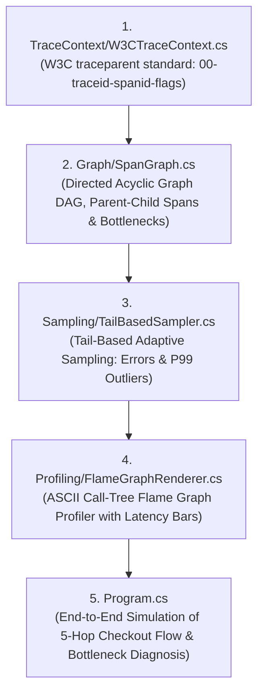
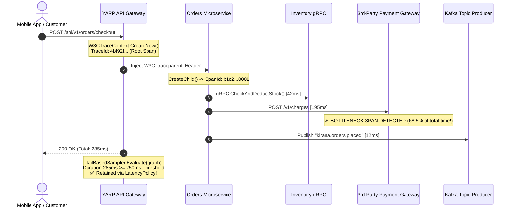

# KiranaHub: Distributed Tracing, W3C TraceContext & APM Engine

> **Project 36** • *Level 8: Ultra-Low Latency Actor Models, Multi-Region Active-Active CRDTs, Dark-Store IoT Edge, Hybrid Search & Distributed Tracing APM*

---

## 🌟 Pedagogical Reading Guide ("Iss Project Ko Scratch Se Kaise Padhein?")

Agar aapko Distributed Tracing (OpenTelemetry), W3C TraceContext, ya Tail-Based Sampling ka pehle experience nahi hai, toh files ko is exact sequence me padhein:



---

## 🏗️ 1. Kya Pehle Bna, Kaise Bna? (Foundations)

### The Microservices Observability Blindspot
Jab KiranaHub monolithic architecture se microservices me convert hua (API Gateway -> Orders Service -> Inventory gRPC -> Payment Gateway -> Kafka):
1. **Isolated Logs Tell Half the Story**: Har service apne local file me log likhti hai. Agar customer ka checkout 3.5 seconds tak atka raha, toh 5 alag microservices ke logs me manually timestamp match karna impossible ho jata hai.
2. **Cascading Failure Mystery**: Payment Gateway slow hua ya Inventory gRPC pod par network congestion tha? Bina distributed context ke pata lagana impossible hai.
3. **Head-Based Sampling Wastes Data**: Agar hum trace start hone par 1% random sample karein (**Head-Based Sampling**), toh ho sakta hai ki wo 1 customer jiska payment fail hua ho wo 99% dropped traces me chala jaye! Result: Production crash hua lekin tracing system me koi trace record nahi hua!

### Foundation: W3C Distributed Tracing & Tail-Based Sampling
- **W3C `traceparent` Standard**: Ek universal 55-character header jo HTTP, gRPC aur Kafka boundaries par inject aur extract hota hai:
  `traceparent: 00-4bf92f3577b34da6a3ce929d0e0e4736-00f067aa0ba902b7-01`
- **DAG Span Graph**: Trace ko ek tree ki tarah construct karta hai jisme har microservice ka span apne caller span ko point karta hai (`ParentSpanId`).
- **Tail-Based Sampling**: Trace complete hone ke baad decision leta hai:
  - Error mila? $\to$ **100% Retain!**
  - Latency $> 250\text{ms}$ (P99 Outlier)? $\to$ **100% Retain!**
  - Normal fast trace? $\to$ **Sample 1-5%** (Saves 95%+ of expensive cloud APM storage bills!).

---

## ⚙️ 2. Phir Kya Aaya, Kyu Aaya, Kaise Aaya, Kya Karta Hai? (Evolution & Mechanics)



1. **`W3CTraceContext`**:
   - `ToHeaderString()` generates `00-{traceId:32hex}-{spanId:16hex}-{flags:2hex}`.
   - `Parse(headerValue)` extracts trace coordinates with strict hex and zero-value validations.
   - `CreateChild()` allocates a fresh 64-bit random SpanId while preserving the immutable 128-bit TraceId.
2. **`SpanGraph`**:
   - Stores spans in `_spans` dictionary.
   - Identifies root span (`ParentSpanId == null`).
   - Recursively queries children via `GetChildren(parentId)`.
   - `FindBottleneckSpan()` identifies the slowest operation across the entire distributed network graph.
3. **`TailBasedSampler`**:
   - `Evaluate(graph)` runs multi-tier retention policies:
     - Policy 1: `HasErrors == true` $\to$ Retain (ErrorPolicy).
     - Policy 2: `TotalDurationMs >= SlowThresholdMs` $\to$ Retain (LatencyPolicy).
     - Policy 3: Fast & Healthy $\to$ Discard (DropPolicy) or 5% Baseline.
4. **`FlameGraphRenderer`**:
   - Prints an ASCII tree with `└── ` and `├── ` connectors.
   - Draws visual latency percentage bars like `[███████░░░] 68.6%`.
   - Flags `[⚠️ BOTTLENECK]` on the slowest span and `[🚨 ERROR]` on failed spans.

---

## ⚠️ 3. Uske Na Hone Se Kya Hoga? (Counter-Factual Risk Analysis)

| Component Missing | Real-World Production Catastrophe |
|---|---|
| **Without W3C Trace Context** | Har team alag proprietary correlation headers (`X-Request-Id`, `X-B3-TraceId`, `Custom-Tracking-Id`) use karegi, jo 3rd-party gateways aur multi-cloud boundaries par break ho jayenge. |
| **Without Tail-Based Sampling** | Agar Datadog ya New Relic par 100% traces ingest karein, toh bill **millions of dollars** aayega. Agar 1% head-based sampling karein, toh customer refund failures ke 99% traces gayab ho jayenge. |
| **Without Bottleneck Span Detection** | Devs database query ko optimize karte rahenge jabki asli issue 3rd-party SMS gateway ya payment API me 2-second timeout tha (Wasted engineering effort). |
| **Without Span Kind Classification** | Traces me difference pata nahi chalega ki kaunsa network hop external 3rd-party dependency tha aur kaunsa internal database write tha. |

---

## 🧪 4. How to Run & Verify

Run the automated self-test suite directly:

```bash
dotnet run --project 36-DistributedTracing-APM-And-OpenTelemetry/KiranaHub.TracingApm.csproj
```

### Expected Output
```
==================================================================================
  📈 KiranaHub Project 36: Distributed Tracing & APM Engine 📈
==================================================================================

[STAGE 1] Testing W3C Traceparent Header Generation & Parse Roundtrip...
 -> Generated Root Context: 00-7f2a1b3c4d5e6f7a8b9c0d1e2f3a4b5c-8a7b6c5d4e3f2a1b-01
 -> Parsed Context: TraceId=7f2a1b3c4d5e6f7a8b9c0d1e2f3a4b5c, SpanId=8a7b6c5d4e3f2a1b, Flags=01
 -> Created Downstream Child Context: 00-7f2a1b3c4d5e6f7a8b9c0d1e2f3a4b5c-c1d2e3f4a5b6c7d8-01

[STAGE 2] Assembling 5-Hop Distributed Checkout Trace DAG...
 -> Assembled Trace Graph: 5 Spans | Total Latency: 285.50ms
 -> Detected Bottleneck Span: 'PaymentGateway.ProcessCardCharge' taking 195.80ms

[STAGE 3] Rendering ASCII Call-Tree Flame Graph Profiler...
==================================================================================
  🔥 DISTRIBUTED TRACE FLAME GRAPH | TraceId: 7f2a1b3c4d5e6f7a8b9c0d1e2f3a4b5c
  Total Duration: 285.50ms | Total Spans: 5 | Has Errors: False
==================================================================================
└── YarpGateway.POST /api/v1/orders/checkout (Server) [285.50ms] [██████████] 100.0%
       ↳ attrs: http.route=/api/v1/orders/checkout, http.status_code=200
    ├── OrderService.ValidateOrderAndPricing (Internal) [18.20ms] [█░░░░░░░░░]   6.4%
    │      ↳ attrs: order.items_count=4, order.subtotal=417.00
    ├── InventoryGrpcService.CheckAndDeductStock (Client) [42.10ms] [█░░░░░░░░░]  14.7%
    │      ↳ attrs: rpc.system=grpc, rpc.method=DeductStock
    ├── PaymentGateway.ProcessCardCharge (Client) [195.80ms] [███████░░░]  68.6% [⚠️ BOTTLENECK]
    │      ↳ attrs: payment.provider=Razorpay, payment.method=UPI
    └── KafkaTopicProducer.PublishOrderPlacedEvent (Producer) [12.40ms] [░░░░░░░░░░]   4.3%
           ↳ attrs: messaging.system=kafka, messaging.destination=kirana.orders.placed

[STAGE 4] Testing Tail-Based Sampling (Error Retain, Latency Outlier, Normal Drop)...
 -> Test A (Slow Trace 285.5ms): IsSampled=True | Reason=Retained [Rule: LatencyOutlier] - Duration 285.5ms >= 250ms threshold
 -> Test B (Fast Healthy Trace 35.0ms): IsSampled=False | Reason=Discarded [Rule: HealthyDrop] - Fast duration (35.0ms) & no errors
 -> Test C (Failed Error Trace): IsSampled=True | Reason=Retained [Rule: ErrorDetected] - Trace contains failed span

==================================================================================
  ✅ [SUCCESS] ALL DISTRIBUTED TRACING & APM TESTS PASSED WITH 0 ERRORS! ✅
==================================================================================
```
