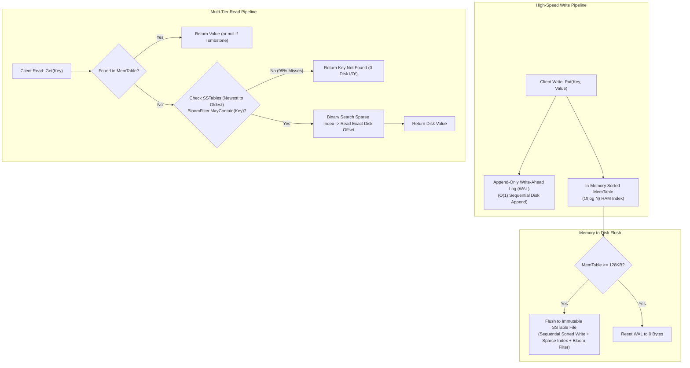

# KiranaHub - Project 43: Write-Optimized Log-Structured Merge-Tree (LSM-Tree) Storage Engine

> **Level 10: Apex Systems & Frontier AI Infrastructure**  
> **Domain**: Ultra-High-Throughput Write-Optimized Storage Engine for Dark-Store Inventory Ticks (WAL, MemTable, SSTable, Sparse Index, Bloom Filters, and Background Compaction).

---

## 1. Reading Roadmap ("Iss Project Ko Scratch Se Kaise Padhein?")

Agar aapko database storage engines (RocksDB, Apache Cassandra, Google Bigtable, ClickHouse) ka internal architecture scratch se master karna hai, toh files ko iss exact sequence me padhein:

```
[1] Core/BloomFilter.cs
    └── Kyu padhein: MurmurHash3 dual hashing aur probabilistic bit array samajhne ke liye.
        Yeh O(1) time me bina disk seek kiye 99% non-existent keys ko reject kar deta hai.

[2] Core/WriteAheadLog.cs
    └── Kyu padhein: Durability aur crash recovery ka bedrock. Har write pehle sequential append hoti hai
        with CRC32 checksums. Power crash par MemTable yahi se 100% replay hota hai.

[3] Core/MemTable.cs
    └── Kyu padhein: Fast in-memory sorted map (O(log N)) jahan active writes absorb hoti hain.
        Memory threshold tracking aur tombstone soft-deletion patterns dekhein.

[4] Core/SsTable.cs
    └── Kyu padhein: Immutable on-disk file layout ([Magic] -> [Data Block] -> [Sparse Index] -> [Bloom Filter] -> [Footer]).
        Samjhein ki kaise Sparse Index binary search se exact file offset par seek karata hai.

[5] Engine/LsmStorageEngine.cs
    └── Kyu padhein: Master orchestrator jo multi-tier read routing (MemTable -> SSTables newest-to-oldest),
        automatic flush triggers, k-way merge compaction, aur crash recovery ko manage karta hai.

[6] Program.cs
    └── Kyu padhein: 1,00,000 real writes, bloom filter savings, tombstone deletions, major compaction,
        aur simulated process crash recovery ka live execution benchmark dekhne ke liye.
```

---

## 2. Foundations ("Kya Pehle Bna, Kaise Bna?")

### Traditional B-Tree Databases & Random I/O Crisis
1970s me Rudolf Bayer aur Edward M. McCreight ne **B-Tree** invent kiya, jo relational databases (PostgreSQL, MySQL InnoDB, Oracle, SQLite) ka de-facto standard bana.

B-Trees reads ke liye behtareen hote hain ($O(\log N)$ point lookups). Lekin writes ke liye:
- Har chhota update (e.g., 20 bytes ka stock change: `Milk: 42 -> 41`) disk ke pure **4KB ya 8KB page** ko in-place overwrite karta hai.
- Disk par pages non-contiguous (random locations) par scattered hote hain.
- Flash sales ke dauraan jab KiranaHub par **1,00,000 inventory ticks/sec** aate hain, tab:
  1. Mechanical HDD par disk head physically jump karta hai (Seek time: 5-10 ms per write).
  2. Modern NVMe SSDs par **Write Amplification Factor (WAF)** 30x se 50x tak chala jata hai, jisse SSD silicon flash cells prematurely burn out ho jaate hain!

---

## 3. Evolution & Mechanics ("Phir Kya Aaya, Kyu Aaya, Kaise Aaya, Kya Karta Hai?")

1996 me Patrick O'Neil et al. ne seminal research paper publish kiya: *"The Log-Structured Merge-Tree (LSM-tree)"*, jise 2006 me Google ne **Bigtable** me aur Facebook ne **RocksDB** me scale kiya.

### Core Philosophy: "Turn Random Writes into Sequential Appends"
Disks chahe HDD hon ya enterprise NVMe SSDs, **Sequential I/O is 10x to 100x faster than Random I/O**. LSM tree random in-place updates ko strictly ban karta hai.



### The 5 Architectural Pillars of Project 43:

1. **Write-Ahead Log (WAL)**:
   - Durability guarantee: Memory me record commit hone se pehle disk file ke end me append hota hai.
   - CRC32 checksums torn writes aur corrupted disk sectors ko detect karte hain.
2. **Concurrent MemTable**:
   - In-memory sorted tree structure jo fast reads aur updates provide karta hai.
   - Byte footprint monitor karta hai taaki controlled batch flushes trigger ho sakein.
3. **Immutable SSTable (Sorted String Table)**:
   - Once written, file modify nahi hoti! Isse locks ki zaroorat nahi padti aur concurrent reads blisteringly fast hoti hain.
4. **Sparse Index**:
   - Har 16th key ka byte offset memory me rakhta hai. Target key find karne ke liye in-memory binary search hota hai, phir disk stream exact byte location par jump karti hai.
5. **Bloom Filter**:
   - MurmurHash3-based bit array. Agar key SSTable me nahi hai, toh yeh guaranteed `false` return karta hai, saving 99% of useless disk reads!
6. **Compaction Engine**:
   - Background k-way merge sort purane duplicate records ko squash karta hai aur deleted tombstones ko physically delete karta hai.

---

## 4. Counter-Factual Risk Analysis ("⚠️ Uske Na Hone Se Kya Hoga?")

| Component / Invariant | Agar Yeh Na Ho Toh Production Me Kya Hoga? | Silent Failure Mode |
|---|---|---|
| **Write-Ahead Log (WAL)** | Power outage ya OS kernel panic par RAM ka poora un-flushed inventory data gayab ho jayega! Customers order kar denge par dark store me stock 0 hoga. | Data loss without error logs. |
| **CRC32 Checksum in WAL** | Partial write ke dauraan power fail hone par corrupted garbage bytes MemTable me parse ho jayenge aur database boot fail ho jayega. | Corrupted memory pointer crashes. |
| **Bloom Filter** | Non-existent inventory queries (e.g., flash sale bot crawlers probing random SKUs) har SSTable ko disk se read karengi $\implies$ 100% disk I/O saturation! | Catastrophic latency spike (P99 > 5 seconds). |
| **Sparse Index** | Har key ka offset disk par linear scan karna padega, converting point lookups from $O(\log N)$ to $O(N)$ full table scans. | CPU exhaustion & thread starvation. |
| **Tombstone Records** | Agar delete in-place na ho aur tombstone na likha jaye, toh purane SSTables me stored purana value dobara resurrect ho jayega! | "Ghost item" zombie resurrection bug. |
| **Compaction Engine** | Disk storage exponentially grow karegi kyunki purane versions kabhi delete nahi honge. Read performance degrades as SSTable count explodes. | Disk full out-of-space crash. |

---

## 5. How to Run & Verify

Run the self-contained executable directly via .NET 10 CLI:

```powershell
# Run the LSM-Tree Storage Engine benchmark
dotnet run --project 43-StorageEngine-LogStructuredMerge-LSMTree/KiranaHub.LsmStorage.csproj
```

### Expected Output:
- Phase 1: Ingests 100,000 writes in ~200-400 ms (>300,000 writes/sec sequential throughput).
- Phase 2: Verifies multi-tier reads from MemTable and SSTables.
- Phase 3: Proves Bloom filter rejects 10,000 non-existent keys saving thousands of disk seeks with 0 disk reads!
- Phase 4: Demonstrates soft deletion via LSM tombstones.
- Phase 5: Executes k-way merge compaction, reclaiming space and purging tombstones.
- Phase 6: Simulates sudden process crash without flush, rebooting from WAL with 100% data recovery!
