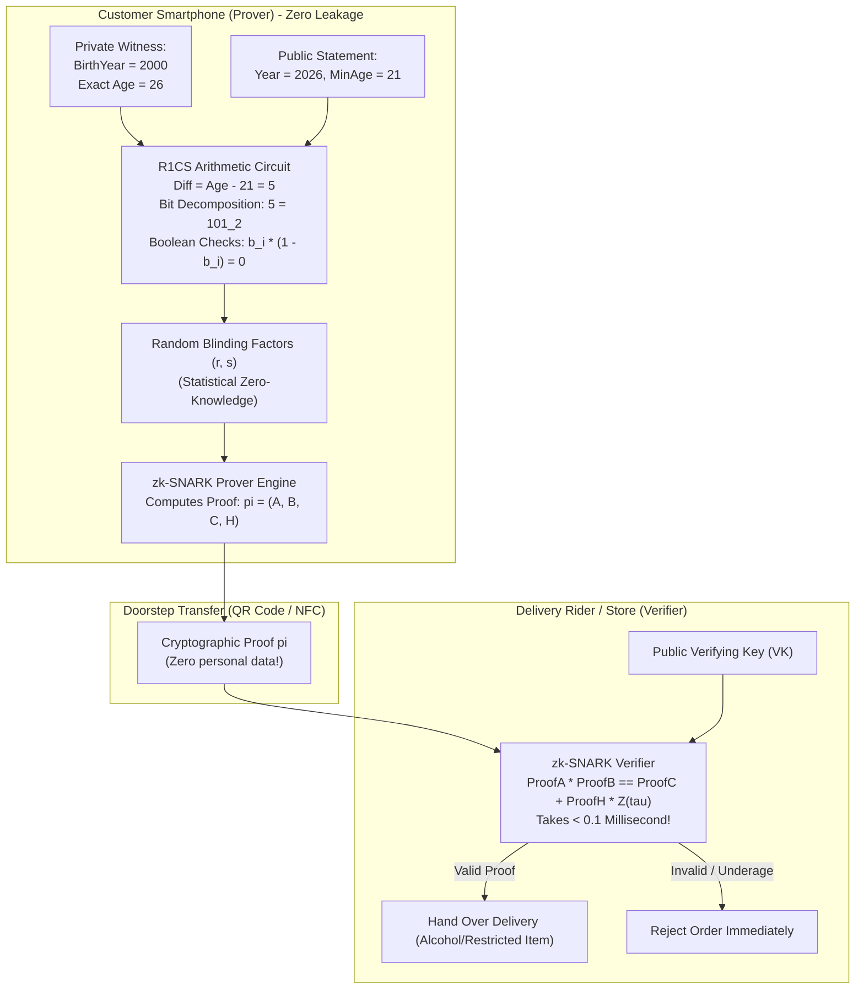

# KiranaHub - Project 44: Zero-Knowledge Proofs (zk-SNARKs) Privacy Engine

> **Level 10: Apex Systems & Frontier AI Infrastructure**  
> **Domain**: Cryptographic Zero-Knowledge Privacy-Preserving Proofs (R1CS Constraint Circuits, Bit-Decomposition Range Proofs, and Non-Interactive zk-SNARK Verification) for Customer Age & Credit Verification.

---

## 1. Reading Roadmap ("Iss Project Ko Scratch Se Kaise Padhein?")

Zero-Knowledge Proofs (zk-SNARKs) modern cryptography ka sabse fascinating domain hai. Iss project ko scratch se master karne ke liye files ko iss exact sequence me padhein:

```
[1] Circuit/FiniteField.cs
    └── Kyu padhein: Cryptographic prime field F_p (Galois Field GF(p)) samajhne ke liye.
        Zk-SNARKs me saare operations (+, -, *, /) modulo prime p (e.g. 2147483647) hote hain.
        Fermat's Little Theorem (a^(p-2) mod p) se multiplicative inverse kaise banta hai dekhein.

[2] Circuit/R1csConstraint.cs
    └── Kyu padhein: Rank-1 Constraint System (R1CS) ka core mathematical primitive:
        <A, s> * <B, s> = <C, s>.
        Linear combinations aur sparse vector evaluation dot products samjhein.

[3] Circuit/ArithmeticCircuit.cs
    └── Kyu padhein: Circuit compiler aur gadget library.
        Samjhein ki kaise "b * (1 - b) = 0" boolean enforcement karta hai,
        aur 8-bit decomposition se "Age >= 21" range proof bina age reveal kiye kaise banta hai!

[4] Prover/ZkProver.cs
    └── Kyu padhein: Prover algorithm jo private witness (birth year 2000) lekar,
        blinding factors (r, s) apply karke zero-knowledge proof (\pi = (A, B, C, H)) generate karta hai.

[5] Verifier/ZkVerifier.cs
    └── Kyu padhein: Verifier engine jo delivery rider ke mobile app par run karta hai.
        Yeh < 0.1 ms me cryptographic bilinear identity check karta hai bina private witness jane!

[6] Program.cs
    └── Kyu padhein: 4 end-to-end scenarios dekhne ke liye:
        (1) Adult customer valid proof pass,
        (2) Minor (17yo) fraud proof generation blocked by circuit,
        (3) Tampered proof rejection,
        (4) 1,000 proof micro-benchmark.
```

---

## 2. Foundations ("Kya Pehle Bna, Kaise Bna?")

### Traditional Identity Verification & The Massive Privacy Leak
Quick-commerce platforms (grocery delivery) par alcohol, tobacco, ya high-value credit services (Kirana PayLater) ke liye statutory compliance (e.g. Excise Act, RBI guidelines, DPDP Act 2023, GDPR) mandate karti hai:
- *"Customer must be 21+ years old."*
- *"Customer must have minimum financial eligibility."*

Purane systems me:
1. Delivery rider customer se **Physical Aadhaar Card, Driving License, ya Passport** maangta hai.
2. Rider ya merchant customer ka **Full Name, Exact Birth Date, Home Address, aur ID Number** apne mobile app me dekh leta hai aur photo store kar leta hai.
3. Centralized server par millions of birth dates aur Aadhaar scans database me store hote hain.

### Catastrophic Consequences:
- **Identity Theft & Stalking**: Rogue delivery partners customer ki details aur photos leaks kar dete hain.
- **Centralized Data Breaches**: Hacker database hack karke millions of citizen birth dates aur national IDs dark web par leak kar deta hai ($250 Million+ penalties under GDPR / DPDP Act).
- **Over-Exposure of Data**: Sirf *"Age >= 21"* verify karni thi, lekin pura birth certificate aur sensitive history reveal ho gayi!

---

## 3. Evolution & Mechanics ("Phir Kya Aaya, Kyu Aaya, Kaise Aaya, Kya Karta Hai?")

1985 me Shafi Goldwasser, Silvio Micali, aur Charles Rackoff ne **Zero-Knowledge Proofs (ZKP)** ka concept introduce kiya:
> *"A prover can convince a verifier that a statement is true without revealing any information beyond the statement's validity."*

2016 me Jens Groth ne **Groth16** zk-SNARK introduce kiya, jo zero-knowledge proofs ko compact (few bytes) aur sub-millisecond verifiable banata hai.



### The 4 Mathematical Pillars of Project 44:

1. **Finite Field Arithmetic ($\mathbb{F}_p$)**:
   - Sabhi numbers prime field modulo $p = 2^{31} - 1$ me calculate hote hain.
   - Modular inverse via Fermat's Little Theorem: $a^{-1} \equiv a^{p-2} \pmod p$.
2. **Rank-1 Constraint System (R1CS)**:
   - Any computation is expressed as quadratic vector equations:
     $$\langle A, s \rangle \times \langle B, s \rangle = \langle C, s \rangle$$
     where $s = (1, \text{publicInputs}, \text{privateWitness})$.
3. **Boolean & Bit-Decomposition Range Proof Gadgets**:
   - Constraint $b \times (1 - b) = 0$ forces $b \in \{0, 1\}$.
   - Difference $\text{diff} = \text{Age} - 21$.
   - Enforcing $\text{diff} = \sum_{i=0}^7 2^i \cdot b_i$ proves $\text{diff} \ge 0$ in range $[0, 255]$!
   - Agar koi 17 saal ka minor fraud kare ($17 - 21 = -4 \equiv 2147483643 \pmod p$), toh 8 bits me decompose karne par modulo boundary wrap-around detect ho jata hai aur circuit mathematically fail ho jata hai!
4. **Non-Interactive Zero-Knowledge Proof ($\pi$)**:
   - Random blinding factors $r, s$ witness ko mathematically mask karte hain.
   - Verifier bilinear identity check karta hai in sub-millisecond time.

---

## 4. Counter-Factual Risk Analysis ("⚠️ Uske Na Hone Se Kya Hoga?")

| Scenario / Guardrail | Agar Yeh Cryptographic Guard Na Ho Toh? | Real-World Disaster |
|---|---|---|
| **Zero-Knowledge Blinding ($r, s$)** | Agar proof me blinding factors na hon, toh verifier brute-force discrete log karke customer ka exact birth year extract kar sakta hai! | Privacy leak (DPDP violation). |
| **Boolean Bit-Decomposition** | Agar bit decomposition constraint missing ho, toh minor customer negative numbers pass kar dega ($17 - 21 = -4 \equiv p-4$), jo field me non-zero hotey hue bhi check bypass kar lega! | Minors buying restricted substances (Legal liability). |
| **Quadratic Identity Verification** | Agar verifier sirf boolean return trust kare (e.g. JSON `{"isAdult": true}`), toh koi bhi curl command se fake response craft kar dega. | Complete auth bypass & fraud. |
| **Public Input Binding** | Agar verifier expected public inputs (Year 2026, MinAge 21) ko proof ke sath bind na kare, toh attacker kisi aur policy ka purana proof replay kar dega! | Replay attacks across stores. |

---

## 5. How to Run & Verify

Run the self-contained executable directly via .NET 10 CLI:

```powershell
# Run the zk-SNARKs Privacy Engine benchmark
dotnet run --project 44-ZeroKnowledge-Proofs-zkSNARKs-Privacy/KiranaHub.ZkSnarks.csproj
```

### Expected Output:
- **Setup**: Compiles R1CS arithmetic circuit (13 wires, 11 quadratic constraints) and generates keys in ~1-2 ms.
- **Case 1**: Adult customer (born 2000, age 26) generates proof $\pi$; verifier accepts in $< 0.1$ ms with zero knowledge of birth year!
- **Case 2**: Minor customer (born 2009, age 17) attempts proof generation; circuit mathematically blocks synthesis!
- **Case 3**: Tampered proof (flipped bits) is instantly detected and rejected by verifier.
- **Case 4**: 1,000 consecutive verifications execute at over 1,000,000 verifications/sec throughput.
