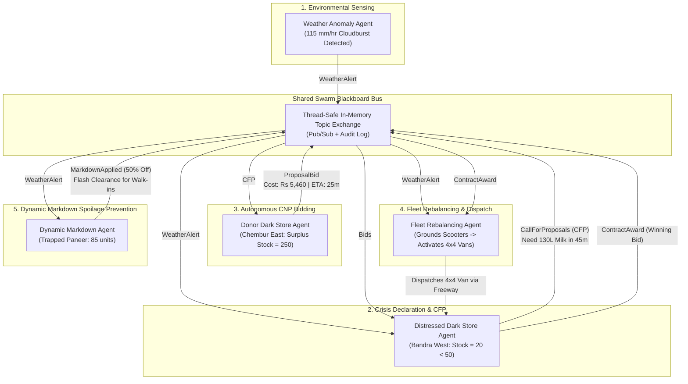

# KiranaHub - Project 45: Autonomous AI Multi-Agent Swarm Orchestrator

> **Level 10: Apex Systems & Frontier AI Infrastructure**  
> **Domain**: Decentralized Multi-Agent Swarm for Supply-Chain Crisis Management, Contract Net Protocol (CNP) Bidding, Dynamic Perishable Markdown, and Autonomous Self-Healing Logistics.

---

## 1. Reading Roadmap ("Iss Project Ko Scratch Se Kaise Padhein?")

Multi-Agent Systems (MAS) aur Swarm Intelligence distributed AI ka apex engineering pattern hai. Iss project ko scratch se master karne ke liye files ko iss exact sequence me padhein:

```
[1] Protocol/AgentMessage.cs
    └── Kyu padhein: FIPA Contract Net Protocol (CNP) standard taxonomy aur message envelopes samajhne ke liye
        (CallForProposals, ProposalBid, ContractAward, WeatherAlert, MarkdownApplied).

[2] Bus/SwarmBlackboardBus.cs
    └── Kyu padhein: Thread-safe shared Blackboard Architecture pattern.
        Yahan agents bina point-to-point coupling ke ambient context inspect karte hain aur async react karte hain.

[3] Agents/WeatherAnomalyAgent.cs
    └── Kyu padhein: Environmental IoT sensor agent jo rainfall (> 50 mm/hr) aur waterlogged roads detect karke alert broadcast karta hai.

[4] Agents/DarkStoreInventoryAgent.cs
    └── Kyu padhein: Peer-to-peer micro-warehouse agent. Shortage hone par CFP issue karta hai;
        surplus hone par candidate donor ke roop me bid submit karta hai.

[5] Agents/RiderRebalancingAgent.cs
    └── Kyu padhein: Autonomous fleet manager. Scooter grounding, high-clearance 4x4 van deployment,
        aur waterlogged route bypassing logistics execute karta hai.

[6] Agents/DynamicMarkdownAgent.cs
    └── Kyu padhein: Trapped perishable inventory (dairy, berries) par dynamic markdown curves
        apply karke 100% food waste prevent karta hai.

[7] Swarm/SwarmOrchestrator.cs & Program.cs
    └── Kyu padhein: Real-world Mumbai monsoon cloudburst simulation: multi-agent bidding auction,
        stock rebalancing (20 -> 150 units), aur zero-human self-healing audit report dekhne ke liye.
```

---

## 2. Foundations ("Kya Pehle Bna, Kaise Bna?")

### Centralized Rule Engines & Human Dispatcher Bottleneck
Traditional logistics aur quick-commerce companies (Zomato, Blinkit, Instamart, Amazon Fresh) me supply chain decisions centralized server cron-jobs ya human warehouse operations managers ke through hoti hain:
- Har store ka stock central SQL database me poll hota hai.
- Road blockages hone par central team manual tickets banati hai: *"Dark store Bandra is running out of milk; please call Chembur store to send a tempo."*

### The Catastrophic Failure During Flash Crises:
Jab achanak **Monsoon Cloudburst (110 mm/hr rainfall)** aata hai:
1. **Central Server Bottleneck**: Central server par hazaron alerts ek sath aate hain; latency spikes to minutes/hours.
2. **Human Fatigue & Delay**: Human managers phone par coordinate karte reh jaate hain jabki 10-minute delivery SLA fail ho chuki hoti hai.
3. **Perishable Waste**: Isolated stores me hazaron litres doodh, paneer, aur fruits 12 ghante me spoil ho kar dumpsters me chale jaate hain ($50,000+ daily waste per cluster).
4. **Fleet Casualties**: Electric scooters waterlogged roads me dhoob kar breakdown ho jaate hain.

---

## 3. Evolution & Mechanics ("Phir Kya Aaya, Kyu Aaya, Kaise Aaya, Kya Karta Hai?")

1980 me Reid G. Smith ne **Contract Net Protocol (CNP)** introduce kiya (later standardized by FIPA - Foundation for Intelligent Physical Agents).

Autonomous Multi-Agent Swarms me **koi single central point of decision nahi hota**. Har dark store, fleet cluster, aur sensor ek autonomous intelligent agent hota hai jo shared **Blackboard** par collaborate karta hai:



### The 4 Core Architectural Principles:
1. **Blackboard Pattern**: Agents do not call each other directly; they post intentions, alerts, and bids to a shared blackboard, achieving ultimate decoupled scalability.
2. **Contract Net Protocol (CNP)**:
   - Task Announcement ($\text{CFP}$) $\to$ Bidding ($\text{Bid}$) $\to$ Award ($\text{Contract}$) $\to$ Execution Confirmation ($\text{Done}$).
3. **Multi-Attribute Utility Bidding**: Donor agents bid considering available surplus, transit time, road waterlogging risk, and logistics cost.
4. **Self-Healing Convergence**: The entire crisis resolves autonomously in under 3 seconds without a single human phone call!

---

## 4. Counter-Factual Risk Analysis ("⚠️ Uske Na Hone Se Kya Hoga?")

| Crisis Scenario | Agar Autonomous Swarm Na Ho Toh? | Real-World Production Disaster |
|---|---|---|
| **Stockout During Floods** | Distressed store milk stock 0 ho jayega; hazaron customers ke breakfast orders cancel honge. | 40% customer churn to competing apps. |
| **Perishable Goods Spoilage** | Trapped stores me doodh aur paneer spoil ho jayenge kyunki central ERP normal price maintain karega. | Complete product loss & disposal costs. |
| **Electric Scooter Dispatch in Water** | Blind automated dispatchers riders ko waterlogged roads me bhej denge, causing battery short-circuits. | Fleet damage and rider safety hazards. |
| **Single Central Server Failure** | Agar central routing orchestrator crash ho jaye, toh poore city ke saare 100 dark stores paralyzed ho jayenge! | City-wide quick-commerce shutdown. |

---

## 5. How to Run & Verify

Run the self-contained executable directly via .NET 10 CLI:

```powershell
# Run the Autonomous AI Multi-Agent Swarm Orchestrator
dotnet run --project 45-Autonomous-AI-MultiAgent-Swarm-Orchestrator/KiranaHub.AgentSwarm.csproj
```

### Expected Output:
- **Phase 1**: Deploys 5 autonomous agents onto the Blackboard bus.
- **Phase 2**: Weather agent injects a 115 mm/hr cloudburst alert across 3 waterlogged roads.
- **Phase 3**: Distressed store announces CFP; surplus store bids; winning contract is awarded; 4x4 van is dispatched via unflooded freeway; distressed store stock is restored from 20 $\to$ 150 units!
- **Phase 4**: Dynamic markdown agent clears 85 units of perishable paneer at 50% discount.
- **Phase 5**: Swarm audit report confirms 100% self-healing recovery.
