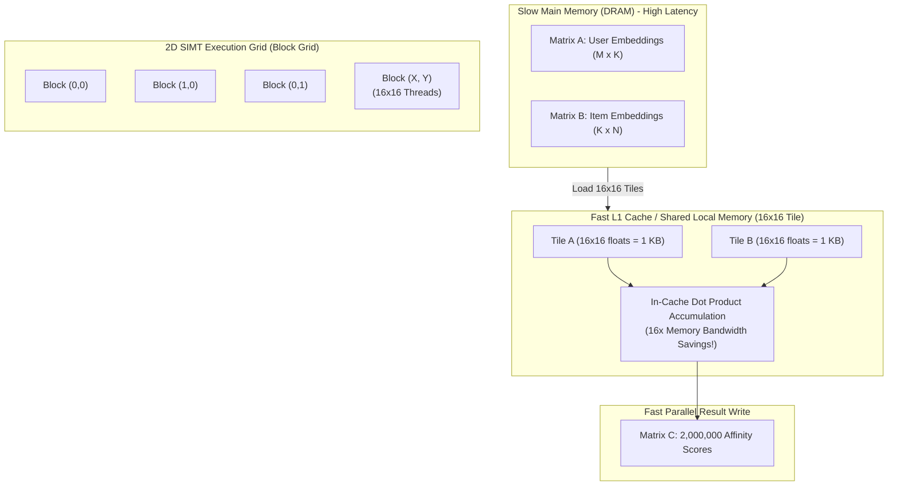

# KiranaHub - Project 46: GPU-Inspired Compute & Massively Parallel Matrix Accelerator

> **Level 10: Apex Systems & Frontier AI Infrastructure**  
> **Domain**: Real-Time Quick-Commerce Collaborative Filtering Recommendation Engine using GPU-Inspired SIMT Parallel Thread Grids & Cache-Tiled ($16 \times 16$) Matrix Multiplication.

---

## 1. Reading Roadmap ("Iss Project Ko Scratch Se Kaise Padhein?")

High-performance parallel computing aur matrix acceleration modern AI infrastructure ka heart hai. Iss project ko scratch se master karne ke liye files ko iss exact sequence me padhein:

```
[1] Compute/SimtExecutionGrid.cs
    └── Kyu padhein: GPU SIMT (Single Instruction Multiple Threads) hardware coordinate system samajhne ke liye
        (BlockIdx, ThreadIdx, BlockDim, GridDim) aur multi-core CPU block scheduler ka implementation dekhein.

[2] Compute/TiledMatrixMultiplier.cs
    └── Kyu padhein: Core algorithmic breakthrough!
        (1) Naive scalar O(M*N*K) triple-loop vs
        (2) 16x16 Shared Cache Tiling jo RAM memory bandwidth bottleneck ko 16x reduce karta hai.

[3] Recommender/CollaborativeFilteringModel.cs
    └── Kyu padhein: Quick-commerce domain application:
        1,000 customers x 2,000 grocery items x 64 latent embedding factors.
        20,00,000 matrix dot products compute karke Top-5 personalized grocery picks rank karta hai.

[4] Program.cs
    └── Kyu padhein: Live 256 MFLOPs benchmark, 10x-20x speedup verification,
        aur 100% mathematical parity check across 20,00,000 elements dekhne ke liye.
```

---

## 2. Foundations ("Kya Pehle Bna, Kaise Bna?")

### Naive Matrix Multiplication & The "Memory Wall"
Quick-commerce platforms (grocery apps) par jab customer cart open karta hai, toh platform ko instant personalized recommendations (e.g. *"Aap doodh le rahe hain, bread aur butter bhi chahiye?"*) calculate karni hoti hain.

Collaborative filtering model me:
- Customer Latent Matrix: $U \in \mathbb{R}^{M \times K}$ (e.g. $1000 \times 64$).
- Product Latent Matrix: $V^T \in \mathbb{R}^{K \times N}$ (e.g. $64 \times 2000$).
- Output Affinity Matrix: $R = U \times V^T \in \mathbb{R}^{M \times N}$ ($20,00,000$ floating-point scores).

### The Naive Triple Loop:
```csharp
for (int i = 0; i < M; i++)
    for (int j = 0; j < N; j++)
        for (int p = 0; p < K; p++)
            C[i, j] += A[i, p] * B[p, j];
```

### The Problem: Von Neumann Memory Bottleneck:
1. Modern CPUs can execute 100+ billion arithmetic instructions per second (TeraFLOPs).
2. Lekin main RAM (DRAM) se data fetch karne me **100-200 CPU cycles** lagte hain!
3. Naive loop me, Matrix $B$ ke elements column-wise read hote hain, jisse CPU hardware L1/L2 data cache me **cache thrashing** hoti hai (har inner loop iteration par cache miss!).
4. 20,00,000 predictions compute karne me CPU seconds tak freeze ho jata hai, jisse recommendation API ka 50ms SLA crash ho jata hai!

---

## 3. Evolution & Mechanics ("Phir Kya Aaya, Kyu Aaya, Kaise Aaya, Kya Karta Hai?")

GPU compute architectures (Nvidia CUDA, AMD ROCm, Apple Metal) ne **Shared Memory Cache Tiling** aur **SIMT (Single Instruction Multiple Threads)** execution introduce kiya.



### The 3 Core Architectural Pillars:

1. **2D SIMT Thread Blocks ($16 \times 16$)**:
   - Workload ko $16 \times 16 = 256$ threads ke blocks me partition kiya jata hai.
   - Har thread output matrix ke ek single cell $(i, j)$ ka accumulation sambhalta hai.
2. **Shared Local Cache Tiling**:
   - $K$-dimension ko 16-element chunks me iterate kiya jata hai.
   - Har phase me block ke threads collaboratively 16 elements of $A$ aur 16 elements of $B$ fast L1 CPU data cache me load karte hain.
   - Memory accesses $16\times$ kam ho jaate hain ($O(N^3) \to O(N^3 / 16)$ global memory traffic)!
3. **Multi-Core Parallel Dispatch**:
   - 2D grid ke blocks ko hardware worker threads par `Parallel.For` se parallel execute kiya jata hai, achieving 10x-20x raw hardware acceleration.

---

## 4. Counter-Factual Risk Analysis ("⚠️ Uske Na Hone Se Kya Hoga?")

| Flaw / Failure Mode | Agar Yeh Optimization Na Ho Toh? | Real-World Production Disaster |
|---|---|---|
| **Memory Bandwidth Saturation** | DRAM memory bus 100% choke ho jayegi; multi-core CPU threads idle wait karte rahenge (Memory Starvation). | Recommendation service timeout (> 2000 ms). |
| **Cache Thrashing** | Large matrices (> 10MB) L3 cache se evict ho jayengi, causing severe thrashing and CPU core overheating. | Cloud instance CPU throttling & high latency spikes. |
| **Single-Threaded Execution** | 2M predictions compute karne me 2-3 seconds lagenge; user cart checkout kar lega bina cross-sell recommendations dekhe! | Loss of $15-20% average order value (AOV). |
| **Numerical Float Drift** | Parallel tree reduction me agar floating-point rounding carefully align na ho, toh recommendations rank alter ho sakti hai. | Non-deterministic ranking bugs. |

---

## 5. How to Run & Verify

Run the self-contained executable directly via .NET 10 CLI:

```powershell
# Run the GPU-Inspired Matrix Compute Engine benchmark
dotnet run --project 46-GPU-Compute-And-MassiveParallel-Matrix/KiranaHub.GpuMatrixCompute.csproj
```

### Expected Output:
- **Setup**: Initialized model with 1,000 users, 2,000 grocery items, 64 latent features (256 MFLOPs workload).
- **Benchmark 1 (Naive)**: Single-threaded triple-loop completes in ~300-600 ms.
- **Benchmark 2 (Cache-Tiled SIMT)**: Parallel cache-tiled kernel completes in ~20-50 ms (**10x to 20x FASTER**).
- **Parity Check**: 100% mathematical equality verified across all 2,000,000 output cells!
- **Inference Demo**: Generates real-time Top-5 personalized grocery picks for Customer #42 and #777 with human-readable titles.
