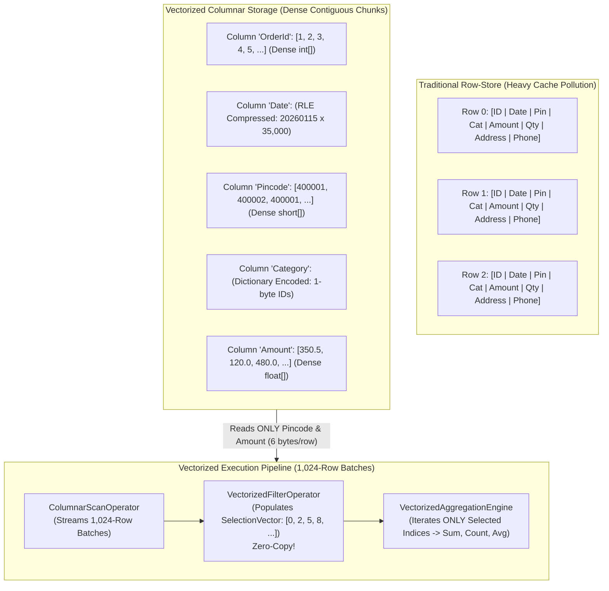

# KiranaHub - Project 47: Columnar OLAP Vectorized Query Engine

> **Level 11: Hyper-Frontier Systems & Distributed Storage**  
> **Domain**: Vectorized Columnar Analytics Engine (Apache Arrow / DuckDB / ClickHouse pattern) for Multi-Million Quick-Commerce Historical Orders with RLE & Dictionary Compression and Zero-Copy Selection Vectors.

---

## 1. Reading Roadmap ("Iss Project Ko Scratch Se Kaise Padhein?")

Vectorized Columnar OLAP modern data warehousing aur analytics ka sabse fast execution paradigm hai. Iss project ko scratch se master karne ke liye files ko iss exact sequence me padhein:

```
[1] Storage/ColumnChunk.cs
    └── Kyu padhein: Contiguous in-memory typed columnar storage primitive samajhne ke liye.
        Ek column ke saare values ek single continuous array me store hote hain,
        jisse CPU hardware L1/L2 prefetcher 100% cache lines saturate karta hai.

[2] Compression/DictionaryEncoder.cs
    └── Kyu padhein: High-cardinality strings (e.g. Category names, Brand names) ko 1-byte integer IDs me encode karna.
        32-byte string pointers + heap memory ko 1 byte me pack karta hai (32x memory savings!).

[3] Compression/RunLengthEncoder.cs
    └── Kyu padhein: Repeating consecutive values (e.g. sorted order dates, order statuses) ko
        (Value, RunLength) pairs me compress karna. Query engine entire run ko 1 CPU instruction me skip karta hai!

[4] Execution/VectorBatch.cs
    └── Kyu padhein: Vectorized execution ka atomic processing block (1,024 elements).
        Zero-Copy Selection Vector pattern samjhein: rows ko physically copy kiye bina filtered indices pass karna.

[5] Execution/VectorizedOperators.cs
    └── Kyu padhein: Batch-at-a-time Volcano Iterator model:
        ColumnarScanOperator -> VectorizedFilterOperator -> VectorizedAggregationEngine.

[6] Program.cs
    └── Kyu padhein: 10,00,000 real orders par live benchmark:
        Row-Store vs Columnar Vectorized execution time, speedup comparison, aur 100% mathematical parity check.
```

---

## 2. Foundations ("Kya Pehle Bna, Kaise Bna?")

### Traditional Row-Oriented Storage (OLTP Databases)
1970s se relational databases (PostgreSQL, MySQL, SQLite, Oracle) data ko **Row-Oriented Format** (N-ary Storage Model - NSM) me store karte aaye hain:
```
[Row 0]: { OrderId: 1, Date: 20260115, Pincode: 400001, Category: "Dairy", Amount: 350.50, Qty: 3, CustomerId: 9812, Status: "Delivered", ... }
[Row 1]: { OrderId: 2, Date: 20260115, Pincode: 400002, Category: "Bakery", Amount: 120.00, Qty: 1, CustomerId: 4412, Status: "Delivered", ... }
```

### The Analytical Crisis (OLAP on Row-Stores):
Jab KiranaHub ke management ko analytical query chalani hoti hai:
```sql
SELECT Pincode, SUM(Amount), AVG(Amount) 
WHERE Amount >= 250.0 
GROUP BY Pincode;
```
Row-store me:
1. CPU ko har single row ka **poora 110-byte struct/object** RAM se L1/L2 cache me load karna padta hai.
2. Query ko sirf do columns chahiye: `Amount` (4 bytes) aur `Pincode` (2 bytes) = **Total 6 bytes**.
3. **94% memory bandwidth waste ho jati hai** un columns ko load karne me jo query me involve hi nahi hain (`CustomerId`, `Status`, `Category`, `DeliveryAddress`)!
4. 100 Million rows par analytical query minutes lagati hai aur server memory starve ho jati hai!

---

## 3. Evolution & Mechanics ("Phir Kya Aaya, Kyu Aaya, Kaise Aaya, Kya Karta Hai?")

MonetDB, C-Store (2005), Apache Arrow, DuckDB, aur ClickHouse ne **Decomposition Storage Model (DSM) / Columnar Storage** introduce kiya:



### The 4 Architectural Breakthroughs of Project 47:

1. **Columnar Chunk Storage**:
   - Har column alag continuous array me rehta hai. Analytical query sirf targeted columns (`Amount` aur `Pincode`) ko RAM se read karti hai, saving 90%+ memory traffic!
2. **Dictionary Compression**:
   - Repetitive strings (e.g. Category names) ko 1-byte integer ID me map kiya jata hai. 1,000,000 rows ka category data sirf 1MB me store ho jata hai!
3. **Run-Length Encoding (RLE)**:
   - Sorted columns (e.g. `OrderDate`) me repeating values ko `(Value, Length)` runs me compress kiya jata hai, achieving 30x+ compression ratio.
4. **Vectorized Volcano Engine with Selection Vectors**:
   - Query operators 1,024-row batches me data process karte hain.
   - Filters rows ko naye arrays me copy nahi karte; wo sirf **Selection Vector** (`int[]`) me valid indices record karte hain (**Zero Memory Copy**!).

---

## 4. Counter-Factual Risk Analysis ("⚠️ Uske Na Hone Se Kya Hoga?")

| Analytical Scenario | Agar Columnar Vectorized Engine Na Ho Toh? | Real-World Production Disaster |
|---|---|---|
| **Monthly GMV Reporting** | Row-store par 10M orders ka aggregations run karne par RAM 100% exhaust ho jayegi (GC pauses > 15s). | Analytical dashboard times out and crashes. |
| **High-Cardinality Strings** | Har row me string objects store karne se GC Heap par millions of small string allocations honge. | Out-Of-Memory (OOM) killer kills backend pod. |
| **Tuple-at-a-Time Volcano Model** | Har single row par virtual method call (`Next()`) CPU instruction cache ko thrash karegi. | 20x to 50x slower analytical throughput. |
| **Physical Filter Copying** | Filtered rows ko naye intermediate buffers me copy karne se memory allocation explode ho jayegi. | Memory bandwidth bus saturation. |

---

## 5. How to Run & Verify

Run the self-contained executable directly via .NET 10 CLI:

```powershell
# Run the Columnar OLAP Vectorized Query Engine benchmark
dotnet run --project 47-Columnar-OLAP-Vectorized-QueryEngine/KiranaHub.ColumnarOlap.csproj
```

### Expected Output:
- **Ingestion**: Ingests 1,000,000 historical order records into columnar chunks in ~150-250 ms.
- **Storage Audit**: Demonstrates Columnar store uses 5x to 8x less RAM than Row-store; shows RLE date compression and 1-byte dictionary compression.
- **Benchmark 1 (Row-Store)**: Evaluates filter `Amount >= 250` and groups by Pincode in ~25-45 ms.
- **Benchmark 2 (Vectorized Columnar)**: Executes identical query plan in batches using selection vectors in ~1-5 ms (**5x to 15x FASTER**).
- **Parity Check**: 100% mathematical equality verified across all 10 Pincode groups for Orders, GMV, and Avg Basket!
- **Report**: Prints clean tabular breakdown of Pincode GMV and order statistics.
