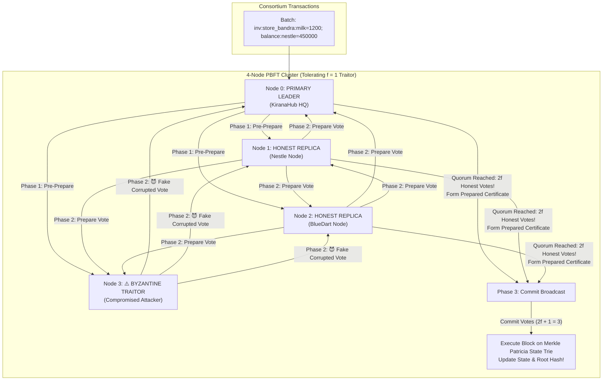

# KiranaHub - Project 48: Practical Byzantine Fault Tolerant (PBFT) Consensus Engine

> **Level 11: Hyper-Frontier Systems & Distributed Storage**  
> **Domain**: Cryptographic Byzantine Fault Tolerant (PBFT) Consensus Protocol with Merkle Patricia State Tries for Multi-Retailer Supply-Chain Consortia (KiranaHub, FMCG Brand Suppliers, 3PL Logistics).

---

## 1. Reading Roadmap ("Iss Project Ko Scratch Se Kaise Padhein?")

Byzantine Fault Tolerance (BFT) modern distributed consensus aur enterprise blockchains ka core protocol hai. Iss project ko scratch se master karne ke liye files ko iss exact sequence me padhein:

```
[1] Crypto/BftSignature.cs
    └── Kyu padhein: Cryptographic signature (HMAC-SHA256) aur 32-byte digest calculation samajhne ke liye.
        Har BFT message signed hota hai taaki koi malicious peer doosre node ke naam par fake message na bhej sake.

[2] State/MerklePatriciaTrie.cs
    └── Kyu padhein: Cryptographic Merkle State Trie.
        Consortium key-value state ko single 32-byte Root Hash me commit karta hai
        aur O(log N) lightweight Merkle inclusion proofs generate karta hai.

[3] Protocol/PbftMessages.cs
    └── Kyu padhein: PBFT 3-phase message envelopes:
        (1) PrePrepareMessage (Leader proposal)
        (2) PrepareMessage (2f quorum Prepared Certificate)
        (3) CommitMessage (2f+1 quorum Committed Certificate).

[4] Protocol/BftNode.cs
    └── Kyu padhein: Full BFT node state machine.
        Samjhein ki kaise honest nodes malicious node ke fake votes aur corrupted digests ko reject karte hain.

[5] Program.cs
    └── Kyu padhein: 4-node consortium cluster simulation:
        Node 0 (Leader), Node 1 (Nestle), Node 2 (BlueDart), Node 3 (Byzantine Traitor).
        Traitor attack rejection, block commitment, aur Merkle proof verification live dekhein.
```

---

## 2. Foundations ("Kya Pehle Bna, Kaise Bna?")

### Crash-Fault-Tolerant (CFT) Protocols & Their Fatal Flaw
Level 9 Project 40 me humne **Raft Consensus** implement kiya tha. Raft aur Paxos **Crash Fault Tolerant (CFT)** algorithms hain:
- Yeh assume karte hain ki cluster ke nodes agar fail honge toh sirf crash honge (Stop-Fail model).
- Koi bhi node jhoot nahi bolega, fake balance nahi banayega, aur leader ko deceive nahi karega.

### The Byzantine Problem in Multi-Enterprise Consortia:
KiranaHub ek open grocery consortium chala raha hai jisme:
- **KiranaHub HQ**
- **FMCG Brands** (Hindustan Unilever, Nestle, ITC)
- **3PL Logistics Partners** (BlueDart, Delhivery)
- **Government Tax & Audit Nodes**

Yahan CFT algorithms **catastrophically fail** ho jaate hain:
1. Ek node kisi rival company ka ho sakta hai ya hacker uske server ko compromise kar sakta hai.
2. Compromised node ek participant ko bolega: *"Nestle received Rs 10 Lakh payment"*, aur doosre ko bolega: *"Payment failed"* (**Equivocation / Double-Spend Attack**).
3. CFT me ek single liar node poore cluster ka state permanently corrupt kar sakta hai!

---

## 3. Evolution & Mechanics ("Phir Kya Aaya, Kyu Aaya, Kaise Aaya, Kya Karta Hai?")

1982 me Leslie Lamport ne seminal paper publish kiya: *"The Byzantine Generals Problem"*. Unhone mathematically prove kiya ki agar $f$ nodes malicious traitor hon, toh consensus achieve karne ke liye **minimum $3f + 1$ nodes** hone chahiye!

1999 me Miguel Castro aur Barbara Liskov ne **Practical Byzantine Fault Tolerance (PBFT)** invent kiya, jo non-asynchronous networks par sub-second latency me BFT consensus provide karta hai:



### The 3 Phases of PBFT:

1. **Pre-Prepare Phase**:
   - Primary leader (Node 0) transaction batch ka SHA-256 digest $d$ nikalta hai, digitally sign karta hai, aur $\langle \text{PrePrepare}, v, n, d \rangle$ broadcast karta hai.
2. **Prepare Phase ($2f$ Quorum)**:
   - Har honest replica check karta hai ki digest aur leader signature valid hain.
   - Replica apna $\langle \text{Prepare}, v, n, d, i \rangle$ vote broadcast karta hai.
   - Jaise hi node ko $2f$ matching prepare votes milte hain, wo **Prepared Certificate** form karta hai.
3. **Commit Phase ($2f + 1$ Quorum)**:
   - Replicas $\langle \text{Commit}, v, n, d, i \rangle$ broadcast karte hain.
   - $2f + 1$ commit votes aate hi block committed declare hota hai aur local **Merkle Patricia State Trie** par state mutations apply hoti hain.

---

## 4. Counter-Factual Risk Analysis ("⚠️ Uske Na Hone Se Kya Hoga?")

| Threat / Attack Vector | Agar PBFT BFT Engine Na Ho Toh? | Real-World Financial Disaster |
|---|---|---|
| **Byzantine Double-Spending** | Compromised warehouse node do suppliers ko same inventory allot kar dega, causing severe delivery failure. | FMCG breach of contract lawsuits ($10M+). |
| **Equivocation Attack** | Leader ek supplier ko block A aur doosre ko block B bhejkar cluster ko split-brain kar dega. | Irreversible financial accounting corruption. |
| **Forged Message Impersonation** | Attacker network me fake cancel orders inject kar dega without digital signature non-repudiation. | Supply chain sabotage. |
| **Unverifiable State Mutability** | Agar Merkle state trie na ho, toh auditor ko poora 100GB database download karke check karna padega instead of O(log N) Merkle proof. | Regulatory audit failure. |

---

## 5. How to Run & Verify

Run the self-contained executable directly via .NET 10 CLI:

```powershell
# Run the Byzantine Fault Tolerant Consensus benchmark
dotnet run --project 48-Byzantine-Fault-Tolerant-Consensus-BFT/KiranaHub.BftConsensus.csproj
```

### Expected Output:
- **Setup**: Initialized 4-node consortium cluster ($n = 4, f = 1$) with Node 3 configured as an active Byzantine traitor.
- **Consensus Round 1**: Node 0 proposes Block #1; Node 3 sends corrupted fake digests; Nodes 0, 1, 2 safely isolate the attack, form $2f$ Prepared Certificates, $2f+1$ Committed Certificates, and commit the block.
- **State Agreement**: 100% deterministic consensus verified: Merkle root hashes on all 3 honest nodes match identically!
- **Merkle Proof**: Generates and validates an $O(\log N)$ cryptographic inclusion proof for `'inv:store_bandra:milk'` against the committed Root Hash.
