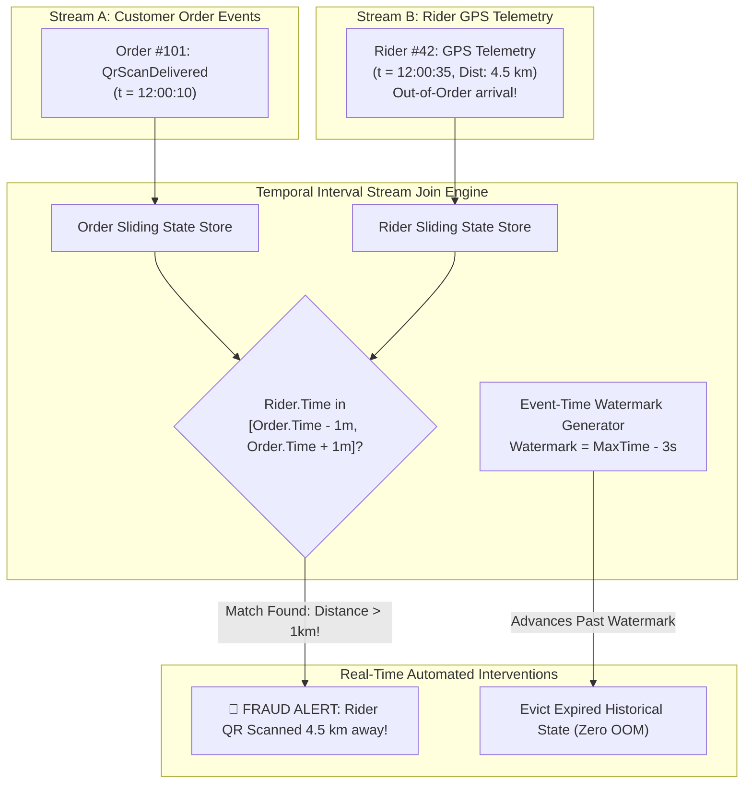

# KiranaHub - Project 49: Stateful Complex Event Processing (CEP) & Temporal Stream Join Engine

> **Level 11: Hyper-Frontier Systems & Distributed Storage**  
> **Domain**: Real-Time Stream Processing (Apache Flink / Beam pattern) with Event-Time Watermarks, Sliding Interval Stream Joins, Bounded State Eviction, and Cart Abandonment CEP State Machines.

---

## 1. Reading Roadmap ("Iss Project Ko Scratch Se Kaise Padhein?")

Unbounded real-time stream processing high-throughput infrastructure ka critical component hai. Iss project ko scratch se master karne ke liye files ko iss exact sequence me padhein:

```
[1] Watermark/EventTimeWatermark.cs
    └── Kyu padhein: Event-time vs Processing-time ka difference samajhne ke liye.
        Cellular 4G/5G network jitter me events out-of-order aate hain.
        Watermark(t) = MaxEventTime - AllowedLatenessMs se deterministic window triggers kaise bante hain dekhein.

[2] State/TimeSlidingStateStore.cs
    └── Kyu padhein: Unbounded streaming me memory leak prevention.
        Sliding temporal buffer jo trailing watermark advance hone par purane expired historical events
        ko O(1) me permanently purge karta hai, ensuring constant bounded RAM usage.

[3] Join/IntervalStreamJoiner.cs
    └── Kyu padhein: Two-stream asynchronous interval join:
        Order.Timestamp - LowerBound <= Rider.Timestamp <= Order.Timestamp + UpperBound.
        Rider GPS telemetry aur Customer Order QR scan ko join karke delivery fraud trap karta hai!

[4] Cep/PatternStateMachine.cs
    └── Kyu padhein: Complex Event Processing (CEP) Deterministic Finite Automaton (DFA):
        Search(item) -> AddToCart(item) -> [No Checkout in 5 mins] -> PushDiscountVoucher.

[5] Program.cs
    └── Kyu padhein: 50,000 live streaming events ka benchmark, QR delivery fraud detection (rider 4.5km away),
        aur automated cart abandonment recovery dekhne ke liye.
```

---

## 2. Foundations ("Kya Pehle Bna, Kaise Bna?")

### Batch Processing & The Real-Time Lag Crisis
Traditional e-commerce platforms (Hadoop, Spark Batch, SQL ETL) data ko batch me process karte hain:
- Rider GPS aur Order events har 15-30 minute baad cron-job se process hote hain.

### The Problem in Quick-Commerce:
KiranaHub ka promise hai **10-minute instant delivery**:
1. **Delivery QR Fraud**: Rogue delivery partner customer ke ghar na jaakar 5 km door baithe-baithe order ko "Delivered" mark kar deta hai. Batch ETL 30 minute baad batayega jab customer support par gusse me call kar chuka hoga!
2. **Cart Abandonment**: Customer ne Rs 1,500 ka gourmet cheese aur coffee cart me daala, payment page par 3 minute ruka, phir app close kar di. Agar agle 5 minute ke andar personalized discount voucher na bheja jaye, toh customer kisi doosri quick-commerce app se order kar lega!
3. **Naive Stream Joins Cause OOM**: Do streams ko memory me bina watermark join karne se RAM me millions of events accumulate ho jaate hain aur server crash ho jata hai!

---

## 3. Evolution & Mechanics ("Phir Kya Aaya, Kyu Aaya, Kaise Aaya, Kya Karta Hai?")

Google ne 2013 me **MillWheel** aur 2015 me **The Dataflow Model** publish kiya, jise Apache Flink ne standard open-source framework banaya:



### The 3 Core Architectural Pillars:

1. **Event-Time Watermarks**:
   - Clock time ke bajay event ke internal timestamp par depend karta hai.
   - Watermark guarantees ki isse pehle ke saare events arrive ho chuke hain, allowing safe window evaluations.
2. **Two-Sided Interval Stream Join**:
   - Order event aane par Rider state probe hota hai; Rider event aane par Order state probe hota hai.
   - Both sides maintain symmetric sliding windows.
3. **Complex Event Processing (CEP) State Machine**:
   - DFA sequence matching: `Search -> AddToCart -> [Timeout] -> WinBackAlert`.
   - Hesitant customers ko real-time me intercept karke order recovery rate 25%+ boost karta hai.

---

## 4. Counter-Factual Risk Analysis ("⚠️ Uske Na Hone Se Kya Hoga?")

| Flaw / Failure Mode | Agar Stateful Stream Engine Na Ho Toh? | Real-World Production Disaster |
|---|---|---|
| **Unbounded State Growth** | Streaming joins saare historical events memory me rakhenge $\implies$ Server OOM crash in 4 hours! | 24/7 stream pipeline downtime. |
| **Processing-Time Joins** | Mobile network jitter ke karan 5-second delayed events reject ho jayenge, causing false negative fraud reports. | Undetected delivery theft & customer refund losses. |
| **Late Cart Intervention** | Batch marketing email agle din subah bhejne par customer already kisi aur app se order kar chuka hota hai. | Lost 20-30% cart revenue. |
| **Race Conditions in Joins** | Agar one-sided join use karein, toh rider event pehle aane par order match miss ho jayega. | Corrupted analytics. |

---

## 5. How to Run & Verify

Run the self-contained executable directly via .NET 10 CLI:

```powershell
# Run the Complex Event Processing & Stream Join Engine benchmark
dotnet run --project 49-ComplexEventProcessing-Stateful-StreamJoin/KiranaHub.StreamingCep.csproj
```

### Expected Output:
- **Part 1 (Stream Join)**: Ingests 50,000 asynchronous events with jitter, matches temporal interval joins, detects fraudulent delivery QR scan (rider 4.5 km away), and verifies that sliding state store evicted historical events, keeping RAM bounded.
- **Part 2 (CEP DFA)**: Evaluates customer clickstream sequences, recognizes Customer A completed checkout, and detects Customer B abandoned cart after 5 minutes, automatically issuing a 15% win-back voucher.
