# KiranaHub: Complete Full-Stack, Distributed & Cloud-Native Engineering Curriculum

> **A Production-Grade Quick-Commerce (10-Minute Grocery Delivery) Learning Platform**  
> Covering 90+ Core Technologies across 36 Standalone, Fully-Documented, and Automated Mini-Projects.

---

## 🌟 The KiranaHub Pedagogical Philosophy

Har ek mini-project ko is tareeqe se banaya gaya hai ki koi bhi software engineer ise **zero se scratch tak** padh sake aur samajh sake:
1. **Reading Roadmap ("Scratch Se Kaise Padhein")**: Har project me exact step-by-step file reading sequence diya gaya hai.
2. **Evolutionary Context ("Kya Pehle Bna, Phir Kya Aaya, Kyu Aaya")**: Har class aur layer ki existence ka reason aur mechanics explain kiye gaye hain.
3. **Counter-Factual Analysis ("Uske Na Hone Se Kya Hoga")**: Agar wo file, interface, ya pattern na ho, toh production me kaunsa catastrophic bug, memory leak, security breach, ya thread starvation aayega.
4. **Strict Line-by-Line Law**: Har single statement par hamare 5-pillar Hinglish annotations lage hain:
   - `[KYA KARTA HAI]` • `[KYU ZAROORI HAI]` • `[KAISE CHALTA HAI]` • `[OUTPUT / SIDE EFFECT]` • `[VARIATIONS TO TRY]`.

---

## 🗺️ Master Curriculum Roadmap

```mermaid
flowchart TD
    subgraph L1 ["Level 1: Core C#, DSA, Memory & Testing"]
        P01["01-Basic-CSharp-And-OOPS"]
        P02["02-SOLID-Principles-In-Action"]
        P03["03-DSA-Core-With-CSharp"]
        P04["04-LINQ-DeepDive"]
        P05["05-Async-And-MultiThreading"]
        P06["06-Memory-Management-And-Reflection"]
        P07["07-Unit-Testing-And-Mocking"]
    end

    subgraph L2 ["Level 2: ASP.NET Core & Data Access"]
        P08["08-AspNetCore-MVC-With-Razor-And-JQuery"]
        P09["09-AspNetCore-WebAPI-Fundamentals"]
        P10["10-EFCore-And-MemoryCache"]
        P11["11-Auth-Identity-And-Security"]
    end

    subgraph L3 ["Level 3: Enterprise & Distributed Backend"]
        P12["12-CleanArchitecture-DDD-CQRS-MediatR"]
        P13["13-RealTime-SignalR-And-BackgroundJobs"]
        P14["14-Microservices-gRPC-And-APIGateway"]
        P15["15-Logging-Monitoring-And-Metrics"]
    end

    subgraph L4 ["Level 4: Blazor UI"]
        P16["16-Blazor-Server-Wasm-And-MudBlazor"]
    end

    subgraph L5 ["Level 5: Modern Frontend, Mobile & Testing"]
        P17["17-TypeScript-And-Modern-JavaScript"]
        P18["18-React-Web-Connecting-To-WebAPI"]
        P19["19-NextJs-FullStack-And-ThreeJs"]
        P20["20-ReactNative-Mobile-App"]
        P21["21-Playwright-E2E-And-Regression-Testing"]
    end

    subgraph L6 ["Level 6: Cloud-Native, Event-Driven, AI & DevOps"]
        P22["22-EventDriven-MassTransit-And-RabbitMQ-Saga"]
        P23["23-Redis-Streams-And-Geospatial-Routing"]
        P24["24-CloudNative-Docker-K8s-And-CICD"]
        P25["25-KiranaAI-Agentic-RAG-And-SmartBundles"]
        P26["26-ChaosEngineering-And-LoadTesting"]
    end

    subgraph L7 ["Level 7: Hyper-Scale Event Sourcing, Kafka, Sharding & FinTech"]
        P27["27-EventSourcing-And-CQRS-ReadProjections"]
        P28["28-Kafka-StreamProcessing-And-FraudDetection"]
        P29["29-DatabaseSharding-And-ConsistentHashing"]
        P30["30-FinTech-DoubleEntry-Ledger-And-Wallet"]
        P31["31-ZeroTrust-mTLS-And-OAuth2-IdentityServer"]
    end

    subgraph L8 ["Level 8: Ultra-Low Latency Actors, Multi-Region CRDTs, IoT Edge & Observability"]
        P32["32-ActorModel-MicrosoftOrleans-VirtualActors"]
        P33["33-MultiRegion-ActiveActive-And-CRDTs"]
        P34["34-IoT-Edge-And-ColdChain-WarehouseAutomation"]
        P35["35-HighPerformance-Hybrid-SearchEngine"]
        P36["36-DistributedTracing-APM-And-OpenTelemetry"]
    end

    L1 --> L2 --> L3 --> L4 --> L5 --> L6 --> L7 --> L8
```



---

## 📚 Projects Directory & Reading Guides

### **Level 1: Core C#, DSA, Memory & Testing**
| # | Project Name | Key Topics Covered | Study Guide |
|---|---|---|---|
| **01** | [`01-Basic-CSharp-And-OOPS`](file:///d:/ToLearn_Antigravity/01-Basic-CSharp-And-OOPS) | Encapsulation, Polymorphism, Abstraction, Records, Generics | [README.md](file:///d:/ToLearn_Antigravity/01-Basic-CSharp-And-OOPS/README.md) |
| **02** | [`02-SOLID-Principles-In-Action`](file:///d:/ToLearn_Antigravity/02-SOLID-Principles-In-Action) | SRP, OCP, LSP, ISP, DIP real-world Kirana checkout engine | [README.md](file:///d:/ToLearn_Antigravity/02-SOLID-Principles-In-Action/README.md) |
| **03** | [`03-DSA-Core-With-CSharp`](file:///d:/ToLearn_Antigravity/03-DSA-Core-With-CSharp) | Trie, Ring Buffer, Dijkstra Graph, BST, Custom HashMap, Heap, Sort | [README.md](file:///d:/ToLearn_Antigravity/03-DSA-Core-With-CSharp/README.md) |
| **04** | [`04-LINQ-DeepDive`](file:///d:/ToLearn_Antigravity/04-LINQ-DeepDive) | Deferred execution, GroupJoin (LEFT OUTER JOIN), ToLookup, ExpressionVisitor | [README.md](file:///d:/ToLearn_Antigravity/04-LINQ-DeepDive/README.md) |
| **05** | [`05-Async-And-MultiThreading`](file:///d:/ToLearn_Antigravity/05-Async-And-MultiThreading) | ValueTask, SemaphoreSlim, CancellationToken, System.Threading.Channels | [README.md](file:///d:/ToLearn_Antigravity/05-Async-And-MultiThreading/README.md) |
| **06** | [`06-Memory-Management-And-Reflection`](file:///d:/ToLearn_Antigravity/06-Memory-Management-And-Reflection) | ReadOnlySpan, stackalloc, ArrayPool renting, GC generations, Reflection | [README.md](file:///d:/ToLearn_Antigravity/06-Memory-Management-And-Reflection/README.md) |
| **07** | [`07-Unit-Testing-And-Mocking`](file:///d:/ToLearn_Antigravity/07-Unit-Testing-And-Mocking) | xUnit, NSubstitute dynamic mocking, behavior verification, exception checks | [README.md](file:///d:/ToLearn_Antigravity/07-Unit-Testing-And-Mocking/README.md) |

---

### **Level 2: ASP.NET Core & Data Access**
| # | Project Name | Key Topics Covered | Study Guide |
|---|---|---|---|
| **08** | [`08-AspNetCore-MVC-With-Razor-And-JQuery`](file:///d:/ToLearn_Antigravity/08-AspNetCore-MVC-With-Razor-And-JQuery) | ViewModels, `<kirana-badge>` TagHelper, ViewComponent, Partial Views, AJAX | [README.md](file:///d:/ToLearn_Antigravity/08-AspNetCore-MVC-With-Razor-And-JQuery/README.md) |
| **09** | [`09-AspNetCore-WebAPI-Fundamentals`](file:///d:/ToLearn_Antigravity/09-AspNetCore-WebAPI-Fundamentals) | REST Controllers, Minimal APIs (TypedResults), Keyed DI, ProblemDetails RFC 7807 | [README.md](file:///d:/ToLearn_Antigravity/09-AspNetCore-WebAPI-Fundamentals/README.md) |
| **10** | [`10-EFCore-And-MemoryCache`](file:///d:/ToLearn_Antigravity/10-EFCore-And-MemoryCache) | SQLite Fluent API, JSON ValueConverter, Shadow Props, Stampede Lock | [README.md](file:///d:/ToLearn_Antigravity/10-EFCore-And-MemoryCache/README.md) |
| **11** | [`11-Auth-Identity-And-Security`](file:///d:/ToLearn_Antigravity/11-Auth-Identity-And-Security) | PBKDF2 Password Hashing, Signed JWT Bearer, Rate Limiting, OWASP | [README.md](file:///d:/ToLearn_Antigravity/11-Auth-Identity-And-Security/README.md) |

---

### **Level 3: Enterprise & Distributed Backend**
| # | Project Name | Key Topics Covered | Study Guide |
|---|---|---|---|
| **12** | [`12-CleanArchitecture-DDD-CQRS-MediatR`](file:///d:/ToLearn_Antigravity/12-CleanArchitecture-DDD-CQRS-MediatR) | Money Value Object, Order Aggregate Root, Domain Events, CQRS, MediatR | [README.md](file:///d:/ToLearn_Antigravity/12-CleanArchitecture-DDD-CQRS-MediatR/README.md) |
| **13** | [`13-RealTime-SignalR-And-BackgroundJobs`](file:///d:/ToLearn_Antigravity/13-RealTime-SignalR-And-BackgroundJobs) | Strongly-typed SignalR Hub, Hangfire queue, Quartz.NET cron scheduler | [README.md](file:///d:/ToLearn_Antigravity/13-RealTime-SignalR-And-BackgroundJobs/README.md) |
| **14** | [`14-Microservices-gRPC-And-APIGateway`](file:///d:/ToLearn_Antigravity/14-Microservices-gRPC-And-APIGateway) | Protobuf gRPC Unary & Streaming over HTTP/2, YARP Reverse Proxy Gateway | [README.md](file:///d:/ToLearn_Antigravity/14-Microservices-gRPC-And-APIGateway/README.md) |
| **15** | [`15-Logging-Monitoring-And-Metrics`](file:///d:/ToLearn_Antigravity/15-Logging-Monitoring-And-Metrics) | Zero-allocation LoggerMessage, K8s Liveness/Readiness, OpenTelemetry Metrics | [README.md](file:///d:/ToLearn_Antigravity/15-Logging-Monitoring-And-Metrics/README.md) |

---

### **Level 4: Blazor Full-Stack UI**
| # | Project Name | Key Topics Covered | Study Guide |
|---|---|---|---|
| **16** | [`16-Blazor-Server-Wasm-And-MudBlazor`](file:///d:/ToLearn_Antigravity/16-Blazor-Server-Wasm-And-MudBlazor) | Blazor Server vs WASM, Reactive CartStateService, Two-way binding, MudBlazor | [README.md](file:///d:/ToLearn_Antigravity/16-Blazor-Server-Wasm-And-MudBlazor/README.md) |

---

### **Level 5: Modern Frontend, Mobile & Testing**
| # | Project Name | Key Topics Covered | Study Guide |
|---|---|---|---|
| **17** | [`17-TypeScript-And-Modern-JavaScript`](file:///d:/ToLearn_Antigravity/17-TypeScript-And-Modern-JavaScript) | Strict TS, Discriminated Unions, Type Guards, Utility Types, ES2024 features | [README.md](file:///d:/ToLearn_Antigravity/17-TypeScript-And-Modern-JavaScript/README.md) |
| **18** | [`18-React-Web-Connecting-To-WebAPI`](file:///d:/ToLearn_Antigravity/18-React-Web-Connecting-To-WebAPI) | Vite + React 19, Custom Hooks, JWT Interceptor, SignalR WebSocket client | [README.md](file:///d:/ToLearn_Antigravity/18-React-Web-Connecting-To-WebAPI/README.md) |
| **19** | [`19-NextJs-FullStack-And-ThreeJs`](file:///d:/ToLearn_Antigravity/19-NextJs-FullStack-And-ThreeJs) | Next.js 15 App Router, RSC, Server Actions, Three.js 3D Delivery Crate | [README.md](file:///d:/ToLearn_Antigravity/19-NextJs-FullStack-And-ThreeJs/README.md) |
| **20** | [`20-ReactNative-Mobile-App`](file:///d:/ToLearn_Antigravity/20-ReactNative-Mobile-App) | React Native Expo Mobile UI, AsyncStorage offline cart, Rider GPS bottom sheet | [README.md](file:///d:/ToLearn_Antigravity/20-ReactNative-Mobile-App/README.md) |
| **21** | [`21-Playwright-E2E-And-Regression-Testing`](file:///d:/ToLearn_Antigravity/21-Playwright-E2E-And-Regression-Testing) | Page Object Model (POM), REST API regression suite, 503 network mocking | [README.md](file:///d:/ToLearn_Antigravity/21-Playwright-E2E-And-Regression-Testing/README.md) |

---

### **Level 6: Cloud-Native, Event-Driven Sagas, AI & DevOps**
| # | Project Name | Key Topics Covered | Study Guide |
|---|---|---|---|
| **22** | [`22-EventDriven-MassTransit-And-RabbitMQ-Saga`](file:///d:/ToLearn_Antigravity/22-EventDriven-MassTransit-And-RabbitMQ-Saga) | MassTransit Saga State Machine, Transactional Outbox, Compensating Transactions Rollback | [README.md](file:///d:/ToLearn_Antigravity/22-EventDriven-MassTransit-And-RabbitMQ-Saga/README.md) |
| **23** | [`23-Redis-Streams-And-Geospatial-Routing`](file:///d:/ToLearn_Antigravity/23-Redis-Streams-And-Geospatial-Routing) | Redis GEOSEARCH Dark-Store discovery, Redlock Distributed Mutex (Lua), Redis Streams | [README.md](file:///d:/ToLearn_Antigravity/23-Redis-Streams-And-Geospatial-Routing/README.md) |
| **24** | [`24-CloudNative-Docker-K8s-And-CICD`](file:///d:/ToLearn_Antigravity/24-CloudNative-Docker-K8s-And-CICD) | Multi-stage distroless Dockerfiles, K8s RollingUpdate, HPA autoscaling, GitHub Actions CI/CD | [README.md](file:///d:/ToLearn_Antigravity/24-CloudNative-Docker-K8s-And-CICD/README.md) |
| **25** | [`25-KiranaAI-Agentic-RAG-And-SmartBundles`](file:///d:/ToLearn_Antigravity/25-KiranaAI-Agentic-RAG-And-SmartBundles) | N-gram Vector Embeddings, Cosine Similarity, Function/Tool Calling, Smart Recipe Kit Generator | [README.md](file:///d:/ToLearn_Antigravity/25-KiranaAI-Agentic-RAG-And-SmartBundles/README.md) |
| **26** | [`26-ChaosEngineering-And-LoadTesting`](file:///d:/ToLearn_Antigravity/26-ChaosEngineering-And-LoadTesting) | Polly v8 Circuit Breaker, Exponential Backoff + Jitter, Chaos Fault Injection, P95/P99 RPS Profiling | [README.md](file:///d:/ToLearn_Antigravity/26-ChaosEngineering-And-LoadTesting/README.md) |

---

### **Level 7: Hyper-Scale Event Sourcing, Kafka, Sharding & FinTech**
| # | Project Name | Key Topics Covered | Study Guide |
|---|---|---|---|
| **27** | [`27-EventSourcing-And-CQRS-ReadProjections`](file:///d:/ToLearn_Antigravity/27-EventSourcing-And-CQRS-ReadProjections) | Append-only event store, Aggregate replay, Optimistic concurrency (`ExpectedVersion`), CQRS read projections, Time-travel debugger | [README.md](file:///d:/ToLearn_Antigravity/27-EventSourcing-And-CQRS-ReadProjections/README.md) |
| **28** | [`28-Kafka-StreamProcessing-And-FraudDetection`](file:///d:/ToLearn_Antigravity/28-Kafka-StreamProcessing-And-FraudDetection) | Multi-partition Kafka log, Consumer groups, MurmurHash2 partitioner, Tumbling/Sliding window aggregation, Real-time fraud detection engine | [README.md](file:///d:/ToLearn_Antigravity/28-Kafka-StreamProcessing-And-FraudDetection/README.md) |
| **29** | [`29-DatabaseSharding-And-ConsistentHashing`](file:///d:/ToLearn_Antigravity/29-DatabaseSharding-And-ConsistentHashing) | MD5 150-virtual-node consistent hash ring, Scale-out with minimal $1/N$ key migration, Scatter-gather parallel query engine, Multi-shard fan-out | [README.md](file:///d:/ToLearn_Antigravity/29-DatabaseSharding-And-ConsistentHashing/README.md) |
| **30** | [`30-FinTech-DoubleEntry-Ledger-And-Wallet`](file:///d:/ToLearn_Antigravity/30-FinTech-DoubleEntry-Ledger-And-Wallet) | Immutable double-entry journal ($\sum \text{Debits} == \sum \text{Credits}$), Customer prepaid wallet, Instant refund balance rollback, Rider payout escrow, Global trial balance verification | [README.md](file:///d:/ToLearn_Antigravity/30-FinTech-DoubleEntry-Ledger-And-Wallet/README.md) |
| **31** | [`31-ZeroTrust-mTLS-And-OAuth2-IdentityServer`](file:///d:/ToLearn_Antigravity/31-ZeroTrust-mTLS-And-OAuth2-IdentityServer) | RSA-2048 PKCS#1 JWT issuance & public key cryptographic validation, In-memory X.509 mTLS certificate validator & SAN verification, ABAC policy engine with PII masking | [README.md](file:///d:/ToLearn_Antigravity/31-ZeroTrust-mTLS-And-OAuth2-IdentityServer/README.md) |

---

### **Level 8: Ultra-Low Latency Actors, Multi-Region CRDTs, IoT Edge & Observability**
| # | Project Name | Key Topics Covered | Study Guide |
|---|---|---|---|
| **32** | [`32-ActorModel-MicrosoftOrleans-VirtualActors`](file:///d:/ToLearn_Antigravity/32-ActorModel-MicrosoftOrleans-VirtualActors) | Virtual actor grains, Location transparency, Single-threaded lock-free turn mailbox, On-demand activation, Idle grain sweeper | [README.md](file:///d:/ToLearn_Antigravity/32-ActorModel-MicrosoftOrleans-VirtualActors/README.md) |
| **33** | [`33-MultiRegion-ActiveActive-And-CRDTs`](file:///d:/ToLearn_Antigravity/33-MultiRegion-ActiveActive-And-CRDTs) | PN-Counter, LWW-Element-Set, OR-Set with UUID tags, Vector Clocks causality, CAP theorem network partition auto-healing | [README.md](file:///d:/ToLearn_Antigravity/33-MultiRegion-ActiveActive-And-CRDTs/README.md) |
| **34** | [`34-IoT-Edge-And-ColdChain-WarehouseAutomation`](file:///d:/ToLearn_Antigravity/34-IoT-Edge-And-ColdChain-WarehouseAutomation) | MQTT 5.0 wildcard broker ('+' and '#'), Perishable cold-chain temperature thresholds, Anomaly noise filtering, A* AGV 2D grid pathfinding | [README.md](file:///d:/ToLearn_Antigravity/34-IoT-Edge-And-ColdChain-WarehouseAutomation/README.md) |
| **35** | [`35-HighPerformance-Hybrid-SearchEngine`](file:///d:/ToLearn_Antigravity/35-HighPerformance-Hybrid-SearchEngine) | Inverted index & tokenization, Okapi BM25 relevance ranking, Levenshtein DP typo correction, Dense vector Reciprocal Rank Fusion (RRF) | [README.md](file:///d:/ToLearn_Antigravity/35-HighPerformance-Hybrid-SearchEngine/README.md) |
| **36** | [`36-DistributedTracing-APM-And-OpenTelemetry`](file:///d:/ToLearn_Antigravity/36-DistributedTracing-APM-And-OpenTelemetry) | W3C traceparent context propagation, Multi-hop DAG span graph, Tail-based adaptive sampling (errors & P99 latency), ASCII flame graph profiler | [README.md](file:///d:/ToLearn_Antigravity/36-DistributedTracing-APM-And-OpenTelemetry/README.md) |

---

### **Level 9: Low-Latency Matching, Consensus & Post-Quantum Cryptography**
| # | Project Name | Key Topics Covered | Study Guide |
|---|---|---|---|
| **37** | [`37-LowLatency-LMAX-Disruptor-RingBuffer`](file:///d:/ToLearn_Antigravity/37-LowLatency-LMAX-Disruptor-RingBuffer) | LMAX Disruptor pattern, 64-byte cache-line padding (false sharing prevention), Bitwise circular ring buffer, Zero-GC in-place mutation, 3-stage pipeline | [README.md](file:///d:/ToLearn_Antigravity/37-LowLatency-LMAX-Disruptor-RingBuffer/README.md) |
| **38** | [`38-KernelBypass-ZeroCopy-RpcGateway`](file:///d:/ToLearn_Antigravity/38-KernelBypass-ZeroCopy-RpcGateway) | `System.IO.Pipelines` (`PipeReader`/`PipeWriter`), `ReadOnlySequence<byte>`, Stackalloc struct mapping via `MemoryMarshal.Read<T>`, Vectorized CRC32 | [README.md](file:///d:/ToLearn_Antigravity/38-KernelBypass-ZeroCopy-RpcGateway/README.md) |
| **39** | [`39-WebAssembly-Wasm-Plugin-Sandbox`](file:///d:/ToLearn_Antigravity/39-WebAssembly-Wasm-Plugin-Sandbox) | In-process WebAssembly bytecode interpreter, 64KB linear memory page isolation, Deterministic instruction metering (Gas limit), Host-guest syscall ABI | [README.md](file:///d:/ToLearn_Antigravity/39-WebAssembly-Wasm-Plugin-Sandbox/README.md) |
| **40** | [`40-DistributedConsensus-Raft-Protocol`](file:///d:/ToLearn_Antigravity/40-DistributedConsensus-Raft-Protocol) | Raft state machine (`Follower`, `Candidate`, `Leader`), Jittered election timers (150-300ms), Log replication, Quorum commitment, Failover & partition healing | [README.md](file:///d:/ToLearn_Antigravity/40-DistributedConsensus-Raft-Protocol/README.md) |
| **41** | [`41-PostQuantum-Cryptography-ZeroTrust`](file:///d:/ToLearn_Antigravity/41-PostQuantum-Cryptography-ZeroTrust) | FIPS 203 ML-KEM (Kyber-512) lattice polynomial ring arithmetic, FIPS 204 ML-DSA (Dilithium) digital signatures, Zero-Trust tamper-evident FinTech ledger | [README.md](file:///d:/ToLearn_Antigravity/41-PostQuantum-Cryptography-ZeroTrust/README.md) |

---

### **Level 10: Hardware SIMD, LSM Storage, zk-SNARKs, Autonomous Swarms & Massively Parallel Matrix Compute**
| # | Project Name | Key Topics Covered | Study Guide |
|---|---|---|---|
| **42** | [`42-Hardware-Intrinsics-SIMD-AVX512`](file:///d:/ToLearn_Antigravity/42-Hardware-Intrinsics-SIMD-AVX512) | AVX2/AVX-512 `Vector256<float>` intrinsics, FMA fused multiply-add, Vectorized catalog pricing & tax matrix, Vectorized Haversine distance engine (2.5x - 4x speedup) | [README.md](file:///d:/ToLearn_Antigravity/42-Hardware-Intrinsics-SIMD-AVX512/README.md) |
| **43** | [`43-StorageEngine-LogStructuredMerge-LSMTree`](file:///d:/ToLearn_Antigravity/43-StorageEngine-LogStructuredMerge-LSMTree) | Log-Structured Merge-Tree (LSM), Append-only WAL with CRC32, In-memory sorted MemTable, Immutable SSTables with Sparse Index & Bloom Filters, K-way merge compaction | [README.md](file:///d:/ToLearn_Antigravity/43-StorageEngine-LogStructuredMerge-LSMTree/README.md) |
| **44** | [`44-ZeroKnowledge-Proofs-zkSNARKs-Privacy`](file:///d:/ToLearn_Antigravity/44-ZeroKnowledge-Proofs-zkSNARKs-Privacy) | R1CS constraint circuits ($\langle A,s \rangle \times \langle B,s \rangle = \langle C,s \rangle$), Finite field $\mathbb{F}_p$, 8-bit decomposition range proof (Age $\ge 21$), Sub-millisecond non-interactive zk-SNARK verification | [README.md](file:///d:/ToLearn_Antigravity/44-ZeroKnowledge-Proofs-zkSNARKs-Privacy/README.md) |
| **45** | [`45-Autonomous-AI-MultiAgent-Swarm-Orchestrator`](file:///d:/ToLearn_Antigravity/45-Autonomous-AI-MultiAgent-Swarm-Orchestrator) | Decentralized Multi-Agent Swarm, Thread-safe Blackboard Bus, FIPA Contract Net Protocol (CNP) bidding, Dynamic perishable markdown curves, Autonomous self-healing logistics | [README.md](file:///d:/ToLearn_Antigravity/45-Autonomous-AI-MultiAgent-Swarm-Orchestrator/README.md) |
| **46** | [`46-GPU-Compute-And-MassiveParallel-Matrix`](file:///d:/ToLearn_Antigravity/46-GPU-Compute-And-MassiveParallel-Matrix) | GPU-inspired SIMT 2D block grid scheduling, Shared local cache tiling ($16 \times 16$), Collaborative filtering matrix dot products ($U \times V^T$), Real-time Top-5 recommendation ranker | [README.md](file:///d:/ToLearn_Antigravity/46-GPU-Compute-And-MassiveParallel-Matrix/README.md) |

---

## 🚀 How to Build the Master Solution

1. **Build all 39 .NET Projects (Levels 1 through 10)**:
   ```bash
   dotnet build KiranaHub.slnx --no-restore
   ```
2. **Run All Unit & Self-Tests**:
   - `07-Unit-Testing-And-Mocking`: `dotnet test 07-Unit-Testing-And-Mocking/KiranaHub.UnitTests.csproj`
   - `17-TypeScript`: `npm.cmd test --prefix 17-TypeScript-And-Modern-JavaScript`
   - `18-React`: `npm.cmd test --prefix 18-React-Web-Connecting-To-WebAPI`
   - `19-NextJs`: `npm.cmd test --prefix 19-NextJs-FullStack-And-ThreeJs`
   - `20-ReactNative`: `npm.cmd test --prefix 20-ReactNative-Mobile-App`
   - `21-Playwright`: `npm.cmd test --prefix 21-Playwright-E2E-And-Regression-Testing`
   - `22-EventDrivenSaga`: `dotnet run --project 22-EventDriven-MassTransit-And-RabbitMQ-Saga/KiranaHub.EventDrivenSaga.csproj`
   - `23-RedisAdvanced`: `dotnet run --project 23-Redis-Streams-And-Geospatial-Routing/KiranaHub.RedisAdvanced.csproj`
   - `24-CloudNative`: `npm.cmd test --prefix 24-CloudNative-Docker-K8s-And-CICD`
   - `25-KiranaAI`: `npm.cmd test --prefix 25-KiranaAI-Agentic-RAG-And-SmartBundles`
   - `26-ChaosAndLoad`: `dotnet run --project 26-ChaosEngineering-And-LoadTesting/KiranaHub.ChaosAndLoadTesting.csproj`
   - `27-EventSourcing`: `dotnet run --project 27-EventSourcing-And-CQRS-ReadProjections/KiranaHub.EventSourcing.csproj`
   - `28-KafkaStreaming`: `dotnet run --project 28-Kafka-StreamProcessing-And-FraudDetection/KiranaHub.KafkaStreaming.csproj`
   - `29-DatabaseSharding`: `dotnet run --project 29-DatabaseSharding-And-ConsistentHashing/KiranaHub.DatabaseSharding.csproj`
   - `30-FinTechLedger`: `dotnet run --project 30-FinTech-DoubleEntry-Ledger-And-Wallet/KiranaHub.FinTechLedger.csproj`
   - `31-ZeroTrust`: `dotnet run --project 31-ZeroTrust-mTLS-And-OAuth2-IdentityServer/KiranaHub.ZeroTrustSecurity.csproj`
   - `32-VirtualActors`: `dotnet run --project 32-ActorModel-MicrosoftOrleans-VirtualActors/KiranaHub.VirtualActors.csproj`
   - `33-MultiRegionCRDT`: `dotnet run --project 33-MultiRegion-ActiveActive-And-CRDTs/KiranaHub.MultiRegionCRDT.csproj`
   - `34-WarehouseIoT`: `dotnet run --project 34-IoT-Edge-And-ColdChain-WarehouseAutomation/KiranaHub.WarehouseIoT.csproj`
   - `35-HybridSearch`: `dotnet run --project 35-HighPerformance-Hybrid-SearchEngine/KiranaHub.HybridSearch.csproj`
   - `36-TracingApm`: `dotnet run --project 36-DistributedTracing-APM-And-OpenTelemetry/KiranaHub.TracingApm.csproj`
   - `37-Disruptor`: `dotnet run --project 37-LowLatency-LMAX-Disruptor-RingBuffer/KiranaHub.Disruptor.csproj`
   - `38-ZeroCopyRpc`: `dotnet run --project 38-KernelBypass-ZeroCopy-RpcGateway/KiranaHub.ZeroCopyRpc.csproj`
   - `39-WasmSandbox`: `dotnet run --project 39-WebAssembly-Wasm-Plugin-Sandbox/KiranaHub.WasmSandbox.csproj`
   - `40-RaftConsensus`: `dotnet run --project 40-DistributedConsensus-Raft-Protocol/KiranaHub.RaftConsensus.csproj`
   - `41-PostQuantumCrypto`: `dotnet run --project 41-PostQuantum-Cryptography-ZeroTrust/KiranaHub.PostQuantumCrypto.csproj`
   - `42-HardwareIntrinsics`: `dotnet run --project 42-Hardware-Intrinsics-SIMD-AVX512/KiranaHub.HardwareIntrinsics.csproj`
   - `43-LsmStorage`: `dotnet run --project 43-StorageEngine-LogStructuredMerge-LSMTree/KiranaHub.LsmStorage.csproj`
   - `44-ZkSnarks`: `dotnet run --project 44-ZeroKnowledge-Proofs-zkSNARKs-Privacy/KiranaHub.ZkSnarks.csproj`
   - `45-AgentSwarm`: `dotnet run --project 45-Autonomous-AI-MultiAgent-Swarm-Orchestrator/KiranaHub.AgentSwarm.csproj`
   - `46-GpuMatrixCompute`: `dotnet run --project 46-GPU-Compute-And-MassiveParallel-Matrix/KiranaHub.GpuMatrixCompute.csproj`


